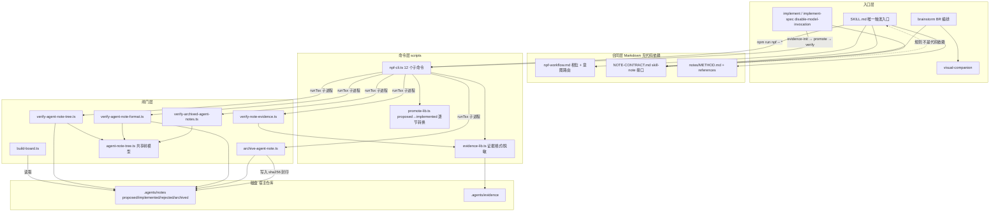

# 系统架构

## 一句话概括

note-pocock-flow 是一个**单仓库、双层职责**的分发包：`notes/` 提供“为什么”（决策事实源）+ `scripts/` 提供“算不算完成”（`npf` CLI 与四道闸）构成**决策中心**；`pocock/*` 的 32 个子 skill 构成**动作层**，每个 skill 通过 `NOTE-CONTRACT.md` 与决策中心对接，但**不互相 import**。整包零运行时依赖——所有脚本跑在 Node 18 内置模块 + `tsx` 上，`scripts/install.mjs` 是唯一的安装实现，`install.sh` / `install.ps1` / `bin/npf` 都是转发参数的薄壳（`README.md:57-68`、`install.sh:1-11`、`bin/npf:1-8`）。

## 分层与真实依赖

四层，依赖方向严格向下，**没有反向 import**：

| 层 | 成员 | 依赖谁 | 被谁依赖 |
|---|---|---|---|
| 入口层 | `SKILL.md`、`pocock/*/SKILL.md` | 合同层（读规则）、命令层（执行） | 宿主 skill 加载器 / 用户 `/<name>` |
| 合同层 | `npf-workflow.md`、`NOTE-CONTRACT.md`、`notes/METHOD.md` + `notes/references/` | 无（纯 Markdown） | 入口层、人工 |
| 命令层 | `scripts/npf-cli.ts` → `evidence-lib.ts`、`promote-lib.ts` | 闸门层（**子进程**调用） | 入口层、安装器、CI |
| 闸门层 | `notes/scripts/verify-*.ts`、`archive-agent-note.ts`、`build-board.ts`、`scripts/verify-note-evidence.ts` | `notes/scripts/agent-note-tree.ts` | 命令层、CI workflow |

图里的**虚线**是一个结构性事实：`NOTE-CONTRACT.md` 是“合同”而非“模块”——各 `pocock/*/SKILL.md` 开头只用一行横幅指向它，规则集中在一处（`README.md:38-40`、`NOTE-CONTRACT.md:1-4`）。好处是改合同不必改 30 个文件；代价是**没有任何编译期或脚本期检查**能保证某个 skill 真的遵守了它——合规靠人读和 review。

## 三个关键耦合点

### 1. 命令层与闸门层是**进程边界**，不是模块边界

`npf-cli.ts` 只 import 同目录的 `evidence-lib.ts` 和 `promote-lib.ts`（`scripts/npf-cli.ts:17-21`）；对 `notes/scripts/*` 的调用全部由 `runTsx()` 起子进程完成（`scripts/npf-cli.ts:96-110`），路径以**字符串**硬编码在 `GATES` 数组里（`scripts/npf-cli.ts:516-521`）。

好处：`verify` 的四道闸各自可独立运行、逐道报告、任一非 0 即失败（`scripts/npf-cli.ts:523-531`），也能被 CI 直接 `npx tsx` 调用（`notes/templates/verify-notes.yml`）。代价：**包内目录结构一旦移动，字符串就静默失效**——没有类型系统兜底。

`runTsx` 本身做了三级降级：复用当前进程的 tsx loader 参数 → 本地 `tsx/cli` → `npx --yes tsx`（`scripts/npf-cli.ts:88-105`）。第三级在 Windows 上必须走 shell 并逐个加引号，这也是 `selftest` 特意在**含空格的临时路径**里回放契约的原因（`scripts/npf-cli.ts:656-668`）。

### 2. `agent-note-tree.ts` 是唯一的树结构真相源

多个校验与工具脚本都从 `notes/scripts/agent-note-tree.ts` 取 `agentNoteRoot`、`AGENT_NOTE_CLASSES` 和 `walkAgentNoteTree()`（该文件 `:5-6` 只依赖 `node:fs` / `node:path`，刻意保持零依赖、Node 18 兼容）。这让“什么算合法 note 路径”只有一处定义：lifecycle 封闭集、6 个 class、三层深度、`yyyy-mm-dd-topic.md` 命名、禁 `INDEX.md`、跳过 `.zh.md`。

### 3. `promote` 是纯文本变换，不碰文件系统

`promote-lib.ts` 的 `promoteTransform(src, evRel)` 输入/输出都是字符串，返回 `{text, warnings}`，所有落盘留给 `cmdPromote`（`scripts/promote-lib.ts:94-180`、`scripts/npf-cli.ts:405-485`）。这个切分让 CLI 能在写盘前做**全量预检**：证据合法性 → `--supersedes` 目标必须是 `implemented/` 且未归档 → supersede-check 未处理命中 → 转换抛错。任一步不过就 `die()`，一个字节都不改。章节契约（只改名/折叠点名节、自由节保序保留、`## Plan` 类拒绝转换）因此可被单测式验证，而 `selftest` 正是这么做的（`scripts/npf-cli.ts:700-760`）。

## 安装期架构：白名单复制 + 托管标记

`install.mjs` 是整个包里唯一知道自己“长什么样”的组件：

- `SHIP` 白名单决定哪些顶层条目进宿主仓库（`scripts/install.mjs:39-42`），会话记录、自测日志、zip 一律不进。
- `pocock/` 下每个子目录**平铺**复制到宿主 `.agents/skills/<name>/`，并写入 `.npf-managed` 标记 JSON；包本体落到 `.agents/skills/note-pocock-flow/`（`scripts/install.mjs:100-160`）。
- 冲突判定先看标记，旧版无标记时**回退到读 SKILL.md 前 15 行是否含包名**（`isManaged`，`scripts/install.mjs:78-86`）——为兼容上一版安装留的隐式协议。
- 装完自动跑 `npf verify` + `npf doctor`（`scripts/install.mjs:240-254`）。

`doctor` 反向依赖这个布局：它先断言包目录的父目录名为 `skills`，否则直接退出（`scripts/npf-cli.ts:600-604`），因此只在**已安装**状态下可用。卸载只认 `.npf-managed` 标记，`notes/` 与 `evidence/` 原地保留（`scripts/uninstall.mjs:34-44`）。

## 独立子系统

**visual-companion** 几乎零耦合：`start-server.sh` / `start-server.ps1` → `server.cjs`（自实现 RFC 6455 WebSocket + 本地 HTTP，零 npm 依赖，`pocock/visual-companion/scripts/server.cjs:1-4`），运行时读同目录的 `frame-template.html` 与 `helper.js`（`:202-204`），会话写 `.agents/visual-companion/<session>/`。它不 import `scripts/`，也**不判完成**——点选结果必须由调用方回写 proposed note（`pocock/visual-companion/SKILL.md:9-14`）。

**build-board** 是只读消费者：读 `.agents/notes/`，注入 `notes/assets/agent-notes-board.html` 模板；`--init` 只拷模板（轻量看板，浏览器直读本地目录），无参模式才打包内联数据（`notes/scripts/build-board.ts:10-46`）。它带防覆盖保护：目标文件不是本工具生成的 html 就拒绝写入。

## 值得注意的设计风险

1. **class 清单三处重复**：`scripts/npf-cli.ts:28`、`scripts/install.mjs:37`、`notes/scripts/agent-note-tree.ts:20`。新增一个 class 必须同时改三处，且没有测试会提醒你漏了。这是当前架构里最脆的一致性约束。
2. **命令层靠相对路径字符串找闸门层**（见上），同样的漂移风险。
3. **合同层不可执行**：“不调 tdd”“收尾不自判完成”这类铁律只写在 `NOTE-CONTRACT.md` 与 `templates/AGENTS.section.md` 里，没有脚本能验证某个 skill 没调用 tdd。这是有意的取舍（规则集中一处 vs 机械可查），但读者不该把它当门禁。
4. **`selftest` 是唯一覆盖这些契约的自动化**：20 余条断言全在临时仓库里跑真实 CLI（`scripts/npf-cli.ts:656-760`），所以 `npm run npf -- selftest` 才是这个包“自身回归”的实际入口。

## 不确定的地方

- 包根**没有 `package.json`**。这意味着 `npm run npf` 只在安装进宿主后存在（由 `install.mjs` 写进宿主 scripts；若宿主已有同名 script 且不含本包路径则保留用户版本，`scripts/install.mjs:181-197`）；在包内只能用 `bin/npf` 或直接 `npx tsx scripts/npf-cli.ts`。文档里两种写法混用，本页统一按 `npm run npf --` 表述，等价性以 `bin/npf:1-8` 与 `install.mjs:181-197` 为准。
- `pocock/visual-companion/scripts/server.cjs` 共 724 行，我只读了前 120 行的协议与配置段以及若干关键行（模板读取、key 鉴权注释），**未逐行审阅**其 HTTP 路由、空闲超时与 owner-pid watchdog 逻辑。上面对它的架构定位有依据，但不构成对其安全性的评估。
- `notes/templates/*.md` 与 `notes/scripts/*` 据 `notes/UPSTREAM.txt` 声明“除 `verify-notes.yml` 外与上游一致”，我核对了内容，但**无法在此仓库内验证**该声明（上游副本不在包内）。

## 相关页面

- [项目概览](./overview.md) — 包的边界、来源与许可
- [开发指南](./getting-started.md) — 安装、升级与阅读顺序

## Sources

- `README.md:1-40`（双层定位、包结构表、许可与改写说明）
- `README.md:57-110`（安装/升级/卸载、CLI 命令表与各命令保证）
- `SKILL.md:1-52`（触发条件、标准路径、脚本强制的不变式）
- `npf-workflow.md:7-95`（相位表、状态面包屑、Phase 1–4 合同）
- `NOTE-CONTRACT.md:1-54`（三条总则、skill 分类附加规则、交棒与同类 skill 让位）
- `scripts/npf-cli.ts:17-30`、`:88-110`、`:347-403`、`:405-485`、`:516-531`、`:656-760`
- `scripts/evidence-lib.ts:1-109`（证据 v2 头、`evidenceProblem`、`redact`、`verificationEvidenceRefs`）
- `scripts/promote-lib.ts:17-48`、`:94-180`（章节集合、`splitSections`、`promoteTransform`）
- `scripts/verify-note-evidence.ts:1-70`（证据闸判定与路径越界检查）
- `scripts/install.mjs:37-42`、`:78-86`、`:100-160`、`:181-197`、`:240-254`
- `scripts/uninstall.mjs:1-61`
- `notes/scripts/agent-note-tree.ts:5-21`、`:30-76`（树模型与 class 封闭集）
- `notes/scripts/verify-agent-note-format.ts:14-45`（生命周期必需/禁用标题）
- `notes/scripts/verify-archived-agent-notes.ts:36-58`（头部布局与 manifest 封印）
- `notes/scripts/archive-agent-note.ts:1-168`（只允许 implemented、sha256 封印、入站链接扫描）
- `notes/scripts/build-board.ts:10-46`（模板来源与两种模式）
- `notes/scripts/check-note-anchors.ts:1-20`（软报告、退出码恒 0）
- `notes/METHOD.md:114-160`、`notes/references/verification.md:1-38`
- `notes/UPSTREAM.txt`、`pocock/UPSTREAM.txt`（上游 commit 与改写清单）
- `templates/AGENTS.section.md`（职责分工表与六条铁律）
- `notes/templates/verify-notes.yml`（CI 四道闸的调用方式）
- `pocock/brainstorm/SKILL.md:20-60`、`pocock/implement/SKILL.md:1-24`、`pocock/visual-companion/SKILL.md:1-40`
- `pocock/visual-companion/scripts/server.cjs:1-4`、`:202-204`
- `install.sh:1-11`、`install.ps1:1-21`、`bin/npf:1-8`、`VERSION`、`.gitignore`
