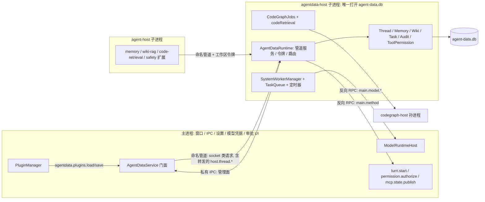

# Agent Note: AgentData 运行在 agentdata-host 子进程

Status: implemented

## Problem

AgentData（sqlite 存储、扩展的 RPC 服务、记忆与 Wiki 的后台任务和定时器、任务队列、工具授权、线程持久化、CodeGraph 的任务与检索入口）原来全部由主进程里的 `AgentDataService` 构造并运行，用同步的 `node:sqlite` 与同步 fs，还带后台计时器与队列。主进程里另有第二条连同一个库文件的连接（`PluginManager` 用的 `AgentDataStorage`）。库是 `journal_mode=delete`，每次写事务都 fsync。

### 迁移前的现状证据

数据来源：本机 `runtime-diag.jsonl`（2026-10-08 至 10-16，3.35 万个 10 秒窗口）、真实 `agent-data.db` 副本（468 MB），以及在副本上用 AgentData 真实类做的同步计时（Node 25.5，量级可信，绝对值不等于应用内数值）。

| 操作 | 触发方 | 主线程被占时长 |
| --- | --- | --- |
| `items` 单条 upsert（7 KB） | 每个 item 终态一次 | p50 12 ms，最大 25 ms |
| `tool_audit` 写入 | 每次工具调用（`permission.tool.evaluate`） | p50 5 ms，最大 13 ms |
| `readThread` 最大线程（15 MB 载荷） | `thread.read` / `item.list` | 0.44–1.75 s；应答超过客户端 1 MiB 上限被 `FRAME_TOO_LARGE` 丢弃，代价付了、结果没拿到 |
| `audit.query`（7302 行） | 审计页 | p50 77 ms |
| `memory.listConversations` / `searchConversations` | 记忆页、记忆工具 | p50 78 / 87 ms |
| Wiki `writePage`（合成数据） | 每写一页全量 `rebuildPageIndex` | 100 页 0.5–0.7 s，500 页 1.8–2.2 s，近似线性 |

代码里已有两处同类事故的局部止血：流式 `item.delta` 逐条写库挡住 `webContents.send`，改成不落盘（`piRuntimeService.ts`）；任务列表在 50 MB 数据上 300–600 ms，加了覆盖索引（`taskViewStore.ts`）。

诊断日志只能给相关性：agent-host 拆出后，有 agent 事件的窗口 ≥200 ms 卡顿率 4.4%，空闲窗口 0.48%；空闲窗口里仍有 ≥1 s 的卡顿（git 轮询、休眠恢复等）。经 TCP 来自 agent-host 的请求不在 IPC 统计里，AgentData 对线上卡顿的贡献算不出来。为此先做了 M0 埋点（[runtime-diag 记录 AgentData 同步耗时](../process/2026-10-16-agentdata-sync-timing-diag.md)），原定攒够线上数据、闸门判 `CONTINUE` 才迁移；用户在数据到位前决定直接迁移（在 worktree 里做、保留进程内退路），见 Alternatives 第一条。

## Decision

主进程启动时拉起 agentdata-host 子进程（同一份 Electron 可执行文件加 `ELECTRON_RUN_AS_NODE=1`，Node IPC，`serialization: 'advanced'`，`RpcPeer`，进程树守卫，不带 V8 参数），由它独占 `agent-data.db`。入口 `electron/agentDataProcess/hostEntry.ts`，构建产物 `out/main/agentdata-host.js`（已进 `asarUnpack`）。一个实例，所有工作区共用。

- 默认 child 模式；`GREN_AGENTDATA_PROCESS=inproc` 退回主进程内（与原来同一份装配），作为生产退路保留一个发布周期，之后只留给测试。
- 两种模式共用 `agentDataProcess/assemble.ts` 装配运行时：`SystemWorkerManager`、`CodeGraphJobs`、`codeRetrieval`、注入的 socket 方法接法完全相同。
- codegraph-host 改由 agentdata-host 拉起（孙进程），CodeGraph 任务回写状态走运行时的进程内入口 `requestJobAdmin`，不再绕 TCP。见 [CodeGraph 运行在 codegraph-host 子进程](./2026-10-16-codegraph-host-process.md)。

### 四条通道（名字只从 `agentDataProcess/contract.ts` 取）

1. **扩展与主进程的 socket 类请求 → agentdata-host**：命名管道（Windows `\\.\pipe\grenagent-agentdata-<主进程 pid>-<随机>`，POSIX 为 `os.tmpdir()` 下 0700 子目录里的 socket），帧格式、令牌校验、方法分派与原来的环回 TCP 完全一样。端点 JSON 多了可选的 `path` 字段，`host/port` 留给 inproc；`agentData/client.ts` 与 `extensions/memory/client.ts`（wiki-rag、code-retrieval、desktop-control 复用它）有 `path` 时连管道。
2. **主进程 → agentdata-host（管理面，私有 IPC）**：`agentdata.admin`（原 `requestAdmin` 的全部方法，错误形状仍是 `Error("CODE: message")`）、`agentdata.registerWorkspace`、`agentdata.registerKnownWorkspace`、`agentdata.resolveDiagnosticPath`、`agentdata.plugins.load/save`、`host.shutdown`。这些方法故意不暴露在 socket 上。
3. **agentdata-host → 主进程（反向端口）**：`main.model.describe / complete / abort`、`main.resolveSession`、`main.method`（`turn.start` / `permission.authorize` / `mcp.state.publish`）。模型调用的 `signal` 变成 `main.model.abort { requestId }`；`onUsage` 变成主进程在同一 IPC 通道上先于应答发出的 `agentdata.model.usage` 事件，失败的调用也记账（`ModelRuntimeHost.completeSimple` 在校验文本之前就回调 `onUsage`）。
4. **agentdata-host → 主进程（诊断）**：`agentdata.diag`，每 10 秒 `agentdata-host-sample`（内存、事件循环延迟、M0 的 `agentData` 方法耗时），以及转记 codegraph-host 的采样与退出；退出记 `agentdata-host-exit`。

### 什么留在主进程、为什么

AgentData 本体没有 electron 依赖，主进程耦合全部集中在 `AgentDataRuntimeOptions` 的几个注入函数上，所以迁走的是模块、留下的是依赖：

- **模型调用**（Q4）留在主进程，经反向 RPC。`ModelRuntimeHost` 持有 `auth.json` 与 OAuth 刷新，agent-host 里已有另一份 `ModelRuntime`；子进程再建一份会出现第三个读写 `auth.json` 的进程。提示词拼装与输出解析（`SystemWorkerManager`）随 TaskQueue 进子进程。
- **`turn.start` / `permission.authorize` / `mcp.state.publish`** 必须在主进程（审批 UI、渲染层广播、问 agent-host 取状态），由子进程经 `main.method` 调回来，链路多一跳；`permission.authorize` 只被 desktop-control 用，人工审批本来就慢。
- **`PluginManager`**（Q3）留在主进程：`allowedPluginIds()`、`list()` 是同步读内存，被主进程 IPC、agent-host 的 host 方法和 `PiPackageService` 消费。持久化改成 `state: { initial, save }` 端口，经 agentdata-host 读写同一张 `plugin_state` 表；表与数据位置不变。写失败只记日志，内存状态照常（持久化只服务于下次启动的 `restore`）。
- **`validateProject`**（Q2）：只用 `realpath`/`stat`，依赖的 `worksDir` 启动时就定了，作为启动参数带给子进程，在子进程本地执行。
- **线程持久化**（Q5）：agent-host 仍经主进程的 `host.thread.*` 转发，主进程只做异步转发，同步写库在子进程。不直连、不改 `agentProcess/contract.ts`。重访条件：主进程诊断里转发开销显出来，或子进程写延迟拖慢工具调用。
- **`journal_mode` 保持 `delete`**（Q5）：WAL 会在库旁多出 `-wal`/`-shm`，改变落盘形态和备份语义；fsync 的代价已经不在主进程。

### 运行时不变量

- **端点在主进程生命周期内不变**：管道名、host 令牌、每个工作区的令牌都由主进程生成并持有；子进程每次拉起（含崩溃重拉，`AgentProcessClient` 的 `env` 现在可以是函数）都带着当前的令牌表与已知工作区。新工作区的令牌先 `agentdata.registerWorkspace` 到子进程、确认后才交给 agent-host，不会出现「令牌已发出但服务端还不认」。扩展写进只读工作区上下文的 `AGENT_DATA_ENDPOINT` 因此在重拉后继续有效。
- **主进程不打开 `agent-data.db`**：`mainBoundary.test.ts` 静态断言 `main.ts` 不引入 `AgentDataStorage`、不建 `DatabaseSync`。多进程写回滚日志库会让持锁进程之外的进程在 `busy_timeout` 上同步等最多 1 秒。
- **反向调用不互等**：两边都只用异步 RPC，子进程等主进程的模型调用时主进程不同步等子进程。
- **生命周期**：启动顺序 agentdata-host（迁移库、监听管道后报 ready）→ PluginManager → agent-host；关停顺序 agent-host → agentdata-host（agent-host 收尾时扩展还会记账；子进程内先停 CodeGraph 同步与模型任务、再关库）。主进程断开时子进程自己收尾退出。崩溃预算沿用 `AgentProcessClient`（60 秒内 3 次后冷却 30 秒）；重拉时运行时启动逻辑照常把上一个进程留下的任务落定（[孤儿任务落定](../bug-fix/2026-10-16-orphan-job-settle.md)）。
- **崩溃后主动重拉**：`AgentProcessClient` 只在主进程下一条 IPC 请求时按需拉起，对 agent-host 够用，对 agentdata-host 不够：扩展直连管道、主进程的线程持久化走管道、记忆 / Wiki 定时任务在子进程里，都不会触发它。所以：① `AgentDataService` 收到非预期退出（`createProcess` 的第二个参数 `hooks.onExit`）后 250 ms 自己重拉，被崩溃预算挡住时每 5 秒再试、连续 10 次失败后停手；② 同时废掉指向旧进程的管道连接（close 事件未必先到，否则下一条写进旧 socket 报 EPIPE）；③ 主进程经管道的请求先 `child.start()`，空档里的线程持久化等新进程而不是报 ENOENT；④ `extensions/_shared/desktop-control.ts` 的工具授权把 `ENOENT` 算作连接层失败，遇到「没人监听」（`ENOENT` / `ECONNREFUSED`）按 250 / 500 / 1000 ms 等它回来，仍不行才 deny 并标 `unavailable`（fail-closed 不变）。以前的行为：崩溃瞬间的工具授权得到 `ECONNRESET` → 立即重试 → `ENOENT`（不在列表里）→ 普通 deny，被当成「规则拒绝」；且扩展一直连不上，直到主进程碰巧发一条管理请求。
- **共享连接上的超大应答**：主进程所有 AgentData 请求共用一条 `AgentDataClient` 连接。超过 1 MiB 的应答只让它自己那条请求以 `FRAME_TOO_LARGE` 失败，连接保留；以前会销毁整条连接，同时在途的请求一起失败。进程内时请求几乎不重叠所以没暴露；拆进程后真实并发了，冒烟里一次最大线程读让 4 条并发的 `item.upsert` 跟着失败。

### 灰度

原计划（Q7）是 M2 默认 `inproc`，冒烟、契约测试、崩溃注入、打包产物冒烟都过了再切 `child`。实际一轮里这些门槛都过了（见验证），直接以 `child` 为默认合入，`inproc` 作为退路。门槛沿用 agent-host 冒烟（Q8）：冒烟里主进程事件循环 p99 小于 50 ms、最大小于 200 ms；线上对照（有活动窗口 ≥200 ms 的比例，基线 4.4%）只报告不设门槛，因为它混有 git 轮询等无关卡顿。

### 破坏性变更

`AgentDataService.agentEndpoint` 变为异步（调用方只有 `main.ts`）；`HostDeps.agentDataEndpoint` 可返回 Promise；child 模式下端点是 `{ path, token }`；`recordJobStage` / `runServiceTask` 只在 inproc 下可用（调用方都已随装配进子进程）；`PluginManager` 增加 `state` 选项（`storage` 选项保留）；`AgentDataChildOptions.createProcess` 多一个 `hooks` 参数，调用方要在子进程退出时回报 `hooks.onExit`；`evaluateToolCall` 多一个可选的 `options.sleep`（测试用）；所有 `requestAdmin` 多一次 IPC 往返。数据格式、表结构、帧协议与版本、令牌语义、错误码不变。

### 涉及文件

- 新增：`electron/agentDataProcess/{assemble,codeGraphClient,contract,host,hostEntry,pipePath}.ts`、`host.test.ts`、`mainBoundary.test.ts`、`electron/app/plugin/pluginStateStore.ts`、`scripts/agentdata-host-smoke.ts`
- 修改：`electron/main.ts`、`electron/app/agentDataService.ts`、`electron/agentData/{runtime,protocol,client}.ts`、`client.test.ts`、`electron/agentProcess/{agentProcessClient,mainBindings}.ts`、`electron/app/plugin/pluginManager.ts`、`electron/agent/workerEntry.ts`、`electron.vite.config.ts`、`electron-builder.yml`、`electron/app/sourceCodeProtection.test.ts`、`electron/app/agentDataService.test.ts`、`extensions/memory/client.ts`、`extensions/_shared/desktop-control.ts` 与其测试

## Alternatives considered

- **在迁移前等 M0 闸门数据。** 最强理由：如果 AgentData 对线上卡顿贡献小，迁移的代价（多一个进程、端点稳定、反向调用）就不值。没选：用户决定直接迁移；用 worktree 隔离、保留 `inproc` 退路，并用真实库副本上的对照冒烟给出收益证据。
- **维持主进程内、只做局部止血。** 最强理由：已经证明有效且风险最小（delta 不落盘、任务列表覆盖索引都是这样做的），不增加进程、端点和反向调用。没选：止血是逐点的，每个新增的同步重活（Wiki 写页全量重建、线程读秒级）都要再补一次。
- **只迁后台任务（TaskQueue、记忆定时器、Wiki ingest），请求仍在主进程。** 最强理由：任务是最长的阻塞来源，与 UI 请求-应答无关，拆出来最干净。没选：任务和请求共用同一个 sqlite 连接和 `service_tasks` 表，拆开后库有两个所有者；要么把请求面也迁走，要么拆库。
- **主进程里的 `worker_threads`。** 最强理由：不增加进程，线程间通信比 IPC 便宜，`node:sqlite` 在 worker 里可用。没选：SDK 文档记录 Windows 上结束 worker 可能让整个进程崩溃，宿主是主进程时风险落在窗口上；线程不能单独限内存与优先级；仓库已有 agent-host 这套子进程做法可复用。
- **合并进 agent-host。** 最强理由：少一个进程，agent-host 本来就是主要调用方。没选：agent-host 承载交互 Agent、子代理、MCP，已经是最忙的子进程（日志里 p99 322 ms、最大 15 s）；AgentData 的同步写会拖慢 Agent 事件，agent-host 崩溃还会连带丢失后台任务与计时器。
- **每类能力一个进程（记忆、Wiki、权限各一个）。** 最强理由：故障与资源完全隔离。没选：共用同一个库和 `service_tasks`/`agent_jobs` 表，多进程写回滚日志库比现状更糟；管理面、令牌与生命周期要多套。
- **Electron `utilityProcess`。** 最强理由：官方 API，可把 MessagePort 直接交给渲染层。没选：RunAsNode 做法（agent-host、pi-worker）已在打包与字节码下验证，utilityProcess 没有。
- **复用上次的 TCP 端口 / 端口变化时通知 agent-host。** 最强理由：不改两个客户端。没选：临时端口在重拉空档里可能被占；端点已写进只读工作区上下文和子代理 env，通知了也换不掉。命名管道名由主进程定，重拉不变。
- **主进程保留 TCP 监听、把字节转发给子进程；或把监听句柄经 IPC 交给子进程。** 最强理由：端点完全不变。没选：前者又把主进程放回数据路径；后者 Node 的句柄共享在父进程里也会接受连接，要靠内部 API 才能避免。
- **`PluginManager` 跟着迁进子进程，或插件状态改存 JSON 文件。** 最强理由：库只剩一个访问方 / 主进程完全不碰 AgentData。没选：`allowedPluginIds()` 是同步读，三处消费都要改异步或另维护缓存，为几行的表不值；改存文件改变了数据位置。
- **子进程里再建一份 `ModelRuntime`，不做反向调用。** 最强理由：少一条反向通道。没选：第三个读写 `auth.json` 的进程会扩大 OAuth 刷新并发的已知问题。
- **CodeGraphJobs 留在主进程、经 TCP 回写任务状态。** 最强理由：少动一处。没选：任务状态在子进程里，回写多两跳；放进同一子进程后用 `requestJobAdmin` 直接调。
- **按原计划 M2 默认 `inproc`、过一个周期再切 `child`。** 最强理由：真实使用中先以开关小范围试，出问题不影响默认路径。没选：门槛在一轮内都已用真实库副本、真实子进程和字节码产物验证；本应用目前只有一个使用者，「小范围」就是默认路径本身，`inproc` 开关已经提供同等的退路。

## Consequences

- 收益（真实库副本、同一负载）：主进程事件循环 p99 162 ms → 25 ms，最长卡顿 482 ms → 36 ms。AgentData 的崩溃、内存增长只影响子进程，codegraph-host 挂在它下面。
- 代价：
  - 子进程内部仍是单个事件循环，AgentData 自己的请求互相排队。原来主进程里的 `requestAdmin`（任务列表、审计、记忆列表）是同步直调、实际上插队；现在要在子进程里排在重请求后面。冒烟的极端负载下（每 1.5 s 读一个 900 KB 线程）`tasks.list` p50 从 5 ms 变成 241 ms：窗口不卡了，但面板在 AgentData 繁忙时加载变慢。若实际使用中明显，下一步是把只读查询放到读连接 / 线程上，或对 `thread.read` 做分页。
  - 冷启动多约 250 ms（子进程拉起 + 库迁移）；agent-host 等它就绪后才拉起。
  - 多一个常驻进程；崩溃时有约几百毫秒的空档，工具授权在空档里最多等约 1.75 秒，等不到才 deny（`unavailable`），扩展的其它 AgentData 请求在空档里失败。
  - 每条管理请求多一次 IPC 往返；`permission.authorize`、`mcp.state.publish`、`turn.start` 多一跳。
- 已知缺口，未处理：
  - 最大线程的 `thread.read` 仍超过 1 MiB 被丢弃（只影响它自己了），线程分页不在本次范围。
  - 应用没有单实例锁：同时开两个应用实例时，两个 agentdata-host 会打开同一个库（迁移前是两个主进程，问题不变），没有启动期检查。
  - 命名管道用 Windows 默认 DACL，本机其它用户能连上管道，但仍要令牌；安全性与原来的环回 TCP 相同。POSIX socket 在 0700 目录里。
  - M0 的闸门脚本 `scripts/diag-agentdata-report.mjs` 只读主进程的 `sample`。child 模式下 `agentData` 字段改在 `agentdata-host-sample` 上，衡量的是子进程自己的事件循环，闸门对迁移后的日志不再有意义。

## 验证

证据目录：`.agents/evidence/2026-10-16-agentdata-host-process/`

- 冒烟 `scripts/agentdata-host-smoke.ts`（应用自带 Electron Node + tsx；扮演主进程，child 模式用 `AgentProcessClient` 拉起构建产物里真实的 `agentdata-host.js`；在真实 `agent-data.db` 副本上跑 20 秒负载：每 50 ms 一条 7 KB `item.upsert`、每 200 ms 一次 `permission.tool.evaluate`、线程读、审计、记忆列表与检索、任务列表），`smoke-localrun.txt`，9 项全部通过：

  | 主进程事件循环 | child | inproc（对照） |
  | --- | --- | --- |
  | p99 | 25 ms | 162 ms |
  | 最长卡顿 / 心跳最大间隔 | 36 ms / 36 ms | 482 ms / 540 ms |

  另验证：负载中 0 个请求错误；kill 子进程、主进程不发任何请求，门面自己重拉；同一时刻用扩展真实的 `desktopControl()` 客户端发的工具授权等了约 0.8 秒，拿到与崩溃前相同的 allow；扩展手里原来的端点（同一管道、同一令牌）、主进程的管道请求（`item.upsert`）与管理请求重拉后都可用；关停后 `PRAGMA integrity_check` 为 ok。第一轮冒烟有 5 个请求错误，查出是共享连接上超大应答连带失败（见上文），修复 `AgentDataClient` 并补测试后复跑通过。崩溃重拉的三项是第二轮加的：第一版冒烟是用主进程的管理请求去触发重拉的，掩盖了「没有主进程请求就不重拉」的问题。对照数字取第二轮之前那次（inproc 各次在 p99 160–235 ms、最长 480–680 ms 之间波动，child 稳定在 p99 25 ms、最长 36–56 ms）。
- 生产字节码产物：`npx electron-vite build` 后用 `out/main/agentdata-host.cjs` 跑同一冒烟（10 秒，含崩溃重拉各项），9 项全部通过（`smoke-bytecode.txt`）；同时用 `codegraph-host.cjs` + `codegraph-worker.cjs` 跑 `scripts/codegraph-host-smoke.mjs`，10 项全部通过（`codegraph-smoke-bytecode.txt`），补上了「worker 线程在字节码产物里能否加载」的缺口。验证时用的是当时已提交的 `electron.vite.config.ts`，生产入口文件名是 `.cjs`（主工作区里他人未提交的改动把它改成 `.js`）。
- 单测 `npx vitest run electron/agentData electron/agentDataProcess electron/app/codeGraph electron/app/appServer electron/app/memoryService.test.ts electron/app/toolPermission electron/app/taskViewService.test.ts electron/app/agentDataService.test.ts electron/app/plugin electron/app/sourceCodeProtection.test.ts electron/agentProcess electron/runtimeDiag.test.ts electron/ipc electron/main.config.test.ts src/features/agentData`：1011 个用例中 997 个通过，14 个失败，部分通过（`vitest.txt`）。14 个失败是迁移前就有的同一组（`auditViewStore` 4、`jobCleanup` 2、`runtime.test` 4、`taskViewService` 4），基线上同样失败，无新增。`host.test.ts` 11 个用例：管道 + 主进程签发令牌、管理面错误形状、崩溃后同端点继续可用、模型反向调用与 usage 先于应答（失败也到）、abort 传到主进程、`permission.authorize` 回到主进程、插件状态经子进程持久化、重拉后项目列表保留、崩溃后不等主进程请求自己重拉（前两次拉起失败也会再试）、主进程管道请求先拉起子进程、stop 之后不再重拉；`client.test.ts` 新增超大应答只影响自己一条。
- 扩展客户端 `npx vitest run memory wiki-rag code-retrieval _shared/desktop-control safety`（extensions 目录）：19 个文件 174 个用例通过（`vitest-extensions.txt`），含新增的「重拉中等待而不是立刻拒绝」「没人回来就标 unavailable」。
- `npm run test:codegraph`：10 个文件 66 个用例通过（`test-codegraph.txt`）。
- 类型检查 `npx tsc -p tsconfig.node.json --noEmit`：158 个错误，与基线逐文件相同，无新增，通过（`tsc.txt`）。
- 真实应用：合并到 master（`df348906`）后，用户 2026-10-17 重新构建、重启，按「`runtime-diag.jsonl` 出现 `agentdata-host-sample`、主进程 `sample` 不再带 `agentData`、记忆 / Wiki / 代码面板 / 工具授权弹窗正常」逐项检查后回复「没问题」。这是用户的口头确认，日志没有收进证据目录。
- 计划里没做的：两种模式参数化跑同一份契约测试并逐项比较结果 JSON（现状是 child 由 `host.test.ts` 覆盖、inproc 由原有套件覆盖）；真实库副本上脚本化会话前后按主键哈希比较各表内容（只做了 `integrity_check`）；运行期主进程文件句柄检查（只有静态测试）；冒烟负载里的 500 页 Wiki `writePage` 与 CodeGraph 检索；线上「有活动窗口 ≥200 ms 比例」与 4.4% 基线的对照。
