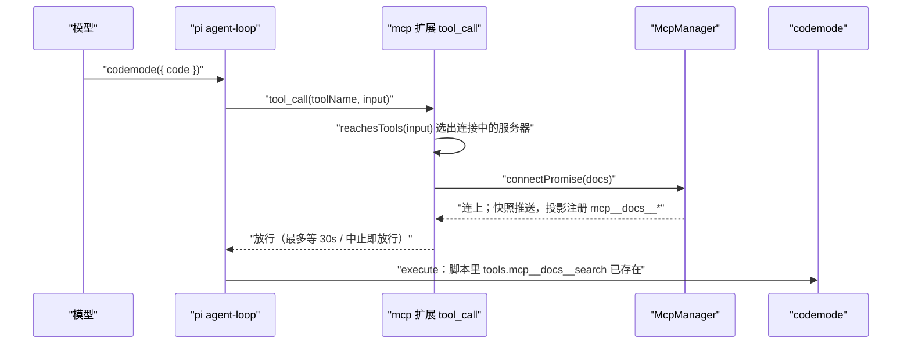

# Agent Note: 接入 pi 1.2 / 1.3 的五项新能力（reachesTools、codemode 时长、argumentsError、read 行号、models.json $schema）

Status: implemented

## Problem

[Pi 升到 1.3.0](../../implemented/architecture/2026-10-17-pi-1.3.0-upgrade.md) 时只修了破坏点，五项上游新能力没有接到桌面端：

- 产品自己的 MCP 扩展（官方内置 MCP 被换掉，见 [会话挂官方 codemode](../../implemented/architecture/2026-10-04-official-codemode-no-builtin-mcp.md)）只在 `before_agent_start` 里等 direct 服务器。codemode / deferred 服务器还在连接时，codemode 脚本先跑起来，`tools.mcp__x__y` 还没注册，脚本直接失败。pi 1.2 给 codemode 和 tool_search 加了 `reachesTools`，官方 MCP 扩展用它在 `tool_call` 里等这次调用要用的服务器。
- pi 1.2 的 TUI 在 codemode 行显示 Elapsed / Took。
- pi 1.3 遇到参数不是合法 JSON 的工具调用时，`arguments` 给 `{}`，`argumentsError` 带上原文，校验失败后以 `Invalid arguments for tool "<name>": <原因>\n\nReceived arguments:\n<原文>` 结束这次调用。桌面端照常按工具画卡：bash 卡是一条没有命令的空终端，看不出模型发错了什么。
- pi 1.3 导出 `formatReadLineRange`（pi #9887）：严格 schema 下省略的参数是 `null`，数字字符串也算，残缺的范围整个不写。
- pi 1.2 发布了 `https://pi.dev/schemas/models.schema.json`，models.json 可以写 `$schema` 给编辑器校验和补全。

## Decision

- **reachesTools**：`extensions/mcp/index.ts` 的 `bind()` 增加 `tool_call` 钩子。只要有服务器还在连接（`mgr.connectPromise(name)` 有值），就按 `extensions/mcp/reach.ts` 的 `serversToWait` 选要等的服务器：工具声明了 `reachesTools` 的，按它的返回值（`"all"` 或脚本里的词）判断，和 pi 内置 MCP 扩展的 `reachesServer` 一致：某个词包含 `mcp__<server>`（`-` 写成 `_`）就算用到；三个资源工具等全部连接中的服务器；`mcp__<server>__*` 直连工具只等自己的服务器；其他工具不等。最多等 30 秒，这一轮被中止就不再等；等不到也照常执行，不取消底层连接。`before_agent_start` 等 direct 服务器的逻辑不变：direct 工具必须在请求前进入激活集。
- **codemode 时长**：桌面端早已有。卡片标题用 `RunDuration`，运行中按秒计时，结束后定格为结果头里 pi 报的 `Wall time`。这次只在 `codemode-card` 场景补上断言：运行中 / 完成 / 失败三种都覆盖。
- **argumentsError**：`electron-agent/src/features/tools/invalidArgumentsModel.ts` 从错误结果里解析出工具名、原因和原文。`ToolExecutionInner` 在分发给各工具卡片之前先判断：状态是 error 且能解析出来，就画 `InvalidArgumentsExecution`。这张卡是一行「<工具> 参数无法解析 · 未执行」，展开后上面是完整错误，下面是模型原样发来的参数；MCP 工具保留服务器标签。识别只认 pi 1.3 的这句前缀，schema 校验失败（`Validation failed for tool …`）和普通失败不受影响。
- **read 行号**：渲染层不能直接 import `formatReadLineRange`，因为它所在的 `render-utils.js` 依赖 `node:os` 和 pi-tui。`fileDiffModel.ts` 的 `readLineRange` 改为同样的取舍：`null` 当省略，数字字符串照算，offset 或 limit 写了但不是数字时整个范围不写，不再猜成从第 1 行开始。显示写法不变（`12-31` / `8-`）。`fileDiffModel.test.ts` 用同一组输入和 pi 的 `formatReadLineRange` 对拍。
- **models.json $schema**：`serializeState` 写出的 models.json 第一个键是 `"$schema": "https://pi.dev/schemas/models.schema.json"`（常量 `MODELS_JSON_SCHEMA`）。pi 1.3 的 models 配置 schema 把 `$schema` 列为可选字段，`loadState` 只读 `providers`，读回不受影响。桌面端不写 pi 的 settings.json、keybindings、主题，这三处没有对应改动。

### 工具调用等待服务器的顺序

## Alternatives considered

- **在 `before_agent_start` 里把 codemode 服务器也一起等上**：实现最简单，一轮开始前全部连好，codemode 永远不会撞上没注册的工具。不选：每一轮都要等所有服务器，哪怕这一轮根本不用 MCP；连不上的服务器会让每条用户输入都卡到超时。上游也是只在用到时才等。
- **额外匹配裸服务器名**（脚本里出现 `docs` 这个词就等 docs）：最初就是这样写的，理由是照顾我们加了 `aliases: [server]` 之后按服务器名写的脚本。不选：按名字查命名空间的写法（`describeNamespace("docs")`）用的是发现类全局函数，reachesTools 本来就返回 "all"；拼接写法 `tools["mcp__" + server + "__x"]` 切出来的是变量名 `server`，也匹配不到。这条规则因此几乎帮不上忙，只会让 `docs`、`github`、`search` 这类常见词的变量或注释白白触发等待。现在只认 `mcp__<server>`，和官方一致。
- **把注释和字符串剥掉再算 reach**：注释里写到完整工具名就不会再多等。不选：要正确剥离 JS 注释，得处理字符串里的 `//`、模板字符串和正则字面量，写错了反而漏等，导致脚本失败；而多等只发生在服务器还在连接的那段时间。沿用上游按原文切词的做法。
- **argumentsError 从助手消息的 toolCall 上读，而不是解析错误文本**：结构化字段，不怕措辞变化。不选：渲染层的 `ToolSegment` 只带 args 和 result，toolCall 上的 `argumentsError` 没有经过 reducer；实时事件 `tool_execution_start` 也不带它。改 reducer 和事件信封，牵动的面比一条前缀匹配大得多。前缀出自 pi-ai `validateToolArguments`，用实测文本写了单测和 UI 场景；措辞一旦变了，测试会失败，卡片退回各工具原来的样子，不会画错。
- **read 行号直接 import pi 的函数**：一份实现，永不漂移。不选：会把 `node:os` 和 pi-tui 带进渲染层打包。改用对拍测试守住一致性。

## Consequences

- 收益：codemode / deferred 服务器在会话刚开、重连期间不再让脚本因「工具不存在」失败；参数写坏的调用一眼能看出原因和原文；read 卡片在严格 schema 和数字字符串下显示正确；用户用编辑器打开 models.json 有校验和补全。
- 代价：带 MCP 的工具调用在服务器连接期间最多多等 30 秒；codemode 脚本里出现某台服务器的 `mcp__<server>` 前缀（哪怕在注释或字符串里），也会等它；出现 `searchTools` 等发现类全局函数时等所有连接中的服务器。这是上游 reachesTools 按原文切词的行为。参数无法解析的识别依赖 pi-ai 的错误措辞，升级 pi 时要看 `invalidArgumentsModel.test.ts` 有没有失败。
- 新增 UI 场景 `invalid-arguments-card`，AGENTS.md 的场景清单相应更新为二十个。

## 验证

- reachesTools 实跑：`cd extensions && npx vitest run mcp/reach.real.test.ts`。测试用真实 AgentSession、官方 `createCodemodeExtension()` 和 faux 模型，服务器 docs 300ms 后才连上，脚本调用 `tools.mcp__docs__search`：通过，结果里有 `DOCS_OK`。临时关掉 `tool_call` 等待再跑：失败，结果是 `Script failed`，证明这个测试确实在检验等待。证据：`.agents/evidence/2026-10-17-pi-1.3-capabilities/reach-real-test.txt`。`npx vitest run mcp` 19 个文件、192 个用例全部通过（`reach.test.ts` 覆盖裸服务器名不再触发等待）（含 `reach.test.ts` 与 `index.test.ts` 新增的等待 / 中止用例）。
- UI：`node ui-harness/check.mjs codemode-card` 55 项全部通过（新增运行中计时、完成 `· 3.4s`、失败 `· 2.0s`）；`node ui-harness/check.mjs invalid-arguments-card` 27 项全部通过，含浅色主题；`node ui-harness/check.mjs provider-model-list` 22 项全部通过（新增「保存：models.json 带 pi 发布的 $schema」）。证据：`.agents/evidence/2026-10-17-pi-1.3-capabilities/ui-check-codemode-card.txt`、`.agents/evidence/2026-10-17-pi-1.3-capabilities/ui-check-invalid-arguments-card.txt`、`.agents/evidence/2026-10-17-pi-1.3-capabilities/ui-check-provider-model-list.txt`，以及两张截图。
- $schema 实读：pi 1.3.0 的 `ModelRuntime.create` 读带 `$schema` 的 models.json，`getError()` 为空，自定义模型 m1 正常列出。证据：`.agents/evidence/2026-10-17-pi-1.3-capabilities/models-schema-load.txt`。
- 单测：`npx vitest run src/features/tools src/features/settings src/stores/agentReducer.test.ts` 35 个文件、410 个用例全部通过（含 `invalidArgumentsModel.test.ts` 用 pi-ai 真实函数生成错误文本、`fileDiffModel.test.ts` 与 `formatReadLineRange` 对拍）。`cd extensions && npx vitest run`：2146 个通过，4 个失败与本次无关（`multi-agent/runner.test.ts` 读到本机配置、`_shared/git-safe.test.ts` 负载下偶发，升级前同样如此）。
- 类型：`npx tsc -p tsconfig.node.json --noEmit` 报错条数 156，与改动前相同，去掉行号后没有新增；渲染层改动文件单独 `tsc` 无报错。
