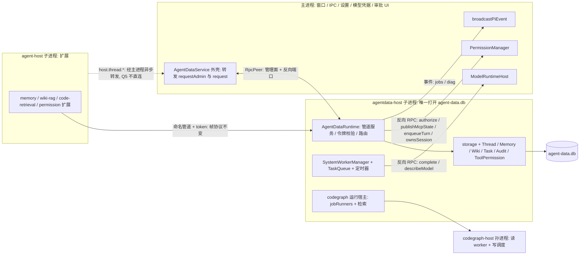

# Agent Note: AgentData 整体移出主进程（agentdata-host 子进程）

Status: proposed

进度（2026-10-16）：Q1–Q8 已由实施方拍板，见下文「0. 决策」；M0 已落地，见 [runtime-diag 记录 AgentData 同步耗时](../../implemented/process/2026-10-16-agentdata-sync-timing-diag.md)，闸门结论等线上数据。

## Problem

AgentData（sqlite 存储、TCP 服务、记忆、Wiki、任务队列、工具授权、线程持久化、CodeGraph 的 job 与检索入口）全部由主进程里的 `AgentDataService` 构造并运行（`main.ts` → `new AgentDataService` → `new AgentDataRuntime`）。它用同步的 `node:sqlite` 与同步 fs，且带后台计时器与队列。判断是：这会占用主线程、影响窗口与 IPC 的流畅度。这条判断按待验证假设处理，下面「现状证据」先验证它，再谈迁移。

本篇范围是 AgentData 体系的进程归属。CodeGraph 自己的读写隔离与自动同步见 [CodeGraph 移出主进程并自动同步](./2026-10-16-codegraph-host-process-auto-sync.md)，本篇调整它的宿主归属（见「与 CodeGraph 方案的关系」）。

### 现状证据：假设「部分成立」

数据来源：本机真实 `runtime-diag.jsonl`（2026-10-08 至 10-16，3.35 万个 10 秒窗口）、真实 `agent-data.db` 的副本（468 MB），以及在副本上用 AgentData 的真实类做的同步操作计时。计时用 Node 25.5（`tsx`）而不是 Electron 自带的 Node，量级可信，绝对值不可直接当作应用内数值。

**1. 代码层面成立。** `agentData/**`、`app/memory*`、`app/appServer/**`、`app/toolPermission/**`、`pi/systemWorkerManager.ts` 都在主进程里执行，没有任何一个文件 `import 'electron'`。主进程里还有第二条指向同一个库文件的连接（`main.ts:200` 的 `new AgentDataStorage(dataPath)`，给 `PluginManager` 用）。库是 `journal_mode=delete`（回滚日志），每次写事务都 fsync。

**2. 同步操作在真实数据上的耗时（主线程被占住的时长）：**

| 操作 | 触发方 | 耗时 |
| --- | --- | --- |
| `items` 单条 upsert（7 KB 载荷） | 每个 item 终态一次，经 `host.thread.upsertItem` | p50 12 ms，p95 20 ms，最大 25 ms |
| `items` 同 id 更新（流式） | 同上（delta 已被代码排除，见下） | p50 13 ms，最大 34 ms |
| `tool_audit` 写入 | 每次工具调用一次（`permission.tool.evaluate`） | p50 5 ms，最大 13 ms |
| `readThread`（最大线程：57 条 item，15 MB 载荷） | `thread.read` / `item.list` | 0.44–1.75 s（多次测量；M0 实跑 440 ms）。应答超过客户端 1 MiB 上限被 `FRAME_TOO_LARGE` 丢弃：主线程付了全部代价，调用方拿不到结果 |
| `audit.query`（7302 行） | 审计页 | p50 77 ms，最大 96 ms |
| `memory.listConversations` | 记忆页 | p50 78 ms，最大 148 ms |
| `memory.searchConversations`（15 MB 对话） | `memory.conversations.search` 工具 | p50 87 ms，最大 135 ms |
| `tasks.list` / `readDetail` / `memory.search` / `overview` | 任务页、记忆工具 | 0.4–20 ms，当前数据量下无压力 |
| Wiki `writePage`（合成数据，每页约 3 KB、含 60 条链接） | 每写一页都 `rebuildPageIndex` 全量重建 | 100 页 0.47–0.69 s；500 页 1.75–2.19 s，近似线性 |

没有测量的部分：`memory.capture`（对话窗口构建与去重召回）、`wiki.ingest`、`wiki.search`（上面的 search 计时拿到的是空结果，作废）、TCP 帧解析、`SystemWorkerManager` 解析模型输出。这几项在本机真实数据里没有负载（Wiki 库 0 页），属于「代码上有同步重活、未量化」。

**3. 代码里已经有同类事故的记录。** `piRuntimeService.ts:574` 的注释：流式 `item.delta` 逐条写库会阻塞主进程事件循环，把 `webContents.send` 排在后面，表现为深度思考卡在第一个字，所以改成不落盘。`taskViewStore.ts:125` 的注释：任务列表在 50 MB 数据上单次 300–600 ms，AgentData 页面进入会卡住，所以加了覆盖索引。这两处都是在不移出进程的前提下局部止血。

**4. 诊断日志只能给出相关性，给不出归因。** agent-host 拆出之后（10-11 起），主进程 2.1 万个窗口里有 198 个事件循环最大延迟 ≥200 ms（0.94%），38 个 ≥1000 ms，最大 6.8 s（10-16）。

- 有 agent 事件的窗口卡顿率（≥200 ms）是 4.4%，没有事件的空闲窗口是 0.48%，约 9 倍。与「回合期间持久化与授权在主线程上落库」吻合，但回合期间渲染层 IPC 也更多，是混杂因素。
- 空闲窗口里仍有 85 个 ≥200 ms、20 个 ≥1000 ms，来源不是 AgentData 的回合路径，可能是 git 轮询（`get_git_status` 单次耗时 1 秒量级，出现在 12/38 个 ≥1 s 窗口里）、系统休眠恢复等。
- 渲染层发起的 `agentData_*` 命令只出现在 38 个 ≥1 s 窗口中的 3 个。**经 TCP 来自 agent-host 的请求（记忆、Wiki、授权、线程）不在 IPC 统计里，当前没有任何方法耗时的记录**，所以 AgentData 对这些卡顿的贡献无法从现有日志里算出。

**结论**：AgentData 在主线程上做同步重活是事实，且有可复现的大块阻塞（线程读 0.44–1.75 s、Wiki 写页秒级）与高频小块阻塞（每个 item 12 ms、每次工具调用 5 ms）；但它是否是线上 ≥200 ms 卡顿的主要来源，现有证据不足以下结论。因此第一步只做可观测性（下面 M0），不依赖它的结论也能继续推进，但收益大小要用 M0 的数据回答。

## Proposal

### 0. 决策（2026-10-16）

用户把 Q1–Q8 交给实施方决定。每条先写查到的事实，再写决定与放弃的选项。

- **Q1 端点稳定性 → 命名管道 + 主进程签发令牌，端点在主进程生命周期内不变。**
  - 事实：扩展每次请求都调 `getConfig('AGENT_DATA_ENDPOINT')`，但这个值来自创建工作区时写进的只读 `WorkspaceContext.config`（`piRuntimeService.workerEnv` → `runInWorkspace`），子代理 worker 经 env 继承；agent-host 的 `runtimeGraph.ts` 还按 cwd 永久缓存端点。端点一旦变化，已打开的工作区和子代理都要重建才能拿到新值。
  - 决定：child 模式下 agentdata-host 监听命名管道（Windows `\\.\pipe\grenagent-agentdata-<主进程 pid>-<随机串>`，POSIX 为 `os.tmpdir()` 下 0700 子目录里的 socket 文件，路径短于 104 字节）。管道名、host 令牌、每个工作区的令牌都由主进程生成并持有，子进程启动（含崩溃重拉）时一次性带过去；新工作区的令牌由主进程生成后先送到子进程、收到确认再交给 agent-host，不会出现「令牌已发出但服务端还不认」。端点 JSON 增加可选的 `path` 字段，`host/port` 保留给 inproc 模式；两个客户端（`agentData/client.ts`、`extensions/memory/client.ts`）有 `path` 时连管道，帧格式与令牌校验不变。
  - 放弃：复用上次的 TCP 端口——临时端口在重拉的空档期可能被任何进程占走，无法保证；端口变化后通知 agent-host——端点已写进只读的工作区上下文和子代理 env，通知了也换不掉，只能重建会话；主进程保留 TCP 监听做字节转发——又把主进程放回数据路径；把监听句柄经 IPC 传给子进程——Node 的句柄共享在父进程里也会接受连接，要靠内部 API 才能避免。
- **Q2 `validateProject` → 作为启动参数，不走反向调用。**
  - 事实：`app/validateProject.ts` 只用 `realpath`/`stat` 判断，依赖的 `worksDir` 是启动时定下的 `join(agentDir, 'works')`，`WorkspaceService` 没有修改它的入口。
  - 决定：`worksDir` 随启动参数带给 agentdata-host，`validateProject` 在子进程里本地执行。
- **Q3 PluginManager → 留在主进程；`plugin_state` 仍存在 agent-data.db，经 agentdata-host 读写。**
  - 事实：`PluginManager` 只在构造时读一次 `plugin_state`（`restore()`），之后每次状态迁移同步写一行（每个内置插件启动要经过 discovered→validated→loaded→started→ready 五次写）；`allowedPluginIds()`、`list()` 都读内存。消费方是主进程的 IPC（`registerPluginCommands`）、agent-host 的 host 方法和 `PiPackageService`。
  - 决定：`PluginManager` 的 `storage` 换成一个端口：`load(): Promise<rows>`（启动时 await 一次）和 `save(record)`（发后不管，按 RPC 顺序到达）。表与数据位置不变，主进程不再打开库文件。写失败只记诊断，内存状态照常（持久化本来只服务于下次启动的 `restore`）。
  - 放弃：跟着迁到 agentdata-host——`allowedPluginIds()` 是同步读，主进程三处消费都要改成异步或维护缓存，为一张几行的表不值得；改存 JSON 文件——改变数据位置，属于数据语义变化。
- **Q4 模型调用 → 留在主进程，agentdata-host 反向调用。**
  - 事实：`ModelRuntimeHost.completeSimple` 在拿到响应、校验文本之前就回调 `onUsage`，失败的那次也计用量（`agent/modelRuntimeHost.ts:96`）；`agentDataModel` 覆盖在主进程的 `completeAgentData` 里应用。
  - 决定：`SystemWorkerManager` 随 TaskQueue 进 agentdata-host（提示词拼装与输出解析在子进程），只有 `model.complete` 与 `model.describe` 回到主进程。`signal` 改成 `model.abort { requestId }`；`onUsage` 改成同一通道上先于应答（或错误）到达的 `model.usage { requestId, report }` 事件，保证失败调用的用量也能记账。
  - 放弃：在 agentdata-host 里再建一份 `ModelRuntime`——会出现第三个读写 `auth.json` 的进程，OAuth 刷新并发的问题在 agent-host 笔记里已经是已知代价，不再扩大。
- **Q5 线程持久化直连与 WAL → 都不做。**
  - 依据：迁移后主进程对 `host.thread.*` 只做异步转发（反序列化后再发出去），同步写库发生在 agentdata-host，主进程的收益已经拿到；直连要改 `agentProcess/contract.ts` 与 `mainBindings.ts`，属于契约变更。WAL 会在库旁多出 `-wal`/`-shm` 文件，改变落盘形态和备份语义，迁移后 fsync 的代价也不再落在主进程。
  - 重访条件：M4 之后主进程诊断里转发开销显出来，或 agentdata-host 的写延迟拖慢了工具调用（授权审计每次 5 ms 级）。
- **Q6 排序（2026-10-16 修订）→ CodeGraph 先单独拆出，已落地；其余按 M0 →（闸门）→ M1 → M2 → M4。** 修订原因：用户点「同步」时主进程卡 19.8 秒，来源是主进程里的 `indexAll`，不应等 AgentData 的闸门。见 [CodeGraph 运行在 codegraph-host 子进程](../../implemented/architecture/2026-10-16-codegraph-host-process.md)。若 agentdata-host 落地，`CodeGraphHostClient` 改由它持有（原 M3）。原文：M0 →（闸门）→ M1 → M2 → M3（CodeGraph 并入 agentdata-host）→ M4。 闸门判 `STOP` 时，AgentData 迁移停在 M0；CodeGraph 方案按它原来的设计（客户端在主进程）单独推进，因为它的理由（大检索阻塞 + 自动同步）不依赖本篇。
- **Q7 灰度 → `GREN_AGENTDATA_PROCESS=inproc|child`。** M2 默认 `inproc`。切默认为 `child` 的门槛：M2 冒烟通过、契约测试两种模式全绿、崩溃注入与关停用例通过、打包产物冒烟通过。切换后 `inproc` 作为生产退路保留一个发布周期，然后只留给测试。
- **Q8 阈值 → 沿用 agent-host 冒烟的标准。** 冒烟里主进程事件循环 p99 小于 50 ms、最大小于 200 ms 是硬门槛。线上对照（有活动窗口 ≥200 ms 的比例，基线 4.4%）只报告不设门槛，因为它混有 git 轮询等与 AgentData 无关的卡顿。
- **M0 闸门**（`scripts/diag-agentdata-report.mjs` 机械判定）：至少约 1 小时的 Agent 活动窗口；卡顿窗口（≥200 ms）至少 10 个且其中 ≥20% 含 ≥100 ms 的顶层 AgentData 同步段，或者 ≥200 ms 的 AgentData 同步段平均每活跃小时 ≥1 次，判 `CONTINUE`；否则 `STOP`，按方法榜做局部修复。

### 1. 模块清单、进程归属与对主进程的依赖（现状）

| 模块 | 位置 | 现在运行在 | 由谁启动 | 依赖主进程提供的东西 |
| --- | --- | --- | --- | --- |
| `AgentDataStorage` + 迁移 | `agentData/storage.ts` | 主进程 | `AgentDataRuntime.start` | 只要 `dataPath`（`app.getPath('userData')` 下） |
| TCP 服务 + 帧解码 + 令牌 | `runtime.ts`、`requestFrames.ts`、`protocol.ts` | 主进程 | 同上 | 无；端点由 `agentEndpoint(workspace)` 同步发给 agent-host |
| `ThreadStore` | `threadStore.ts` | 主进程 | 同上 | 调用方是 agent-host（经 `host.thread.*`）和渲染层 IPC |
| `ToolDecisionService` + `ruleStore`/`auditStore` | `app/toolPermission/**` | 主进程 | 同上 | 无（纯 sqlite）；`workspace` 由 token 反查 |
| `MemoryStore` / `MemoryService` | `memoryStore.ts`、`app/memoryService.ts` 等 | 主进程 | 同上 | 计时器（补抽 60 s、空闲 10 min、L2 延迟）；`validateProject`；通过队列用模型 |
| `TaskQueue` + `ServiceTaskRegistry` | `app/appServer/**` | 主进程 | 同上（仅当注入了 `executeServiceTask`） | `executeServiceTask` → `SystemWorkerManager` |
| `SystemWorkerManager` | `pi/systemWorkerManager.ts` | 主进程 | `main.ts` | `describeModel` / `complete` → `ModelRuntimeHost`（`auth.json`、provider 配置、`getConfig('agentDataModel')`） |
| `WikiService` + ingest | `agentData/wikiEngine/**` | 主进程 | `AgentDataRuntime.start` | `completeSimple`；wiki 根目录（由 `dataPath` 推出） |
| `JobStore`、`TaskViewStore`、`AuditViewStore`、`AgentDataDiagnostics` | `agentData/*Store.ts`、`app/taskViewService.ts` | 主进程 | 同上 | 诊断读 `codeRetrieval.projects/status` |
| `codegraph.sync` 执行器 + CodeGraph 检索 | `app/codeGraph/**` | 主进程 | `main.ts` 注入 `jobRunners`/`codeRetrieval` | `knownWorkspaces`（主进程在 `resolveWorkspace` 时填） |
| `PluginManager` + `plugin_state` | `app/plugin/**` | 主进程 | `main.ts:200` | 自己开第二个库连接；`allowedPluginIds()` 被 agent-host 的 host 方法和 `PiPackageService` 读 |
| 外壳 `AgentDataService` | `app/agentDataService.ts` | 主进程 | `main.ts` | 被 `ipc/register.ts`（约 46 处）、`enhancePrompt.ts`、`main.ts` 调用 |
| 注入的 socket 方法 `turn.start` / `permission.authorize` / `mcp.state.publish` | `main.ts` 的 `methods` | 主进程 | 同上 | `agent.pi.enqueueTurn`、`PermissionManager`（再问 agent-host 取权限档）、`broadcastPiEvent`、`agent.mcp.workspaceForCwd` |

### 2. 任务性质归类

三类，以「能否放在另一个进程里仍保持语义」为判据。

**A. 真正的后台、长时、周期性任务（可整体离开主进程）**

| 项 | 依据 |
| --- | --- |
| 记忆抽取、去重、场景、画像（`TaskQueue` + `MemoryService` 计时器） | 秒到分钟级、LLM 调用、定时触发；结果写库，没有同步返回给 UI 的要求 |
| Wiki ingest / 页面生成 / 同步 | 分钟级，198 处同步 fs 调用，LLM 并发；ingest 与页写入都会重建整库索引 |
| `codegraph.sync` 及 CodeGraph 检索 | 见另一篇；本质是长耗时同步任务 |
| 启动补抽、任务恢复（`recoverRunning`、`recoverLayerSchedules`） | 启动期一次性后台工作 |

**B. 同步、低延迟、但不必与主进程同址（可迁，代价是多一次进程间往返）**

| 项 | 依据 |
| --- | --- |
| 线程持久化（`createThread/createTurn/upsertItem/updateTurn`） | 调用方本来就是 agent-host，经 `host.thread.*` 到主进程再自环 TCP 到 `AgentDataRuntime`；离开主进程后少一次主线程同步写。调用者要的是「写成功」，不是「在主进程里写」 |
| 工具授权规则与审计（`permission.tool.evaluate/remember/settle`） | 每次工具调用一次，纯 sqlite，调用方是 agent-host。迁出后 agent-host 直接连 agentdata-host 的 TCP，主进程不在路径上 |
| 记忆读写与搜索、Wiki 读/搜索、任务/审计/概览视图 | 渲染层与扩展触发的请求-应答，数据都在库里，无主进程资源依赖 |
| TCP 服务本身 | 帧解码与 JSON 解析随库迁移最自然 |

**C. 边界模糊，需要单独判断**

| 项 | 判断 |
| --- | --- |
| `PluginManager` + `plugin_state` | 主进程消费 `allowedPluginIds()`，但状态存在 AgentData 库里。迁移后库只能有一个所有者（见约束 2），已定：留在主进程，持久化经 agentdata-host（Q3） |
| 模型调用（`completeSimple`、`describeModel`） | 网络 I/O 是异步的，真正的 CPU 很小；但 `ModelRuntimeHost` 持有 `auth.json` 与 OAuth 刷新，agent-host 里已经有另一份 `ModelRuntime`。迁入第三份会扩大「多进程写 `auth.json`」的风险。已定：留在主进程，agentdata-host 反向 RPC（Q4） |
| `turn.start` / `permission.authorize` / `mcp.state.publish` 三个注入的 socket 方法 | 逻辑本身必须在主进程（审批 UI、渲染层广播、问 agent-host 取状态）。迁出后它们从「本地函数」变成「agentdata-host 转发回主进程」，调用链多一跳。`permission.authorize` 只被 `desktop-control` 用，人工审批本来就慢，可接受 |
| 外壳 `AgentDataService` 与 `ipc/register.ts` | 必须留在主进程（IPC 入口），内部从直接调用改成转发 |
| `knownWorkspaces` | 主进程在 `resolveWorkspace` 时填，CodeGraph 用它列项目。迁移后需要显式通知（或持久化），否则 agentdata-host 看不到工作区 |

**必须保留在主进程的部分**：`PermissionManager` 的审批生命周期与渲染层弹窗（`broadcastPiEvent`、`webContents`）、`SettingsService`/`getConfig`、`ModelRuntimeHost`、`WorkspaceService`、到 agent-host 的桥（`enqueueTurn`、`ownsSession`、`workspaceForCwd`）、IPC 注册。这些不是 AgentData 的一部分，只是它的依赖。

### 3. 可行性边界

- **整体迁移可行**，不是「只能部分解耦」。依据：AgentData 本体没有 electron 依赖，主进程耦合全部集中在 `AgentDataRuntimeOptions` 的几个注入函数（`validateProject`、`resolveSession`、`completeSimple`、`executeServiceTask`、`jobRunners`、`codeRetrieval`、`methods`）上；agent-host 与扩展已经通过环回 TCP + token 访问它，和进程位置无关。
- **不能迁走的是依赖，不是模块**：模型凭据与调用、审批 UI、渲染层广播、会话归属判断。它们变成 agentdata-host 到主进程的反向调用。
- **拆分后会产生新的耦合，必须一并处理**：
  1. **端点与令牌变成跨进程状态**。现在 `agentEndpoint(workspace)` 是同步函数，令牌和端口由进程内状态决定。agentdata-host 重启后端口和令牌会变，agent-host 里扩展缓存的 `AGENT_DATA_ENDPOINT` 会失效。按 Q1：命名管道 + 主进程签发令牌，端点在主进程生命周期内不变。
  2. **库文件只能有一个所有者**。`journal_mode=delete` 下多进程写同一个库，靠 `busy_timeout=1000` 同步等待，会在持锁进程之外再阻塞另一个进程最多 1 秒。主进程不得再打开 `agent-data.db`（含 `main.ts:200`）。
  3. **反向调用的死锁与超时**。agentdata-host 在等主进程的 `completeSimple` 时，主进程不能同步等 agentdata-host；沿用 agent-host 笔记已经定的规则：双方都只用异步 RPC，等待期间事件循环保持空闲。
  4. **同步变异步**：`agentEndpoint`、`recordJobStage`、`endpoint()` 目前是同步调用，外壳要改成异步或发后不管。
  5. **崩溃面扩大**：agentdata-host 崩溃时，agent-host 的记忆/授权/线程请求同时失败。授权失败必须保持 fail-closed（沿用现有 `evaluateToolCall` 的 catch 转 deny）。

### 4. 解耦后的结构

**形态**：新增 `agentdata-host` 子进程（与 agent-host 同做法：同一份 Electron 可执行文件，`ELECTRON_RUN_AS_NODE=1`，`serialization: 'advanced'`，`RpcPeer`，进程树守卫，不带任何 V8 参数）。入口 `electron/agentDataProcess/hostEntry.ts`，新构建产物 `out/main/agentdata-host.js`。一个实例，所有工作区共用。

**交互契约（四条通道）：**

1. **扩展（及主进程的 socket 类请求）→ agentdata-host**：child 模式走命名管道（Q1），帧格式完全不变（`protocol.ts`、`requestFrames.ts`，换行分隔的 JSON）。令牌语义不变：host token 管理、workspace token 绑定工作区；变的只是令牌由主进程生成。主进程自己的 `AgentDataService.request`（含转发的 `host.thread.*`）继续用同一个 `AgentDataClient` 连这条通道，代码路径与 inproc 模式一致。
2. **主进程 → agentdata-host（管理面）**：经 RpcPeer，只承载原来 `requestAdmin` 能到的方法（`admin.*`、`memory.admin/list/create/update/delete/conversations.*`、`wiki.*` 的管理方法、`codeRetrieval.*`、`admin.jobs.*`）。这些方法**故意不暴露在 socket 上**，所以管理面是私有 IPC。再加：生命周期 `hello`、`status`、`shutdown`、`resolveDiagnosticPath`；`registerWorkspace(workspace, token)`（主进程签发的新令牌，等确认后才交给 agent-host；同时取代 `knownWorkspaces`）；`pluginState.load/save`（Q3）。启动参数：`dataPath`、wiki 根目录、`worksDir`（Q2）、管道名、host 令牌与工作区令牌表。错误形状保持：`RpcError` 在 `requestAdmin` 里变成 `Error("CODE: message")`。
3. **agentdata-host → 主进程（反向端口）**：`model.complete` / `model.describe` / `model.abort` 与 `model.usage` 事件（Q4）、`authorize`、`publishMcpState`、`enqueueTurn`、`ownsSession`。这些是现在注入的函数，按名字一一对应，类型来自新的 `agentDataProcess/contract.ts`（照 `agentProcess/contract.ts` 的做法，`Record<Method, Handler>` 保证两边同改）。
4. **agentdata-host → 渲染层（通知）**：经主进程 `broadcast` 通道。第一版只推 jobs 终态与 CodeGraph 状态；任务页现有的 2 秒轮询保留，推送缺席时也能工作。

**生命周期：**

- 启动：主进程完成设置与工作区服务后 → 拉起 agentdata-host → 等 `host.ready`（库迁移完成、管道已监听）→ 再拉起 agent-host（它需要端点）。现在 `agentData.start()` 也在 agent-host 之前，顺序不变。
- 关停：沿用既有规则，先 `agentProcess.shutdown()`，再 `agentdata-host.shutdown()`，因为 agent-host 收尾时扩展还会记账。agentdata-host 收尾：停定时器与队列、等在途 RPC、关库，最多 `shutdownGraceMs`，超时由进程树守卫清理。
- 崩溃：主进程以 `AgentProcessClient` 同样的预算重拉（60 秒内 3 次后冷却 30 秒），带上同一个管道名和令牌表，扩展不重建会话就能接上；冷却期间扩展请求得到连接失败，授权按现有逻辑转 deny。重启后 `TaskQueue.recoverRunning()`、`recoverLayerSchedules()`、`recoverPendingCaptures()`、Wiki 任务置失败、`codegraph.sync` 残留 job 置失败（CodeGraph 笔记里已经列出的缺口）全部沿用 `AgentDataRuntime.start` 里的现有逻辑，不额外设计。

### 5. 影响面

| 对象 | 被谁依赖 | 处理 |
| --- | --- | --- |
| `AgentDataRuntime` 与 `runtime*.test.ts`、`codeGraphRuntime.integration.test.ts` | 测试直接构造 | 类不变，仍可在进程内构造；子进程入口只是另一个宿主 |
| `AgentDataService` 公共面 | `main.ts`、`ipc/register.ts`（约 46 处）、`enhancePrompt.ts`、`ipc/contracts.ts` | `request/requestAdmin/createThread/...` 签名不变；`agentEndpoint`、`recordJobStage` 变异步/发后不管（**破坏性**，调用方只有 `main.ts` 两处） |
| `AgentDataRuntimeOptions` 的注入函数 | `main.ts` 一处装配 | 抽成 `AgentDataPorts`，进程内与子进程两种实现 |
| `AgentDataStorage` | `main.ts:200`（PluginManager）、`taskTestFixture` | 主进程不得再 import（加一条静态测试） |
| `PluginManager` 与 `allowedPluginIds()` | `main.ts` 的 host 方法、`PiPackageService`、`ipc/register.ts` 的插件命令 | 留在主进程，`storage` 换成 `load/save` 端口（Q3）；对外方法与返回不变 |
| `AgentDataClient`（主进程）与扩展侧 `memory/client.ts`（`wiki-rag`、`code-retrieval`、`desktop-control` 都复用它） | 主进程、全部扩展 | 端点 JSON 有 `path` 时连管道，否则照旧 `host/port`（加法，两处） |
| `AgentDataRuntime` 的令牌表与监听 | 扩展端点 | 增加「由外部注入令牌与监听路径」的构造选项；不传时保持现在的自生成与 TCP，测试不受影响 |
| `RpcPeer`（`extensions/_shared/rpc-peer.ts`） | agent-host、子代理 worker | 复用，不改 |
| `agentProcess/contract.ts`、`mainBindings.ts` 的 `host.thread.*` | agent-host | 不改：主进程继续异步转发（Q5） |
| 构建与部署 | `electron.vite.config.ts` 的 `mainInput`、`electron-builder.yml` 的 `asarUnpack`、字节码 | 新增入口 `agentdata-host`，进 `asarUnpack`；`mainExternal` 里的原生模块（`@colbymchenry/codegraph` 等）规则不变 |
| 诊断 | `runtimeDiag.ts` | 新增 `agentdata-host-sample`（内存、事件循环延迟，以及 M0 已有的 `agentData` 字段，形状不变）与 `agentdata-host-exit` |
| `docs/architecture.md`「Agent Data Runtime」 | 文档 | 随落地更新 |
| CodeGraph | 见下节 | 宿主归属变化 |

**破坏性变更**（逐项）：① `AgentDataService.agentEndpoint` 同步改异步；② `recordJobStage` 同步改发后不管；③ 主进程不再能直接访问 AgentData 内部对象（`endpoint()` 之外没有调用方，已查）；④ 主进程不得打开 `agent-data.db`；⑤ 所有 `requestAdmin` 多一次进程间往返（IPC，亚毫秒量级，待 M2 实测）；⑥ `permission.authorize`、`mcp.state.publish`、`turn.start` 的链路多一跳；⑦ child 模式下端点 JSON 是 `{ path, token }` 而不是 `{ host, port, token }`，只影响本仓库的两个客户端（已列入改动）。**数据格式、表结构、帧协议与版本、令牌语义、错误码均不变。**

### 6. 与 CodeGraph 方案的关系

[CodeGraph 方案](./2026-10-16-codegraph-host-process-auto-sync.md)里「主进程侧 `CodeGraphHostClient`」的位置，在本方案下改由 agentdata-host 持有：`jobRunners['codegraph.sync']` 与 `codeRetrieval` 不再由 `main.ts` 注入，而是在 agentdata-host 里装配，codegraph-host 成为它的子进程（孙进程）。CodeGraph 的读 worker 池、写调度、自动同步、状态模型、配置项、验证项都不变。排序按 Q6：M2 之后在 agentdata-host 里做 CodeGraph，避免先把 `CodeGraphHostClient` 接进主进程再拆掉；M0 闸门判 `STOP` 时，CodeGraph 按它原来的设计单独推进。

### 7. 迁移步骤（每步可独立验证、可独立回滚）

**M0 可观测性（不改行为）——已落地**

- 内容与验证见 [runtime-diag 记录 AgentData 同步耗时](../../implemented/process/2026-10-16-agentdata-sync-timing-diag.md)。原计划里的负载冒烟脚本与大库夹具移到 M2：它们的用途是对比 inproc 与 child 两种模式，M0 的 inproc 基线已由「现状证据」里的实测给出。
- 下一步：正常使用积累至少约 1 小时的 Agent 活动后跑 `node scripts/diag-agentdata-report.mjs`，结论写回本笔记。**闸门判 `CONTINUE` 才进入 M1。**
- 回滚：删字段与埋点。

**M1 在主进程内先把接缝拉直（不改进程）**

- 内容：把 `main.ts` 里分散的装配抽成 `AgentDataPorts`（上节通道 3 的函数集合）；`PluginManager` 的 `storage` 换成 `load/save` 端口（Q3，进程内实现仍写同一张表）；令牌表改由外壳生成并注入 runtime；`knownWorkspaces` 变成显式的 `registerWorkspace`；`validateProject` 的 `worksDir` 变成构造参数（Q2）；`agentEndpoint`/`recordJobStage` 在外壳上先改成异步签名。
- 验证：现有 `agentData`、`app/memory*`、`app/appServer`、`toolPermission`、`ipc/register` 测试全绿；行为 diff 为零；静态测试断言 `main.ts` 不再 import `AgentDataStorage`。
- 回滚：纯重构，直接 revert。

**M2 子进程与传输（默认关闭）**

- 内容：`agentDataProcess/{contract,hostEntry,client}.ts`，`AgentDataService` 增加子进程实现，开关 `GREN_AGENTDATA_PROCESS=inproc|child`，默认 `inproc`（Q7）。命名管道监听与两个客户端的 `path` 支持（Q1）；模型反向调用与 `model.usage` 事件（Q4）。构建入口与 `asarUnpack`。`scripts/agentdata-load-smoke.mjs` 与大库夹具生成器（真实库不入仓库）。
- 验证：同一份契约测试（外壳的全部方法 + 扩展侧 TCP 脚本）参数化跑两种模式，结果 JSON 逐项相同；`agentdata-host-smoke.mjs`（照 `agent-host-smoke.mjs`）：拉起 → hello → 管理面全方法一遍 → 反向端口一遍 → 关停；崩溃注入（`kill -9` 写事务中）后 `PRAGMA integrity_check` 通过、`recoverRunning` 生效。
- 回滚：开关切回 `inproc`。

**M3 CodeGraph 并入**：按 CodeGraph 方案落地，但宿主改为 agentdata-host（`codegraph-host` 作为其子进程，`jobRunners`/`codeRetrieval` 在 agentdata-host 里装配）。验证项见该篇。

**M4 默认切到 child 并清理**：按 Q7 的门槛切默认；`inproc` 保留一个发布周期作为退路，之后只留给测试；删除主进程里对 AgentData 内部类的静态 import；更新 `docs/architecture.md`。
- 验证：见下节。回滚：把默认改回 `inproc`（保留一个版本周期）。

**不做**：agent-host 直连 agentdata-host 做线程持久化、`journal_mode=WAL`（Q5，附重访条件）。

## 验证

计划（落地后改成实际结果，证据放 `.agents/evidence/2026-10-16-agentdata-out-of-main-process/`）：

- **主进程响应性（主要指标）**：`agentdata-load-smoke.mjs` 在一个模拟主进程里同时开：每秒 20 次 item upsert（7 KB）、每秒 5 次 `permission.tool.evaluate`、循环 `thread.read` 最大线程、`audit.query`、`memory.conversations.search`、一个 500 页 Wiki 的 `writePage`、一路 CodeGraph 检索；模拟主进程每 10 ms 记事件循环抖动并每 100 ms 做一次到 agentdata-host 的 ping。通过标准：`child` 模式下主进程事件循环 p99 小于 50 ms、最大小于 200 ms（与 agent-host 冒烟同一条线）；同一脚本在 `inproc` 模式下跑，记录阻塞时长作为对照，预期能复现 1 s 以上的单次阻塞。
- **线上对照**：落地后在真实 Electron 里用 M0 的同一份聚合，比较「有 agent 事件的窗口」≥200 ms 的比例，基线是 4.4%（2026-10-11 至 10-16）。目标不是归零，是 AgentData 方法不再出现在主进程耗时榜上。
- **功能一致性**：全部现有 AgentData 相关 vitest 套件在 `inproc` 与 `child` 两种模式下通过；契约测试对确定性调用逐项比较结果 JSON；扩展侧 `memory`、`wiki-rag`、`code-retrieval`、`permission` 的现有测试不改断言通过。
- **数据一致性**：把真实库副本交给 agentdata-host，跑一段脚本化会话前后，对 `threads/turns/items/memories/service_tasks/tool_audit/permission_rules` 比较行数与按主键排序的内容哈希；`PRAGMA integrity_check`；确认运行期间主进程没有打开该库文件（句柄检查）。
- **生命周期**：启动顺序、关停顺序（含超时）、崩溃循环预算、崩溃重拉后 agent-host 内扩展不重建会话即可恢复请求（同一管道名与令牌）、重拉前已发给新工作区的令牌仍然有效、授权在 agentdata-host 不可用时 fail-closed。
- **打包**：字节码入口不带 V8 参数，`asarUnpack` 含新入口；`sdkPackaging.test.ts` 补断言；打包产物上跑缩小版冒烟。
- **回归范围**：`electron/agentData/**`、`electron/app/{memory*,appServer,toolPermission,taskViewService,agentDataService}`、`electron/ipc/register`、`electron/agentProcess/mainBindings`、`extensions/{memory,wiki-rag,code-retrieval,_shared}`、`electron/app/codeGraph/**`。UI 无变更，`ui-harness` 场景不需要重跑；若 M4 之后任务页改用推送，再点名 `code-retrieval-panel` 相关场景。

## Alternatives considered

- **维持主进程内、只做局部止血。** 最强理由：已经证明有效且风险最小——`persistItem` 不再落 delta、任务列表加覆盖索引都是这样做的；不增加进程、不引入端点与反向调用的复杂度。没选为默认路线的原因：止血是逐点的，每个新增的同步重活（Wiki 每次写页全量重建、线程读 0.44–1.75 s）都要再补一次；而且本篇的证据显示，仍存在无法归因的 ≥1 s 卡顿。但它是 M0 之后的合理退路：如果 M0 数据显示 AgentData 贡献很小，就停在 M0 加几处局部修复。
- **只迁后台任务（TaskQueue、记忆定时器、Wiki ingest），读写请求仍在主进程。** 最强理由：任务是最长的阻塞来源，且与 UI 请求-应答无关，拆出来最干净。没选：任务和请求共用同一个 sqlite 连接和 `service_tasks` 表，拆开后库有两个所有者，回到约束 2 的多进程写；要么把请求面也迁走，要么拆库，改动更大且改变数据位置。
- **`worker_threads` 放在主进程里。** 最强理由：不增加进程，共享内存，线程间通信比 IPC 便宜；`node:sqlite` 在 worker 里可用。没选：与 CodeGraph 笔记同一理由——SDK 文档记录 Windows 上结束 worker 可能让整个进程崩溃，宿主是主进程时风险落在主窗口；单个 worker 崩溃/OOM 无法限内存与优先级；并且仓库里已有 agent-host 这套子进程做法，可直接复用。
- **把 AgentData 合并进 agent-host。** 最强理由：少一个进程，agent-host 已经是扩展和 AgentData 的主要调用方，TCP 都可以省掉。没选：agent-host 会承载交互 Agent、子代理、MCP，已经是事件循环最忙的子进程（日志里 p99 322 ms、最大 15 s）；AgentData 的同步写会反过来拖慢 Agent 事件；并且 agent-host 崩溃会连带丢失 AgentData 的后台任务与计时器。
- **每类能力一个进程（记忆、Wiki、权限各一个）。** 最强理由：故障与资源完全隔离。没选：共用同一个 sqlite 文件和 `service_tasks`/`agent_jobs` 表，多进程写同一个回滚日志库的 `busy_timeout` 阻塞比现状更糟；管理面、令牌与生命周期要多套。
- **Electron `utilityProcess` 取代 `ELECTRON_RUN_AS_NODE` 子进程。** 最强理由：官方 API，可直接把 MessagePort 交给渲染层。没选：仓库里 RunAsNode 做法（agent-host、pi-worker）已经在打包与字节码下验证；utilityProcess 没验证，沿用已知可行的路径。

## Acceptance criteria

- M0 闸门脚本给出结论并写回本笔记：`CONTINUE` 才进入 M1；`STOP` 时把方法榜与结论写回并停止本篇后续步骤。
- `child` 模式冒烟：主进程事件循环 p99 小于 50 ms，最大小于 200 ms；`inproc` 对照复现了大于 1 s 的阻塞。
- 现有相关测试在两种模式下全部通过；数据一致性比较零差异；`integrity_check` 通过。
- 主进程不再打开 `agent-data.db`，有静态测试保证。
- 崩溃注入、关停顺序、授权 fail-closed 三类用例通过；打包产物冒烟通过。
- `pnpm run verify-notes` 通过。

## Risks

- 归因不足本身是风险：如果 AgentData 对线上卡顿的贡献小，整个迁移的收益有限，代价（多一个进程、端点稳定性、反向调用）仍在。M0 之后再决定是否继续。
- 命名管道（Q1）的权限：Windows 默认 DACL 给 Everyone 读权限，连上管道仍须令牌，安全性不低于现在任何本机用户都能连的环回 TCP；POSIX socket 放在 0700 目录里。管道名含主进程 pid 与随机串，多开实例不会冲突。重拉时若旧子进程的句柄尚未释放，监听会失败，子进程需要短暂重试，这一点要在 M2 的崩溃注入里验证。
- 反向调用链变长：`permission.authorize`、`mcp.state.publish`、`turn.start` 从本地函数变为 agentdata-host → 主进程 → agent-host 的两跳。需要超时与取消的设计，避免两个进程互等。
- 第二个子进程的内存与冷启动开销；用「库迁移与 TCP 监听完成后才报 ready」控制启动顺序，冷启动时间要实测（M2）。
- `journal_mode=delete` 下，崩溃中途的回滚日志（`-journal`）由重启后的第一次打开恢复，必须保证只有 agentdata-host 打开；旧版本主进程若与新版本 agentdata-host 同时存在（升级时的旧进程残留）会触发多所有者。需要启动期检查。
- 本篇的耗时数据来自 Node 25.5 + 合成/副本数据，不是 Electron 内的实测；绝对值会变，结论依赖量级。M0 的线上数据是最终依据。
- M0 闸门依赖使用者积累线上数据；在数据到位前本篇停在 M0。门槛是实施方定的（20% / 每活跃小时 1 次），足以区分「主要来源」与「偶发参与」，但不是经验值，第一次报告后可以校准。
