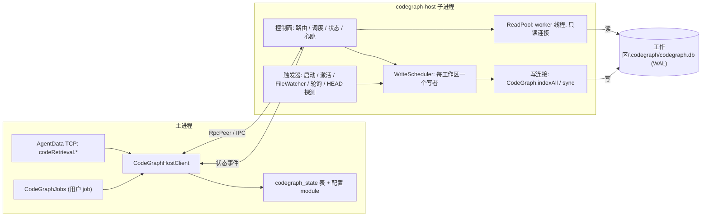
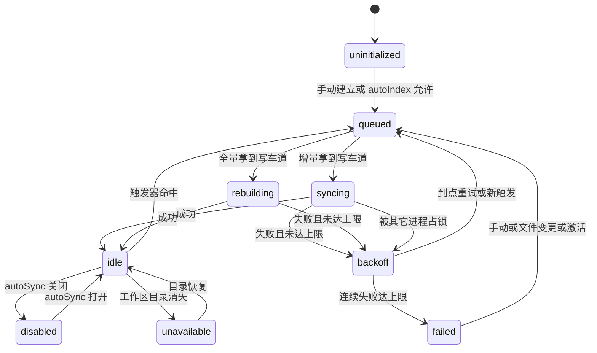

# Agent Note: CodeGraph 自动索引、自动同步与同步期间给旧结果

Status: proposed

> 范围（2026-10-17 收窄）：本篇原名「CodeGraph 移出主进程，并加自动索引与自动同步」。前半已经落地，不再属于本篇：
>
> - SDK 只在 codegraph-host 子进程里跑，子进程内一个写线程、N 个读线程、写前 evict，见 [CodeGraph 运行在 codegraph-host 子进程](../../implemented/architecture/2026-10-16-codegraph-host-process.md)。主进程在同步期间最长卡顿 452 ms → 25 ms，下文 S0 基线与 E1 响应性冒烟已在那篇做完；S1（只读连接与写者并发）、S6（`node:sqlite` 在 RunAsNode 的 worker 里可用）由 `codeGraphThreads.sdk.test.ts` 覆盖了一部分。
> - `CodeGraphHostClient` 由 agentdata-host 持有（codegraph-host 是它的子进程），不在主进程，见 [AgentData 运行在 agentdata-host 子进程](../../implemented/architecture/2026-10-16-agentdata-host-process.md)。下文所有「主进程」一侧（状态表、`touch`、广播、关停顺序）落地时都改在 agentdata-host 里做，状态推送经它的诊断 / 事件通道回到主进程再广播。
> - `codegraph.sync` 残留 job 的收尾已由 [孤儿任务落定](../../implemented/bug-fix/2026-10-16-orphan-job-settle.md) 修好。
>
> 仍是提案、未动工的：增量同步期间给同一工作区的旧结果（现在仍返回 busy）、读队列上限与读超时、写调度（合并、优先级、退避、熔断、附着）、自动同步触发器、状态模型与 `codegraph_state` 表、资源守卫、配置项与面板。下文保留原提案的完整设计，其中「总体结构」「1. 执行隔离与响应性」里读池 / 写线程的部分以 implemented 那篇为准。

## Problem

代码检索（`code_explore` 与代码索引面板）已经不占主线程（见上）。剩下的问题：

1. ~~**长检索与索引占主线程。**~~ 已由 codegraph-host 解决；当时实测主进程在一次同步里卡 19.8 秒。
2. **索引靠人点。** [内嵌 SDK 的决定](../../implemented/architecture/2026-09-07-embedded-codegraph-sdk.md)明确「不启用 SDK watcher，缺索引不自动创建」，同步只有面板上的按钮（`jobs.create('codegraph.sync')`）。官方 CodeGraph 有 watcher 自动增量同步；这里索引与代码的差距要人工对齐，`code_explore` 在模型改完代码后立刻查，拿到的是旧结果。

现状里还有几处会在引入后台同步后被放大的缺陷：

- 读与写互斥（仍在；读写线程分离后只剩同一工作区互斥，其它工作区的查询已不再排在同步后面）：同工作区有写者时读直接返回 `CodeGraph workspace is busy indexing`。手动同步偶发，自动同步每次保存都发生就不可接受。
- 超时只在传输层（仍在）：`AgentDataClient` 65 秒超时、`closeOnTimeout: false`，客户端放弃后读线程里的计算继续跑完，没有取消，也没有排队上限。
- ~~同步 job 崩溃后不收尾~~：已由 [孤儿任务落定](../../implemented/bug-fix/2026-10-16-orphan-job-settle.md) 修好。
- 生产环境没有给 SDK 传 `--liftoff-only`（仍在；SDK 的 WASM Zone-OOM 防护，`wasm-runtime-flags`）：`scripts/test-codegraph.mjs` 跑测试时传了，codegraph-host 的字节码入口不能带 V8 参数；现在 OOM 只会带走子进程。
- `status().state === 'stale'` 在 SDK 里的含义是「索引由旧版抽取器建成」（`isIndexStale()`），不是「文件已变」。现在没有任何地方回答「磁盘上有多少文件还没进索引」。

## Proposal

### 总体结构

新增一个 **codegraph-host 子进程**（与 agent-host 同一套做法：同一份 Electron 可执行文件加 `ELECTRON_RUN_AS_NODE=1`，Node IPC，`RpcPeer`，进程树守卫）。主进程只留一个薄的 `CodeGraphHostClient`，对外保持 `CodeGraphService` 现有方法。SDK 的所有访问都在子进程里：读走子进程内的 worker 线程池，写走子进程内的调度器。



> 上图是原提案的结构。已落地部分与图不同的地方：「主进程」那一侧（`CodeGraphHostClient`、`CodeGraphJobs`、AgentData 的 `codeRetrieval.*`）现在都在 agentdata-host 里；写在子进程的一个写线程里跑，不在子进程主线程。`WriteScheduler`、触发器、`codegraph_state` 表都还没有。

### 1. 执行隔离与响应性

- **主进程**不再静态引入 `@colbymchenry/codegraph`，也不在其中执行任何 SDK 调用（`codeGraphEngine.ts` 的 `loadEmbeddedSdk` 只在子进程里跑）。
- **读**：子进程里一个 `ReadPool`（`worker_threads`），每个 worker 持有自己的只读连接（`CodeGraph.open(root, { readOnly: true, sync: false })`），按工作区 LRU 缓存。`executeCodeGraphTool`（现有 `codeGraphQuery.ts`）搬到 worker 里执行。主进程到子进程是异步 RPC，子进程控制面事件循环不跑重活，所以 `status`、取消、心跳在任何检索期间都能及时响应。
- **写**：`indexAll` / `sync` 在子进程主线程（SDK 自己再用 parse 池和 store worker）。控制面和写任务共用事件循环，写任务期间控制面延迟不保证；用心跳监测（见「资源」）而不是假定它不卡。
- **并发度**：全局写车道 1 条（`maxConcurrentWriters`，默认 1）、同工作区永远 1 个写者；读 worker 默认 `min(2, max(1, cores-1))` 个。写与读不互斥（WAL），见一致性。
- **排队与背压**：
  - 读队列有上限 `maxQueuedReads`（默认 32）。队满立即拒绝，错误码 `CODEGRAPH_BUSY`，带 `retryAfterMs`，不入队、不等待。
  - 同一个工作区的读最多占读池一半（向上取整），避免一个大项目的 explore 饿死别的项目。
  - 写队列按工作区合并：每个工作区至多一个运行中 + 一个待执行；重复请求并入待执行槽，触发原因取并集，`full` 吸收 `incremental`。总待执行工作区数上限 `maxQueuedWrites`（默认 8），超出时自动触发被丢弃并记一次 `dropped` 计数（下次触发会再来），手动请求不丢、直接拒绝并报 `CODEGRAPH_BUSY`。
  - 优先级：手动 > 分支切换 > 文件变更 > 轮询/启动补同步。手动任务插队，但不抢占运行中的写者。
- **超时**：读从入队起算 `readTimeoutMs`（默认 30 秒，小于传输层 65 秒）。超时：排队中的直接移除；运行中的 `worker.terminate()` 并重建 worker，返回 `CODEGRAPH_TIMEOUT`。终止 worker 时遵守 SDK `worker-teardown` 的规则（worker 的首条消息到达前不终止，否则 Windows 上有整进程崩溃风险；崩的也只是子进程）。写用**停滞超时**而不是总时长：`writeStallTimeoutMs`（默认 120 秒内没有进度事件）判为卡死，杀子进程并走失败/退避；`maxIndexDurationMs` 默认 0（不限）。
- **取消**：读没有调用方侧取消（AgentData TCP 方法目前没有 abort 通道），只靠超时和关停。写取消沿用现有语义：`signal` 软取消，SDK 1.6 的 `sync` 不转发 signal，所以增量同步要等当前批次结束才能响应；超过 `cancelGraceMs`（默认 10 秒）仍未停止，则杀子进程并重启，全量索引会留下 `partial` 状态，由下次计划重建。
- **重复请求**：
  - 读：同一工作区、同一工具、规范化后参数相同、同一 `generation` 的并发请求单飞（共享一次执行）。
  - 写：并入待执行槽或附着到运行中的任务；手动 `codegraph.sync` job 在已有自动同步运行时**附着**，同步结束时一并完成，不再失败。已有的 `JOB_ALREADY_RUNNING` 只针对同一工作区的另一个用户 job。

### 2. 自动索引与自动同步

触发器全部在子进程里，统一投递到 `WriteScheduler.request({ workspace, reason, priority })`。

| 触发 | 条件 | 动作 |
| --- | --- | --- |
| 服务启动 | host 就绪后延迟 `startupDelayMs`（默认 10 秒），对状态表里登记的、`autoSync` 为真的工作区依次补同步 | 增量；一次只排一个，低优先级 |
| 工作区激活 | 主进程 `resolveWorkspace` 或面板切换项目时调用 `touch(workspace)`；距上次检查超过 `staleAfterMs`（默认 5 分钟） | 登记工作区、启动 watcher、排增量 |
| 代码变更 | SDK `FileWatcher`（公开构造函数 `new FileWatcher(root, syncFn, opts)`），`syncFn` 指向调度器而不是直接 `graph.sync`；`debounceMs` 默认 2000，传 `paths` 走 SDK 的快路径 | 增量（带 `paths`） |
| 定时轮询 | `pollIntervalMs` 默认 5 分钟，仅对近期活跃的工作区；watcher 降级（`isWatcherDegraded`）时缩到 `degradedPollIntervalMs`（默认 1 分钟） | 增量；无变化时 `sync()` 是空操作 |
| 仓库/分支切换 | 在激活、轮询、watcher 爆发三个时机读 `.git/HEAD`（含 worktree 的 gitdir 指针）与上次记录比较，不同则视为切换；等 `branchSwitchSettleMs`（默认 3000）让 checkout 的事件风暴停下来 | 增量，优先级高于普通变更；记录 `reason: 'branch_switch'` |
| 手动 | 面板按钮、`jobs.create` | 与现状一致，优先级最高 |

watcher 数量有上限 `maxWatchedWorkspaces`（默认 3，LRU 淘汰）；被淘汰的工作区回落到轮询。

**首次全量索引**默认不自动做：它会在用户仓库里创建 `.codegraph/`，还可能耗时很久。`autoIndex` 默认 `existing`：只自动维护已有索引的工作区；`all` 才对新工作区自动建；`off` 全关。按工作区可覆盖。

**增量 / 全量判定**由一个纯函数 `planFor(workspace)` 给出：

- 全量：未初始化且策略允许；`getIndexState() !== 'complete'`（上次被打断或失败）；`isIndexStale()` 且策略允许（见下）；数据库打不开且被分类为损坏（先一次增量重试，仍失败则 `CodeGraph.recreate`）；用户显式要求重建。
- 增量：其余情况。增量的依据是 SDK `sync()` 自己的逐文件比对（索引里记录的文件状态与磁盘当前状态），不是我们另存一份快照；watcher 快路径用事件给出的 `paths` 限定范围。
- SDK 升级后抽取版本变化（`isIndexStale()`）：`rebuildOnEngineUpgrade` 默认 `manual`，只标 `stale` 并提示，不自动全量重建；设为 `auto` 才自动。原因见 Alternatives 与 D3。

### 3. 状态模型与生命周期

每个工作区在子进程里一个状态机，持久化的部分写进 AgentData SQLite（新表 `codegraph_state`），重启后恢复。



`sdk_unavailable` 是进程级而不是工作区级状态，保持现有语义。

对外状态（`codeRetrieval.admin.status` 返回，**在现有字段上只增不删**）：

```ts
interface CodeGraphStatusView {
  // 现有字段原样保留：workspace, connected, indexed, sdkAvailable, sdkVersion, state, files, nodes, edges, lastIndexedAt, message
  phase: 'uninitialized' | 'idle' | 'queued' | 'syncing' | 'rebuilding' | 'backoff' | 'failed' | 'disabled' | 'unavailable';
  mode?: 'incremental' | 'full';
  trigger?: 'startup' | 'activate' | 'watch' | 'poll' | 'branch_switch' | 'manual' | 'retry';
  progress?: { stage: string; processed?: number; total?: number };
  queuedAt?: number; startedAt?: number;
  lastAttemptAt?: number; lastSuccessAt?: number;          // lastSuccessAt 才是「索引与磁盘对齐过」的时间
  lastError?: { message: string; at: number; code?: string };
  consecutiveFailures: number; nextRetryAt?: number;
  pendingChanges: number;                                    // watcher 已见到但尚未入索引的文件数
  watcher: { active: boolean; degraded: boolean; reason?: string };
  servingStale: boolean;                                     // 正在用旧索引应答
  generation: number;                                        // 每次成功提交 +1，进程内单调
}
```

`state`（旧枚举）仍然给出，由新字段推导：全量建立/重建期间是 `indexing`；**增量同步期间不再是 `indexing`**，保持 `indexed`（或 `stale`/`partial`）并带 `phase: 'syncing'`。这是对现有调用方唯一有语义影响的变化，见「兼容性」。

**推送**：子进程状态变化经 `CodeGraphHostClient` 以 `codegraph://state` 广播给渲染层（面板免轮询，保留 `status` 轮询作为兜底）。**不静默失败**的三条出口：① `lastError`/`consecutiveFailures`/`nextRetryAt` 在状态里；② 每次失败写一条 `recordDiagEvent({ kind: 'codegraph-sync-failed', ... })` 进 `runtime-diag.jsonl`；③ 达到熔断上限时为该工作区建（或刷新）一条 `source: system` 的 `codegraph.sync` 失败 job，任务中心可见、可重试。成功的自动同步**不**建 job（否则任务列表被刷屏）。

### 4. 一致性语义

- **最终一致，滞后上界**：一次编辑到可查询 ≈ `debounceMs`（2 秒）+ 排队等待 + 该次同步耗时。watcher 降级时上界退化为 `degradedPollIntervalMs`；两者都失效时上界是 `pollIntervalMs`。这是目标值，不是保证值，实际值由 E2E 测量（验证 E2）。
- **同步进行中的查询**：增量同步期间读继续应答，数据是「上一次已提交的状态」，状态里 `servingStale: true`；`codeRetrieval.call` 的结果在 `structuredContent` 里增加 `meta: { generation, asOf, pendingFiles }`（只增字段，旧调用方忽略）。全量重建期间（索引被就地改写）读返回 `CODEGRAPH_BUSY`，消息保留现有子串 `CodeGraph workspace is busy indexing`。
- **并发读写的可见性**：SQLite WAL 下读者永远看到已提交数据。SDK 的提交粒度是逐文件批次，所以**单个文件的更新是原子的，一次完整同步不是**；同步中读者可能看到「部分文件已更新」的混合态。单次工具调用内部由多条语句组成，可能跨过一次提交；实现上读 worker 在调用前后比较 `PRAGMA data_version`，变化则重试一次，仍变化则在 `meta.consistency` 标 `mixed`。同一工作区同一时刻只有一个写者；跨进程写（用户另开官方 CLI/MCP）靠 SDK 的 `codegraph.lock`，拿不到锁时记为 `deferred`，退避重试，不计入失败次数，持续超过 5 分钟才作为 `locked_by_other_process` 报告。

### 5. 失败与降级

| 场景 | 行为 |
| --- | --- |
| 单次增量同步失败 | 索引仍是上一个一致状态，继续对外应答，`servingStale: true`；按指数退避重试：30 秒起，因子 2，上限 30 分钟，±20% 抖动；`maxConsecutiveFailures`（默认 6）后进入 `failed`，不再自动重试，直到手动、新的文件变更事件或工作区激活 |
| 全量重建失败 | 索引状态为 `partial`/`failed`，读返回带原因的错误（与现状一致）；同样退避与熔断 |
| SDK 抛 `LockUnavailableError` | 视为 `deferred`，见一致性 |
| 工作区目录消失 | `unavailable`，停 watcher，不重试；目录恢复后下次触发复位 |
| 读 worker 崩溃/超时 | 重建 worker；该请求返回错误，不重放（读可重放但会放大雪崩，交给调用方） |
| 子进程崩溃 | 在途请求以 `CODEGRAPH_HOST_EXITED`（可重试）拒绝；在途**写任务**对应的 job 标记失败并带原因；主进程按 `AgentProcessClient` 同样的预算重拉（60 秒内 3 次后冷却 30 秒），冷却期间读返回 `CODEGRAPH_BUSY`，状态显示 `host_restarting`；重拉后按状态表和 `getIndexState()` 重新规划（被打断的全量会是 `partial`，计划为全量；被打断的增量重新比对即可，幂等） |
| 主进程退出 | 关停顺序：先 `codegraphHost.shutdown()`（停触发器 → 软取消写任务 → 等 `shutdownGraceMs` 默认 5 秒 → 关连接），再 `agentData.stop()`，因为进度回调还要写 AgentData；超时由进程树守卫清理。子进程在 IPC 断开时自行退出 |
| 主进程崩溃后残留 job | 已落地（做法不同）：运行时启动时把未结束的 job 落定，已请求取消的记 cancelled，其余记 `JOB_INTERRUPTED` 失败，见 [孤儿任务落定](../../implemented/bug-fix/2026-10-16-orphan-job-settle.md) |
| 心跳丢失 | 子进程每 2 秒发心跳；主进程 15 秒没收到就判无响应，杀掉重拉，同样计入崩溃预算 |

### 6. 资源约束

- 子进程内存：`--max-old-space-size` 默认 2048 MB；读 worker 用 `resourceLimits.maxOldGenerationSizeMb`（默认 512）；资源守卫每 5 秒采样 RSS，超过 `maxRssMb`（默认 3072）则终止当前写任务并重启子进程，读 worker 单独回收。WASM 线性内存不在 V8 堆内，所以 RSS 守卫不可省。
- CPU：主进程拉起后用 `os.setPriority(pid, PRIORITY_BELOW_NORMAL)` 降优先级；解析线程数用环境变量 `CODEGRAPH_PARSE_WORKERS` 限制，默认 `min(2, max(1, floor(cores/4)))`（SDK 默认 `cores-1` 上限 8，会吃光机器）；全局写车道 1 条。
- `--liftoff-only` 等 V8 参数：agent-host 笔记已经记明字节码入口不能带 V8 参数。首选方案是在入口里用 `v8.setFlagsFromString` 于加载 SDK 之前设置（待 S5 验证）；退路是该入口不走字节码（见 D6）。
- 有界结构：读队列、写待执行槽、watcher 数、打开的图实例数（`maxOpenWorkspaces` 默认 4，沿用 15 分钟空闲关闭）、单次结果大小（`maxResultBytes` 默认 1 MiB，超出截断并标 `truncated`）、每工作区内存里的尝试历史（最近 20 条）。没有无界队列或缓存。

### 7. 兼容性

保持不变：`CodeGraphService` 的方法与返回结构（`status`、`call`、`search`、`projects`、`runSync`、`cancelSync`、`close`），`AgentDataCodeRetrievalProvider` 接口，`codeRetrieval.*` RPC 名与参数，`CodeSearchView.available/results/message`，`CodeRetrievalResult` 结构，`CodeGraphJobs` 的构造与回调，`code_explore` 扩展侧调用，`CODEGRAPH_SDK_VERSION` 固定为 1.6.2。

逐项变更：

1. `status().state`：增量同步期间不再是 `indexing`（改为 `indexed`/`stale`/`partial` + `phase: 'syncing'`）。依赖旧语义的只有 `codeIndexPresentation.ts`（`indexing` → `canQuery: false`），随本改动更新。
2. `call()`：增量同步期间不再抛 `busy indexing`，而是返回旧数据。全量重建期间仍抛，消息子串不变，额外带 `code`。
3. 新增错误码 `CODEGRAPH_BUSY` / `CODEGRAPH_TIMEOUT` / `CODEGRAPH_HOST_EXITED` / `CODEGRAPH_CANCELLED`；原有两条消息子串（`CodeGraph workspace is busy indexing`、`CodeGraph index is not initialized for this workspace`）保留。读不再无限等待：最长 30 秒，之前可到 65 秒甚至无限。
4. 手动 `codegraph.sync` job 在已有自动同步时附着而不是失败。
5. `knownWorkspaces` 不再只是内存集合，登记进 `codegraph_state`，重启后可用。
6. `structuredContent` 增加 `meta`（只增）。

### 对外接口与配置

新增（均向后兼容）：

- RPC：`codeRetrieval.admin.states`（所有已登记工作区的状态列表，供概览用）；`codeRetrieval.admin.touch { workspace }`（激活登记）；`codeRetrieval.admin.rebuild { workspace }`（显式全量，走与手动 job 相同的路径，不另起一套）。
- 事件：`codegraph://state { workspace, status }`。
- IPC：`agentData_code_states`、`agentData_code_touch`，类型进 `src/lib/agentData.ts`。
- 配置：复用现有版本化配置 `admin.config`，module 为 `codegraph`，按工作区覆盖放 `workspaces[path]`。

| 配置项 | 默认 | 语义 |
| --- | --- | --- |
| `autoIndex` | `existing` | `off` 全关；`existing` 只维护已有索引；`all` 新工作区也自动建 |
| `autoSync` | `true` | 总开关，可按工作区关 |
| `startupDelayMs` | 10000 | 启动后多久开始补同步 |
| `debounceMs` | 2000 | 文件事件合并窗口 |
| `pollIntervalMs` / `degradedPollIntervalMs` | 300000 / 60000 | 轮询兜底，0 关闭 |
| `staleAfterMs` | 300000 | 激活时距上次检查多久才再排同步 |
| `branchSwitchSettleMs` | 3000 | 分支切换后等多久再同步 |
| `maxWatchedWorkspaces` | 3 | 同时挂 watcher 的工作区数 |
| `maxConcurrentWriters` | 1 | 全局写车道 |
| `readWorkers` | `min(2, max(1, cores-1))` | 读 worker 数 |
| `maxQueuedReads` / `maxQueuedWrites` | 32 / 8 | 队列上限 |
| `readTimeoutMs` | 30000 | 读超时（含排队） |
| `writeStallTimeoutMs` / `maxIndexDurationMs` | 120000 / 0 | 写的停滞超时与总时长上限 |
| `cancelGraceMs` / `shutdownGraceMs` | 10000 / 5000 | 取消与关停宽限 |
| `retry` | 30s, x2, 30min, 20%, 6 次 | 退避与熔断 |
| `hostMaxOldSpaceMb` / `maxRssMb` / `readWorkerHeapMb` | 2048 / 3072 / 512 | 内存上限 |
| `parseWorkers` | `min(2, max(1, floor(cores/4)))` | 解析线程数 |
| `maxOpenWorkspaces` / `idleCloseMs` | 4 / 900000 | 打开的图实例上限与空闲回收 |
| `maxResultBytes` | 1048576 | 单次结果上限 |
| `rebuildOnEngineUpgrade` | `manual` | `manual` 只标 stale；`auto` 自动全量 |

### 改动清单与影响面

| 文件/模块 | 改动 | 影响面 |
| --- | --- | --- |
| `electron/app/codeGraph/host/hostEntry.ts`（新） | 子进程入口：装配控制面、读池、调度器、触发器、资源守卫 | 新构建入口 `codegraph-host`，打包要进 `asarUnpack` |
| `host/contract.ts`（新） | 主 ↔ 子方法名与事件名，处理表类型化 | 两边必须同改 |
| `host/scheduler.ts`（新） | 写调度：合并、优先级、车道、退避、熔断、附着 | 纯逻辑，可注入时钟与假 SDK 做单测 |
| `host/readPool.ts`、`host/readWorker.ts`（新） | worker 线程读池：超时、终止、重建、单飞、队列背压 | `readWorker` 也是构建入口 |
| `host/triggers.ts`（新） | 启动补同步、激活、`FileWatcher`、轮询、HEAD 探测 | 唯一接触 fs 事件的地方 |
| `host/resourceGuard.ts`（新） | RSS 采样、优先级、心跳 | 失败时触发子进程重启 |
| `codeGraphEngine.ts` | 保留类型与在子进程内的实现；读改走 worker，写改走调度器；`status()` 组合新字段 | 现有 `codeGraphEngine.test.ts` 需随拆分调整，行为用例保留 |
| `codeGraphHostClient.ts`（新） | 主进程侧客户端，方法与旧 `CodeGraphEngine` 公共面一致；崩溃预算、冷却、重拉 | 取代 `main.ts` 里直接构造的引擎 |
| `codeGraphService.ts` | 改为继承/包装 `CodeGraphHostClient`，`search`、`projects` 不变 | 无调用方变化 |
| `codeGraphJobs.ts` | 附着语义；进度回调不变 | job 完成时机与现在一致 |
| `agentData/codegraphStateStore.ts`（新） | `codegraph_state` 表：登记、最近成功/失败、HEAD、模式 | 新表，随 `storage.ts` 迁移 |
| `agentData/runtime.ts` | 启动时收尾 `codegraph.sync` 残留 job；`JOB_ALREADY_RUNNING` 针对用户 job；新 admin 方法；状态透传 | 改了错误语义的触发条件 |
| `agentData/jobStore.ts`、`taskViewStore.ts` | 失败收尾；system 来源的同步 job 只在失败时可见 | 任务中心 |
| `main.ts` | 构造 host client；`resolveWorkspace` 调 `touch`；关停顺序加入 host | 关停顺序是契约 |
| `electron.vite.config.ts`、`electron-builder.yml` | 新入口 `codegraph-host`、`codegraph-read-worker`，`asarUnpack` | 打包产物，字节码路径只能打包后验证 |
| `ipc/register.ts`、`preload`、`src/lib/agentData.ts` | 新命令与类型 | 渲染层类型 |
| `CodeRetrievalPanel.tsx`、`codeIndexPresentation.ts` | 同步中仍可查询、显示最近成功时间/失败原因/下次重试、自动同步开关 | UI，需 ui-harness 场景 |
| `docs/architecture.md`「Agent Data Runtime」 | 更新现状事实 | 文档 |
| [内嵌 SDK 笔记](../../implemented/architecture/2026-09-07-embedded-codegraph-sdk.md) | 「启用 SDK watcher」一条改为指向本笔记；落地后其「只有用户显式建立/同步才写索引」一条被取代 | 部分取代，两篇互链 |

## 验证

计划（落地后在 implemented 版本里改成实际结果与证据路径，证据放 `.agents/evidence/2026-10-16-codegraph-host-process-auto-sync/`）：

- **S0 基线**：在当前主进程内跑大项目的 `codegraph_explore` 与全量索引，用 `perf_hooks.monitorEventLoopDelay` 记主进程事件循环延迟的 p99 与最大值，确认「会阻塞」不是推断。没有基线，后面的收益没有对照。
- **S1–S6 先行验证**（每项出结论后回填假设表）：S1 只读连接在 WAL 下与写者并发读；S2 `indexAll` 作用在已有完整索引上时对读者的可见性（是否就地清表）；S3 单次工具调用跨提交的混合读如何检测；S4 `FileWatcher` 公开构造 + 自定义 `syncFn` 在 `paths` 快路径下的行为；S5 字节码入口里用 `v8.setFlagsFromString` 设 `--liftoff-only` 与堆上限是否生效；S6 `node:sqlite` 在 `RunAsNode` 的 `worker_threads` 里可用。
- **单测**（`pnpm run test:codegraph` 用应用自带的 Electron Node 跑，另有纯逻辑部分走 `pnpm exec vitest run electron/app/codeGraph`）：调度器（合并、优先级、车道、队列上限、退避、熔断、附着）用假时钟与假 SDK；读池（超时终止并重建、队满 `CODEGRAPH_BUSY`、单飞）；`planFor` 全量/增量判定；HEAD 探测；host client 崩溃/冷却/重拉（照 `agentProcessClient.test.ts` 的假子进程）；兼容用例：现有 `codeGraphService.test.ts`、`codeGraphRuntime.integration.test.ts` 不改断言通过。
- **E1 主进程响应性冒烟** `scripts/codegraph-host-smoke.mjs`（照 `agent-host-smoke.mjs`）：合成 2 万文件项目；同时跑 全量索引 + 8 路并发 `codegraph_explore` + 一条故意慢的查询；主进程侧每 10ms 记事件循环抖动。通过标准：主进程事件循环 p99 小于 50ms、最大小于 200ms；同一脚本对旧的进程内实现跑一遍留作对照。再加真实 Electron 下 `runtime-diag.jsonl` 的主进程延迟样本。
- **E2 自动同步端到端**（临时 git 仓库，已建索引，host 在跑）：① 新增函数 `uniqueSymbolXyz`，轮询 `codegraph_search` 直到命中，记录编辑到命中的耗时，断言小于 `debounceMs` + 同步耗时 + 余量，且没有产生用户可见 job；② 删除文件后符号消失；③ `git checkout` 切到相差 200 个文件的分支，状态出现 `trigger: 'branch_switch'`，最终收敛；④ 退出应用、离线修改文件、重启，启动补同步后命中；⑤ 全量索引中途 `kill -9` 子进程，重拉后状态 `partial`，自动重建完成；⑥ 注入同步失败，观察退避序列、`lastError`、`nextRetryAt`、旧索引仍可查、达上限后进入 `failed` 并出现失败 job、手动重试成功；⑦ 另开官方 CLI 持锁，状态为 `deferred` 而不是失败。
- **E3 资源与背压**：灌入 100 个并发读，断言队列不超过上限、超出者得到 `CODEGRAPH_BUSY`、RSS 稳定、主进程不卡；构造超过 `maxRssMb` 的场景，验证子进程被回收并自动恢复。
- **UI**：`pnpm ui:check code-retrieval-panel`，补场景：同步中可查询、显示最近成功时间、失败原因与重试倒计时。
- **打包**：`sdkPackaging.test.ts` 增加新入口的 `asarUnpack` 断言；字节码路径在打包产物上跑 E1 的缩小版。

## Alternatives considered

- **`worker_threads` 放在主进程里，不另起进程。** 最强理由：不增加进程、不增加 IPC 跳数、读 worker 本来就要用线程；SDK 自己的 `QueryPool` 就是这么做的。没选的原因：SDK 的 `worker-teardown` 文档记录了 Windows 上 worker 在 V8 并发标记期间结束会让**整个进程**以访问冲突崩溃，放在主进程里这个风险由主窗口承担；索引与解析本身已经在主进程里拉起一堆线程并吃 WASM 内存，无法设内存上限和降优先级（线程不能单独设）；V8 参数（`--liftoff-only`）也只能给整个进程。子进程把崩溃、内存、优先级一并隔离，并且仓库里已有 agent-host 这套可复用的做法。
- **只给读加 worker 池，写保持在主进程。** 最强理由：改动最小，直接缓解检索阻塞，不碰 job 路径。没选：索引的写库和引用解析同样是同步 SQLite，占的正是用户抱怨的那段时间；而自动同步会让写变成常态，留在主进程等于把阻塞从偶发变成持续。
- **启用 SDK 自带的 `graph.watch()`，不自己编排。** 最强理由：官方路径，行为和官方 CodeGraph 一致，代码最少。没选：它内部直接调 `graph.sync`，绕过调度器，无法做全局并发上限、优先级、统一的状态与失败出口，也无法让手动任务附着；`FileWatcher` 是公开类、构造时可注入 `syncFn`，能复用它的忽略规则与平台策略而保留编排权。
- **自己写文件监听，复用主进程现有的 `fileWatchService`。** 最强理由：已有代码，主进程里已经监听文件浏览器的目录。没选：它的忽略范围与索引的作用域（`.gitignore`、`git ignored-untracked`、SDK 的内置排除）不一致，会触发大量无关同步；SDK 的 `FileWatcher` 已经解决了 Windows 上 NTFS 访问时间戳误报等问题。
- **每次文件变更都用全量重建，省掉增量判定。** 最强理由：没有增量漂移的可能。没选：大项目全量要分钟级，且全量期间读被拒；SDK 的 `sync()` 本就是为此设计的，全量只作为兜底。
- **自动同步也建用户可见 job。** 最强理由：与现有手动同步一条路径，状态/重试/取消全复用。没选：保存一次就一条，任务中心会被刷屏；失败才建 job 保留了可见与可重试。
- **影子库式的零停机全量重建**（建到临时目录，完成后原子替换）。最强理由：重建期间读不中断。没选：SDK 1.6 的 `indexAll` 固定写 `.codegraph/codegraph.db`，没有目标路径参数，需要拷贝整个工作区或改 SDK；SDK 自己用 `recreate()` 丢弃重建。全量重建本来就是低频兜底，这里接受重建期间读被拒。

## Acceptance criteria

- E1：大型检索与全量索引并发时，主进程事件循环 p99 小于 50ms，最大小于 200ms；基线对照留证据。
- E2 的 ①–⑦ 全部通过；编辑到可查询在默认配置下 P95 不超过 10 秒（已索引、无其它写任务时）。
- 增量同步期间查询不再因 `busy indexing` 失败；全量重建期间的错误消息子串不变。
- 任何一次同步失败都能在状态、`runtime-diag.jsonl` 里找到记录；熔断后任务中心有失败 job。
- 队列、watcher、图实例、结果大小都有上限，E3 通过。
- 现有 `codeGraphService.test.ts`、`codeGraphRuntime.integration.test.ts`、`codeGraphJobs.test.ts` 的断言不改即通过。
- `pnpm run verify-notes` 通过；本笔记转 implemented 时「验证」段写明命令、证据路径与结果。

## Risks

- 读 worker 里只读连接的行为（S1）、`indexAll` 对读者的可见性（S2）、混合读检测（S3）都还没有实测，如果 S2 显示全量重建期间读到的是半截数据，需要把「全量重建期间读被拒」做得更严（先标记再清表）。
- `v8.setFlagsFromString` 在字节码入口里设 `--liftoff-only`/堆上限未必生效（S5）。不生效就要让该入口不走字节码，源码保护的边界要重新评估（`sourceCodeProtection.test.ts`）。
- 多一个常驻进程：冷启动成本、内存占用、更多崩溃面。用「按需拉起」缓解：只在有已登记且 `autoSync` 的工作区或有首次请求时才起子进程。
- 自动同步在 `git checkout` 大改动、`node_modules` 之类作用域外目录大量变动时的行为依赖 SDK 的忽略规则，规则不一致会造成空转；`pendingChanges` 与 `dropped` 计数用来发现这种情况。
- 与用户自己运行的官方 CodeGraph（CLI/MCP，自带 watcher）在同一仓库同时写：靠 `codegraph.lock` 互斥，会出现 `deferred`；没有更强的协调手段。
- 读取取消没有调用方通道，调用方放弃后读 worker 仍会跑到超时。可接受（有上限），但不是真取消。
- `.codegraph/` 目录写进用户仓库，`autoIndex: 'all'` 会让这件事自动发生；默认 `existing` 规避。
