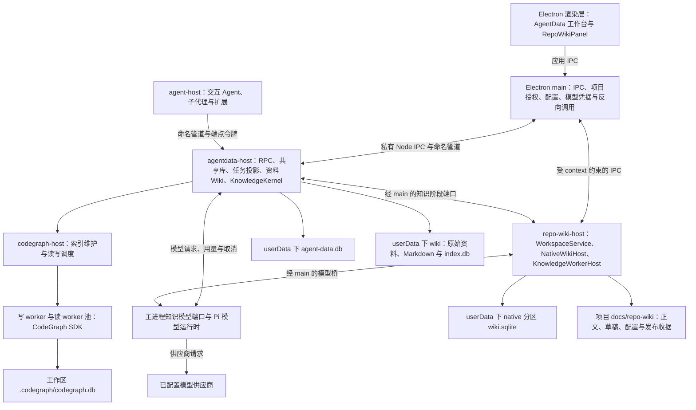
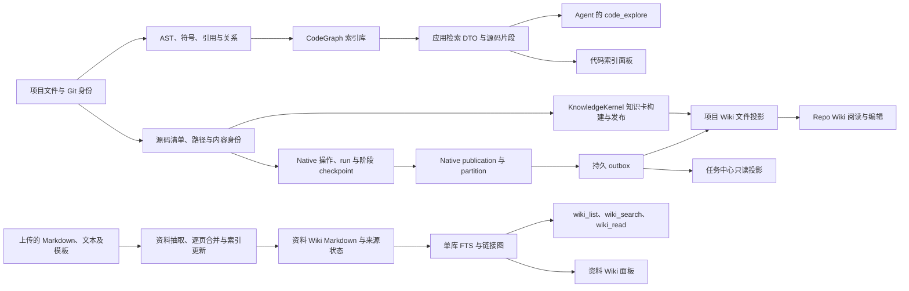
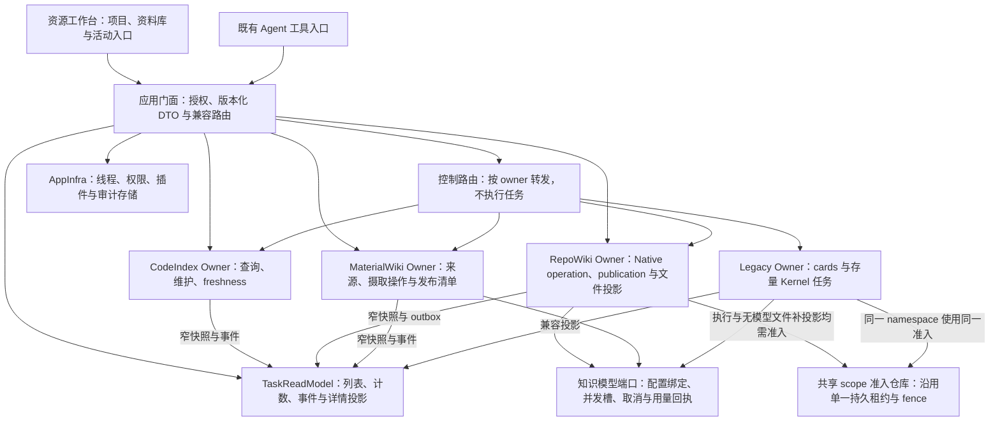
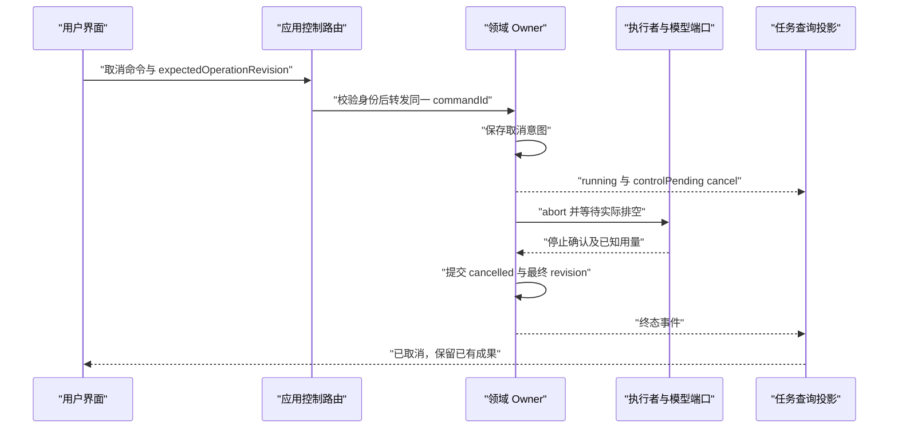

# Agent Note: AgentData 全链路现状与轻量解耦改造评审

Status: proposed

## Problem

用户希望解决 AgentData 职责混杂、任务状态含义不清、UI 难以理解的问题，目标是解耦、更快捷、更轻量。当前问题贯穿执行权威、数据权威、状态投影和产品入口，单独重做页面不能完整解决。

本稿先呈现当前链路，再提出目标架构和渐进落地路径。文中的方案均为待评审建议；本轮仅调查和编写文档，未修改实现、迁移数据、重启应用或调用模型。

已确认的边界：

- 全链路覆盖 Repo Wiki、资料 Wiki、CodeGraph、任务、审计诊断、宿主、存储、模型端口和 Agent 消费。
- 继续以本机 Electron 为主，保留现有数据和调用入口，允许版本化迁移与分阶段替换。
- 优先解决混乱与状态可信问题，同时建立性能、可观测性、质量的验收依据。
- 可以检查本地只读状态和日志；不得借调查触发生成、重建或付费模型调用。

## 1. 评审基线与证据等级

基线为 **2026-11-03 的当前工作区**，分支 `codex/repo-wiki-knowledge-kernel`，HEAD `310e5728`，包含大量未提交改动。HEAD 只标识参照点，不代表所评审实现都已提交。CodeGraph 检索还会返回 `.agents/evidence/` 中的旧源码快照，本文最终结论取实际源码路径的磁盘内容。

证据标记：

| 标记 | 含义 | 能支持什么 |
| --- | --- | --- |
| F | 当前源码、配置或依赖解析确认 | 当前工作区的接线、协议、算法和条件行为 |
| R | 本轮只读运行证据 | 采样时的文件、表、聚合计数、进程和日志 |
| I | 基于 F/R 的推断 | 附触发条件与验证办法，不当作已发生事故 |
| P | 改造建议或拟定验收目标 | 待评审，不代表已有能力或已测性能 |
| H | 历史笔记/验收记录 | 解释既有约束，不替代本轮验证 |

**边界提醒：磁盘源码、已安装依赖、正在运行的 bundle 是三个不同对象。** 本轮未重启应用，也未确认进程所载 bundle 与全部未提交源码一致。未启动 UI harness；UI 结论是组件结构与状态接线分析，没有声称已复现用户当前屏幕的全部视觉问题。

本轮证据位于 [只读采样](../../../evidence/2026-11-03-agentdata-architecture-review/inventory.json) 和 [采样脚本](../../../evidence/2026-11-03-agentdata-architecture-review/read-only-inventory.mjs)。脚本直接以 `readOnly` 打开 SQLite，并设置 `query_only`，没有实例化会执行迁移、恢复或补投影的应用 Service。

### 1.1 本机采样结果

采样时间为 `2026-11-03T06:25:04.508Z`；跨库查询与进程采样并非同一全局事务。

| 对象 | R：观察值 | 解读边界 |
| --- | --- | --- |
| 开发版共享库 | `%APPDATA%/electron-agent/agent-data.db`，886,951,936 字节，约 845.86 MiB；schema 7；journal_mode=delete | 不代表安装版数据目录；容量不能直接归因于某张表 |
| 用户任务 | 22 条：CodeGraph completed 5；旧 Repo Wiki cancelled 7、failed 9；native failed 1 | 采样时这些 Job 全部终态；不能据此声称现在有运行任务挂死，也不能推导总体失败率 |
| 系统任务 | `wiki_page_generate` completed 1 | 历史记录，不能代表当前资料 ingest 路径 |
| 共享库主要计数 | threads 617、turns 1,602、items 94,842、tool_audit 97,213、agent_audit 8,766、knowledge_build_items 242 | 说明共享库大量承担会话与工具基础设施；未测各表字节占用 |
| Native 数据 | 三个 native 分区目录；其中一个有 failed operation 1、run 1、publication 0，另两个 operation 0 | 不等于用户全部项目无可读 Wiki，项目文件可能仍保留旧正文 |
| 进程 | main、agent-host、agentdata-host、repo-wiki-host 存在；codegraph-host 的父进程为 agentdata-host | 与默认进程拓扑相符；进程存在不等于所有服务健康 |
| 最近日志样本 | AgentData RSS 约 67.7 MiB，CodeGraph RSS 约 371.9 MiB；后者 syncing=0 | 单点/短窗口指标，不能证明泄漏或预测峰值 |
| 最近 AgentData 窗口 | 11 次权限求值同步合计约 58.9 ms；3 次 item.upsert 合计约 29.9 ms | 共享宿主还在服务知识功能以外的调用；不是检索/生成基准测试 |

## 2. 当前端到端链路

### 2.1 进程与组件关系

以下是默认 child 模式的 F；`GREN_AGENTDATA_PROCESS=inproc` 保留兼容退路。[E01–E04]



Repo Wiki 的 native 与 KnowledgeKernel 工作组件位于已有 repo-wiki-host 进程中，不能从目录名 `knowledgeProcess` 推导出每类组件各有一个常驻 OS 进程。CodeGraph SDK 内部还可使用解析等 worker，图中只展开应用明确管理的层级。

### 2.2 数据如何变形、落盘和消费



**F：Repo Wiki 与资料 Wiki 没有自动合成同一个知识库。** `wiki-rag` 的三个工具访问资料 Wiki 的 list/search/pageRead；Native Repo Wiki 主要经项目文件和自身阅读器消费。Agent 可以通过普通文件工具读取项目 Markdown，但这不等于 Repo Wiki 已进入 `wiki_search` 的召回空间。[E05、E11]

### 2.3 逐环节职责、输入输出与触发

| 环节 | 职责与输入 → 输出 | 触发方式 | 边界/下游 |
| --- | --- | --- | --- |
| 项目发现与授权 | 宿主已知工作区、当前会话项目 → 项目摘要、授权 context、hydrate 目标 | 注册/打开项目、切项目、Repo Wiki 激活 | 项目列表、CodeGraph 活跃登记、Wiki projectId 并非同一集合；不能按 UI 列表相等假定身份一致 |
| CodeGraph 写入 | 文件、Git HEAD、已有索引与抽取版本 → AST/符号/边/文件状态 | 首次索引需显式操作；已有索引可由访问、watch、HEAD 变化、补偿扫描触发增量 | 不调用 LLM；自动同步不新建首次索引、不自动转全量；SDK 是主要第三方边界 |
| CodeGraph 查询 | workspace、只读 tool、args → schemaVersion 1、文本、rows、nodes/edges、部分 meta | UI 查询、Agent code_explore | 图来自索引，源码片段来自当下磁盘；存在跨时刻组合，非严格单快照 |
| Native Repo Wiki 准入 | project/branch/locale/source pin/作者设置/model identity → confirmation 与幂等 operation | 正常 hosted Wiki 的 prepare/start | context 访问权与运行所有权分离；凭据不进入 Wiki 数据库 |
| Native 生成 | operation → README/overview/plan/catalogue/page checkpoint → publication | 已确认的 full/update/sync/repair/regenerate | 页面池独立并发，不是旧 Kernel 页 DAG；部分成功可发布，源/模型/租约等全局错误会阻断 |
| Native 投影 | SQLite publication/outbox → AgentData 任务摘要、项目正文与文件状态 | 派发收尾、状态读取对账、显式无模型补投影 | completed 表示 SQLite 提交；文件 ready/conflict/error 是另一维；文件冲突不应重跑模型 |
| KnowledgeKernel | 旧 Wiki/当前 cards 请求 → 构建项、模型账本、检查点、文件发布收据 | cards、兼容 API、启动恢复、显式修复/重分析 | 当前仍装配；旧任务不因 UI 改为 native 自动失去恢复能力；全必需项通过后发布 |
| 资料 Wiki | raw .md/.txt、purpose/schema → 抽取页、merge 正文、overview、FTS/来源状态 | 显式 wiki.ingest | 当前内存 buildQueue，未生成新的通用 Job；请求 await 全部执行；逐页文件写入后再更新索引 |
| 统一任务查询 | agent_jobs UNION service_tasks，加 capabilities/knowledge/native 摘要 → TaskView | 工作台加载、跟踪、2 秒条件轮询、详情读取 | 是跨模型展示；Native Job 是投影，不能视为 Native 执行权威；正常自动索引不在列表 |
| 模型接入 | 文本 completion 或工具 message、模型配置身份、AbortSignal → 文本/消息、usage、取消排空 | 各生成域调用 | 并发槽当前由资料 WikiService 持有，默认全局 5；不同域占槽粒度不一致 |
| 会话/权限/插件基础设施 | Agent 线程、turn/item、工具事实、规则、插件状态 → 持久记录、授权结果、广播 | 普通对话与每次工具调用、插件启停 | 同属 AgentData 共享库/宿主，但不是知识生产链；整体停掉 AgentData 会影响这些下游 |
| 审计与诊断 | Job 审计、SDK 状态、进程采样 → 投影后的审计页、诊断项、JSONL 日志 | 管理页、显式检查、10 秒周期采样 | 当前诊断实现主要检查 CodeGraph；文档仍保留部分旧 Wiki 诊断描述 |

## 3. 四条执行链的实际细节

### 3.1 CodeGraph：内容、运行和用户任务是三个事实

F：[E06–E08]

1. 手动 `codegraph.sync` 先写 `agent_jobs pending`，再交给 CodeGraphJobs 和 SyncScheduler；Job 会先变 running，真正写入仍可能在调度等待中。结束后回写同一共享库；没有独立索引任务数据库。
2. 正常自动同步只在 codegraph-host 的调度内存中维护；只有失败诊断和熔断才留相应记录。熔断失败 Job 的 `origin=breaker`，却仍投射为 `source=user`。
3. 已有索引被访问后挂 watcher；默认最多 3 个 watcher、1 秒防抖。自动全局一条写车道；挂载后有启动补同步和周期补偿。登记文件 `codegraph-state.json` 有界保留已访问工作区，不是任务日志。
4. 增量写入时允许读取已有 WAL 索引；全量就地重建会挡新读、等待在途读取、回收读连接；写完刷新读连接。SDK 按批次提交，不能把整轮同步当成一个事务快照。
5. 读准入已有队列上限 32、默认 30 秒含排队、同参数单飞和工作区公平限制；status 查询绕过这层，仍与 SDK 读 worker 竞争。
6. 普通自动失败指数退避，连续 6 次熔断；外部锁单独退避、不计普通失败。取消需等待 SDK 安全结束，已写索引增量保留。
7. AgentData 宿主崩溃会主动重拉；CodeGraph 宿主目前依赖下一请求拉起。后者若在纯后台维护中退出，watch/poll 不会自行存活。

当前版本：manifest 固定 CodeGraph 1.6.2、Pi SDK 1.4.0；安装解析实际是 CodeGraph facade/platform 1.6.2、Electron 38.8.6。顶层遗留 platform 1.6.0 不是 facade 实际使用的解析目标。旧文档的 1.6.0 和“没有自动 watcher”已漂移。

### 3.2 Native Repo Wiki：操作权威与文件可用性分开

F：[E09–E13]

- 正常 hosted Wiki 已默认 `qoder-wiki-local-v1`，cards 仍走 KnowledgeKernel；独立/兼容入口仍保留。
- operation 是用户意图，run 是一次执行领取，lease/fence 防止旧执行者写回，checkpoint 是阶段成果，publication/partition 是已提交版本。
- 确认后固定 project/root/branch/locale/commit/model/config/作者/plan/policy；修复必须匹配原身份。源码相关变化、模型变化和计划变化不能无声拼接旧成果。
- full 流水线为 README → overview → plan → 根/子 catalogue → 页面池 → 来源复核 → 发布。参考页面并发 3、maxAttempts 2；第一轮全部文档失败直接失败，有成功时才继续失败集重试。
- `publish` 在同一 SQLite 事务中更新 publication、partition、operation/run completed 与 outbox。允许部分成功，保留 prior native pages，只有显式删除才移除。
- outbox 将提交结果投射到 AgentData 与 ProjectFiles。投影失败保留未 ack 事件，支持无模型重放；较新 publication 已替代时不能再把旧文件投影覆盖回来。
- **共享准入不是纯展示。** `NativeWikiProjection.admit/release/recover` 还在共享库维护 `scope/lease_id` 与 pinned lease，协调 Native 和 Kernel 对同一文件 namespace 的写入；无模型文件补投影也经过此门。Native Job 的状态是派生展示，但活跃准入映射是安全权威，不能随任务读模型重建而清空。[E32]
- 项目文件支持人工编辑保护、合并、冲突、journal/CAS/receipt。文件逐个 rename，受控 reader 参与锁与恢复；不承诺外部任意读取者在提交中看到跨文件瞬时一致快照。
- Native 中断恢复先确认旧执行者已退出，再将 dispatched usage 记 unknown、run interrupted；控制意图分别恢复 queued/paused/cancelled。当前未见 Native 启动无条件自动派发，续跑/修复经显式准入。
- Native 与 legacy Wiki 共用 branch/locale namespace。投影保留现有目录的旧页面，不会把它们自动变成 native checkpoint。因此“本次发布页数”“native 可读页数”“文件阅读器全部页数”可以不同。

### 3.3 KnowledgeKernel：当前 cards 与存量任务仍有所有权

F：[E14]

`agent_jobs` 是这条链的执行状态权威，构建项、来源快照、模型请求和租约同在共享库。阶段工作经 main 转交 repo-wiki-host，模型凭据留在主进程；ACK checkpoint 可复用，failed candidate 另有局部复验/repair 语义。

30 秒 lease、10 秒续租、epoch/owner/generation fence、模型 reserve/usage reconcile、发布 pinned claim 与 ProjectFiles receipt 共同防止迟到执行者覆盖。lease 过期本身不是旧 worker 已退出证明。文件发布完成但索引刷新失败可保持 blocked/pinned，恢复按 receipt 补索引/结算。

**仍存在启动恢复。** 当前生产装配始终启用 Kernel；`recoverPending` 会处理旧 pending/running 及 resumePolicy=auto 的 paused。正常 Wiki UI 已切 native 与“旧 Wiki 执行器已退役”不是同一事实。是否停止旧 Wiki 自动恢复，需要单独决定，不能在架构清理中顺手改变。

### 3.4 资料 Wiki：当前最明显的执行账本缺口

F：[E15–E17]

`wiki.ingest` 将资产改 pending，进入按 wikiId 串行的内存 buildQueue，再改 processing，经过 scanning/ingesting/rebuilding-index，最终 ready/failed。它不走当前通用 Job 队列；服务端反而拒绝新建 `wiki.*` Job。

原始来源按 hash/status 选择，抽取与页面 merge 使用模型，正文逐页同步写入，随后更新本库 index.db 的 FTS、链接和来源摄取状态。部分来源失败、部分页 merge 失败、锁定页跳过时，资产仍可能 ready；overview/index/log 的某些失败非致命。ready 表示该轮收尾，不保证来源全部成功。

- 没有持久 operation/run，也没有整批 publication/receipt；进程中断后 pending/processing 没有对应构造恢复路径。
- `resetDraft` 只修改数据库状态，没有 abort 正在执行的 build。它不能作为可靠的“取消并恢复编辑”命令。现有 `cancelled/finishCancelled` 服务的是删除资料库后的资源清理，会删除资产、目录映射和文件，不能复用为“取消本轮操作、保留资料库”。[E33]
- UI 的 busy 仅 processing 或本组件 ingesting，pending 不算 busy；仅 processing 触发周期刷新。跨组件/重挂载后，排队意图与后台执行可能难以识别。
- index.db 除可重建检索数据，还含来源是否已摄取的状态；简单删除会改变下次摄取行为，可能增加模型调用。
- `listPages/search` 仅在资产 ready 时返回结果；对已知 ref 的 `readPage` 不要求 ready。因此 processing/failed/draft 时，旧正文可能仍在却从列表和召回中消失。改造应保留上一已发布版本的可读/可检索能力，并将本轮执行失败独立展示。[E31]

## 4. 当前任务为什么难以理解

### 4.1 名称相同，权威与终态含义不同

| 当前对象/状态 | 实际含义 | 容易产生的误解 |
| --- | --- | --- |
| Job completed | 对该 Job 的执行器完成/投影完成 | 并非所有类型都表示文件、索引、模型结果全部成功 |
| Native operation completed | SQLite publication 已提交，可部分覆盖 | 不保证 ProjectFiles ready，也不保证计划内全部页成功 |
| Kernel prepared / published | 已 ACK 构建成果 / 已确认正式文件发布 | prepared 不能算正式可读页面 |
| 资料 Wiki ready | ingest 收尾，允许部分源失败 | 不保证所有原文成功，也不保证本次生成了新正文 |
| CodeGraph state failed | 最近同步失败可覆盖已有可连接索引状态 | 不等于现有索引不可查询 |
| CodeGraph stale | SDK 抽取版本落后 | 不等于所有源文件变更都由该字段准确描述 |
| source=user/system | agent_jobs/service_tasks 的存储分支 | 不等于用户主动/系统主动；breaker 是反例 |

### 4.2 已确认的展示与控制断裂

F：[E18–E23、E29]

1. **控制信息被压缩。** Native pausing/cancelling 被映射为 Job running，通用 TaskStatus 无对应状态，也未携带完整控制意图；项目专用面板与全局任务页可能表达不同。
2. **动作分流不完整。** TaskViewService 的通用 cancel/retry 主要识别 `codegraph.sync`、`repoWiki.generate` 和 Kernel metadata；`repoWiki.native` 没有接入同等通用动作。任务页可能显示运行任务，却禁用动作；应回所属项目控制。
3. **计数口径不同。** TaskViewStore 将 blocked 和特定 paused 算活动；overview SQL 对 agent_jobs 仅统计 pending/running；JobsPanel 统计已加载的用户非终态任务。三者的“进行中”没有同一口径。
4. **轮询口径又不同。** TaskProvider 每 2 秒条件刷新，隐藏/失焦停止；paused/blocked 与 tracked 的轮询处理不同。加载更多后，每次 refresh 会从第一页重取已加载的全部页。
5. **列表与详情有客户端仲裁。** TaskDetailDrawer 比较 Kernel revision、Native revision 和 updatedAt，再合并列表/详情数据；客户端承担了一部分跨快照决策。
6. **重试字段在边界丢失。** 前端可提交 expectedModelIdentity/expectedPlanToken，TaskViewService 对 Kernel repair 要求它们，但 runtime 的 `admin.tasks.retry` 路由只传 expectedModel。F 是字段丢失；I 是对应 Kernel 全局重试会遭确认失败，须用完整 IPC→runtime 合同测试验证。
7. **错误被过度压缩。** taskViewStore.safeError 只保留少数错误码，其余变成“检查相关配置与审计”；详情 events 仅从少数 Job 审计动作抽取，未形成跨模型/发布/投影时间线。
8. **特殊字段直接进入产品页。** 通用任务详情同时展示 engine、operationId、revision、publicationId、Kernel 阶段等。排障信息与用户需要的“正在做什么、已得到什么、接下来能做什么”混在一起。
9. **主题被子产品固定。** RepoWikiWorkspace 显式使用独立浅色算法和固定森林绿 token；AgentData 外壳沿宿主主题。F 是主题所有权不同，I 是这会加重用户感受到的视觉不一致；需实际深浅主题截图确认程度。

## 5. 存储、契约与强耦合

### 5.1 数据归属清单

| 数据位置 | 当前权威/职责 | 能否按缓存删除 | 迁移必须保护什么 |
| --- | --- | --- | --- |
| userData/agent-data.db | Job、Kernel 构建/模型账本、资产状态、线程/权限/插件及审计 | 不能 | 多个产品/基础设施共享；当前 journal_mode=delete、单宿主写入 |
| workspace/.codegraph/codegraph.db | 代码索引事实 | 可重建，但不能冒充无成本缓存 | 重建耗时、版本、已有结果与活跃写者；WAL 一致性 |
| userData/codegraph-state.json | 自动维护访问登记 | 可重新登记 | 不是所有项目清单，也不是可靠运行日志 |
| userData/wiki/wiki-sources.json | 资料库 ID 与目录映射 | 不能随意删 | 丢失可能导致资产与目录脱节 |
| userData/wiki/库ID/raw、wiki | 原文、生成正文、人工锁定内容、模板 | 不能 | 来源、编辑、锁定语义及引用 ref |
| 各资料库 index.db | FTS/图与来源摄取状态 | 不能整体视作纯派生 | 先区分可重建索引与影响后续模型调用的状态 |
| userData/repo-wiki/native/分区/wiki.sqlite | Native operations/runs/checkpoints/usage/publications/outbox | 不能 | 发布权威、未知用量、修复父链；使用 WAL |
| userData/repo-wiki/native/projects.json | Native 项目身份登记 | 不应随意删 | 按原身份找到分区和历史操作 |
| docs/repo-wiki/语言/namespace | 编辑后的正文、配置、草稿、合并基线、文件收据 | 不能 | legacy/native 共存页、人工编辑、branch/locale/cards 身份 |
| userData/repo-wiki/project-index.sqlite3 | 项目文件索引缓存 | 可重建但恢复要显式 | 不得与 Native 权威库混为一谈 |
| 会话 JSONL、session-memory、AGENTS.md | 会话与工作上下文的独立来源 | 本次不动 | AgentData 长期 Memory 已裁撤，不等于这些数据被裁撤 |

### 5.2 关键接口与维护边界

仓库无法确认实际跨团队组织归属；以下列出需要对齐的**代码责任方/外部系统**，不虚构现有团队。[E02、E05、E24–E28]

| 接口边界 | 当前契约 | 强耦合或隐含前提 |
| --- | --- | --- |
| Renderer → main | agentData_* invoke；Repo Wiki 使用 context/project/action 校验 | 前后端直接共享部分 electron 目录类型；Repo Wiki 另有 vendor contracts |
| main → AgentData 管理面 | 私有 Node IPC，agentdata.admin 等；admin.tasks/审计查询/overview 在此路由 | 不能由 socket payload 自选 trusted；但 socket 分派仍复用 adminMethod，部分 jobs/config/import 方法未加 trusted 门，不能概括为全部 admin.* 仅私有 IPC 可达 |
| 扩展 → AgentData | JSONL，严格 version=1、id、method、params、token；优先 path，否则 host/port | 稳定端点和工作区令牌由 main 持有；重拉后复用；没有版本协商；宿主/扩展两份客户端和两份请求编码器需保持兼容 |
| 传输大小与时限 | 两端请求帧上限 1 MiB、分片请求总上限 32 MiB；宿主客户端默认 5 秒，Service/代码检索 65 秒；宿主回复上限 1 MiB；扩展共享客户端未设置回复大小上限 | 宿主复用连接，超大回复按单请求失败；扩展每请求新连接并累积到换行；两端限制不同，超时均不证明业务停止 |
| AgentData → CodeGraph | status/call/search/runSync/cancelSync 与 progress/diag/state 事件 | SDK Node/Edge/IndexProgress 渗入应用 DTO；state 事件支持但中间装配没有接 onState |
| read worker → SDK | open 时禁 sync，当前未显式 readOnly | “查询不改源码”不等于“打开索引绝不触发迁移/维护写” |
| 模型调用 | 主进程凭据/OAuth；模型身份与配置身份；requestId、usage、abort；全局槽默认 5 且热刷新 | 共享槽挂在资料 WikiService，使 Native/cards 对资料服务实例有生命周期依赖；资料 extract 的占槽区间与 Kernel/Native 单次模型消息不同 |
| Native → AgentData/文件 | outbox 至少一次投影，revision/eventId 去重；ProjectFiles journal/CAS | 无跨库/文件事务；projection 必须可重放，不能反向把任务投影当执行命令 |
| Kernel → worker/模型/文件 | source/model/plan 身份、fence、usage reserve/ACK、publication claim/receipt | 不能只搬 Job 状态丢掉 lease 和模型账本，不能拿超时替代退出确认 |
| Agent 侧取消 | code_explore 的 execute 接收但未使用 signal；wiki-rag 三个 execute 未透传 signal | 停止 Agent 回合不会经此链取消在途查询；只有客户端超时/断连，不等于底层执行停止 |
| 知识读取与通用 RPC 范围 | 资料库全局读、应用内写；代码请求按 params.workspace；thread.list 全库；turn.start 使用 payload 的 workspace/profile | 工作区 token 没有在这些入口一致绑定资源。部分 jobs/config/import 可由 socket 到达；是否有意开放需清点调用方。不能把受限 toolPermission 的隔离语义推广到全部 RPC |
| 权限调用 | permission.tool.* 用 token 决定工作区，原始工具事实八项完整，缺项拒绝 | 依赖共享库和宿主；其受限语义不能推广到 turn.start/thread/adminMethod 等其他入口 |
| 启动依赖 | await agentData.start → 加载插件状态并 startAll → allowedPluginIds → 扩展白名单 | 知识与基础设施共享宿主启动，知识能力不能通过停整个 AgentData 来禁用；当前路径没有独立的知识域就绪门 [E34] |

**已裁撤：** AgentData 长期 Memory 的捕获、提炼、注入、RPC、任务、配置和旧数据已移除，当前迁移代码会清理残留。Goal 权威在会话事件，session-memory 保留。改造不应恢复这些旧领域。

## 6. 痛点与风险登记

优先级表示建议处理顺序，未将源码推断包装成已复现事故。

| ID | 证据与问题 | 影响/推断条件 | 验证方式 |
| --- | --- | --- | --- |
| R1 / 首批 | F：资料 ingest 无持久执行身份；resetDraft 不 abort [E15] | I：中断遗留 busy，或 UI 已允许编辑而旧 build 继续写 | 临时库真实子进程：排队、运行、reset/cancel、强杀重启，断言正文及动作 |
| R2 / 首批 | F：Native 控制意图丢失，动作未接全，计数多口径 [E18–E21] | 用户无法判断正在取消、已暂停、排队与执行 | 同一组原始快照经项目页/全局页对照；取消前后真实事件断言 |
| R3 / 首批 | F：Kernel 重试身份字段被 runtime 丢弃 [E22] | I：全局 repair 确认无法到达执行方 | 从公开 IPC 跑到真实 runtime 的临时合同用例，模拟身份变化 |
| R4 / 首批 | F：旧 Kernel 仍有启动自动恢复 [E14] | I：若简单“退役旧引擎”，可能误停旧授权任务或造成默认引擎与后台引擎争权 | 按 domain 清点 pending/paused/lease；分别验证旧 Wiki 与 cards 恢复 |
| R5 / 首批 | F：源码索引与源码片段时刻不同；search 缺完整 freshness [E07] | I：回答把旧关系与新文本当同一版本，行号偏移 | 并发改源/同步/检索，对照版本与磁盘内容；标明 mixed/unknown |
| R6 / 第二批 | F：CodeGraph read worker 未启用 SDK readOnly [E08] | I：打开旧索引时可能维护写，与 writer 竞争；未确认损坏 | 受控旧库、真实 readOnly 连接与 reader/writer 并发测试 |
| R7 / 第二批 | F：CodeGraph 退出按需重拉，state 事件在装配丢失 [E06] | I：无外部请求时自动维护停止；UI 靠轮询补偿 | 杀维护 host 后不发查询，观察监督者恢复；重放漏事件后快照对账 |
| R8 / 第二批 | F：共享 DatabaseSync 单事件循环，ThreadSnapshot 全量读；状态查询可触 SDK [E03、E08、E27] | I：重读/冷开 SDK 拖慢轻量状态；本轮未压测 | 用真实库一致性副本，测任务/权限/线程混合负载的排队与分位数 |
| R9 / 第二批 | F：资料正文先写、索引后提交，无整批发布收据 [E16] | I：崩溃/索引失败后文件与索引不一致，重试可能重复模型工作 | 文件写后/索引前注入崩溃，验证新旧可读版本与本地补索引 |
| R10 / 第二批 | F：Native DB、项目文件、任务投影分属不同提交 [E09–E13] | 具备 outbox/journal 补偿，但必须区分 publication 成功、文件冲突、投影延迟 | 在各提交边界中断，重放至收敛；补投影不得增加模型请求 |
| R11 / 第二批 | F：资料 Wiki logger 为 no-op；多套审计/usage，通用详情事件很窄 [E17、E23] | I：跨进程取消/生成/发布失败难串起来，无法按 operation 对账成本 | 单操作从命令到模型、发布、投影查全 trace；错误脱敏后仍能定位 |
| R12 / 后续 | F：加载更多后轮询重取已加载页；概览并行读 status/list/overview/projects [E19–E21] | I：历史量和项目量增长后无效读取放大；未测当前瓶颈贡献 | 固定项目/任务规模测调用次数、传输字节与 UI 首显 |
| R13 / 先定策略 | F：代码、thread/turn、资料库、部分 jobs/config/import 的 token/资源范围和通道权限并不相同 [E24、E35] | I：若要求项目隔离或管理面只限主进程，现状边界不足；资料库全局读可能是产品设计 | 分别盘点读、写、启动回合和管理命令的调用方；先定 capability/范围矩阵，再测两个工作区与不同令牌 |
| R15 / 第二批 | F：主启动 await AgentData 后才初始化插件及其扩展白名单 [E34] | I：知识域启动异常可能沿共享 ready 链阻断普通工作区能力；未注入故障复现 | 区分 AppInfra 就绪与知识域就绪，注入 Wiki/SDK 初始化失败，确认普通会话与权限仍可用且失败关闭 |
| R14 / 持续 | F：旧 docs、notes 与 Native/SDK 当前实现存在差异 | 新维护者按旧文档继续扩展错误链路 | 以生产装配与当前入口生成能力清单，旧文档标适用版本；不改冻结历史 |

## Proposal

## 7. 目标与明确不做的部分

**P：改造方向是“领域独立执行、共用薄查询与模型端口、按资源组织 UI”。** 保留已有可靠的进程隔离、发布协议和存储身份，先消除多方解释同一状态，再逐步退役重复路径。

目标边界：

| 目标 | 验收含义 |
| --- | --- |
| 可替换性 | UI、Agent 工具、通用任务页不 import SDK 或具体生成内核；同一接口可替换 adapter，原数据保留读取 |
| 状态可信 | 每次操作一个执行权威；同一完整快照版本在所有视图同义；运行、内容、freshness 和投影分开 |
| 可靠性 | 接受即有持久身份；幂等请求不重复执行；取消有确认；中断可解释；投影失败可无模型补偿 |
| 轻量 | 空闲不扫全量任务/项目，不解析正文获取角标；重 CPU 与同步库操作继续离开主线程；按需启动与有界缓存 |
| 可观测性 | 从 operation 定位 attempt、模型 request、publication、projection；排队、执行、补偿耗时可分开 |
| 质量 | 引用可追来源与版本；明确 partial/unknown；新旧引擎按同一任务集对比，不能凭“新版”声称更准 |
| 维护成本 | 每域一个 Owner；模型并发/连接协议各有单一实现归属；兼容层有退出条件，不永久双写 |

本次目标不包含：引入团队云服务、消息中间件、向量数据库或分布式调度；更换 CodeGraph SDK/模型供应商；重做聊天/子代理/Goal；恢复 Memory；合并两类 Wiki 的内容语义；清理用户数据；一次性迁走全部共享表；默认将 Repo Wiki 接入全局资料检索。上述需要新收益证据或独立授权。

### 7.1 建议的性能与行为验收线

以下为 **P，尚未测得的候选目标**，最终数值在阶段 0 按当前机器、固定项目集和数据规模定档。

- 任务角标/操作摘要读取不启动 SDK、扫描源码、解析正文或调用模型；统计来自有索引的窄记录。
- 通常情况下状态事件提交至可见 UI 的 p95 ≤ 500 ms；事件断线或丢失时，前台快照兜底 ≤ 5 s，隐藏页恢复后先对账再展示可操作状态。
- 已缓存任务首页/资源摘要查询 p95 ≤ 200 ms；热代码查询 p95 候选 ≤ 500 ms。冷启动、全量扫描和模型生成独立统计，不混成同一 SLA。
- 空闲无任务变化时不持续轮询完整任务历史；后台只保留必要维护心跳和监督，不用关闭视图触发执行取消。
- 首屏先显示可用资源壳与本地摘要，不等待全部知识域 ready；对照记录点击至首显、可交互与首次结果三个时间。
- 吞吐按索引变更文件/秒、资料来源/分钟、Wiki 成功页面/分钟记录；在相同模型、语料、并发、成功率和费用下比较，不先承诺倍数。
- RSS、线程数、缓存连接、启动时间先取同负载基线；优先证明无无界增长、无多余常驻实例，再决定是否减少默认 worker 或闲置退出。

## 8. 目标架构与模块边界



图表达逻辑边界，不要求新增这些名字对应的进程、数据库或框架。

| 模块 | 独占职责 | 明确禁止的职责 |
| --- | --- | --- |
| CodeIndex Owner | SDK 读写角色、同步调度、索引状态、查询结果版本 | 被任务 UI 直接修改索引状态；用某次同步失败代替索引可用性 |
| RepoWiki Owner | Native operation/run、checkpoints、usage、publication、ProjectFiles 对账 | 再由 JobStore 执行 Native；在读任务列表时隐式启动生成 |
| MaterialWiki Owner | 来源身份、摄取意图、来源/页级结果、持久状态与补偿 | reset 状态代替停止执行；将正文与摄取状态都称纯缓存 |
| Legacy Owner | 按原合同读取/恢复 cards 和旧任务；限制新创建入口 | 自动把 legacy checkpoint 改造成 native，或无声切换付费执行策略 |
| TaskReadModel | 接收领域快照/事件，统一计数、分页、显示；必要时持久化可重建窄投影；只读保留未知/历史任务 | 拥有另一套调度/租约、清空活跃准入映射、推断底层终态、为了摘要打开所有领域库 |
| 共享 scope 准入仓库 | 由 agentdata-host 的单一 repository 持有沿用的 scope/lease_id/pinned/fence；Native 执行、补投影和 Kernel 发布共用 | 让 Native/Legacy 各自另建互不相识的锁，或将活跃锁当展示缓存清空 |
| 控制路由 | 校验目标/revision/capability，调用相应 Owner | 按 kind 字符串猜控制方法；删除任务行就取消真实任务 |
| 知识模型端口 | 绑定配置身份、统一 requestId/abort/usage 传递、公平有界并发 | 持有新一份凭据或业务发布状态；在读取内容时解析/启动模型 |
| AppInfra | 线程、权限、插件等既有基础设施持久化 | 反向依赖具体 Wiki 实例以完成权限或线程写入 |

先做依赖反转，继续复用已有 agentdata-host、codegraph-host、repo-wiki-host；不把重活合回 main。共享库先按 repository/表所有权分模块，后续只有排队或备份收益被测量证明时才拆物理库。

共享模型 limiter 从资料 WikiService 抽成宿主所有的端口，初期维持同一并发上限、运行时热刷新和在途/排队保留语义；三个调用方注入同一实例。预算与业务计费账本仍由领域 Owner 保有，通用模型端口只传递 request lifecycle 和 usage，避免再造全局任务账本。

启动就绪也按此边界拆开：AppInfra 的权限、线程、插件持久化先满足核心启动；知识域按需初始化，各自报告 ready/unavailable，不把某个 Wiki/SDK 失败变成整个应用无窗口或扩展状态丢失。核心授权不可用时仍失败关闭，不为可用性绕过审批。原进程可保留，先拆 readiness 与初始化依赖。

应用门面的方法表显式按调用角色和资源范围授权，不再以 admin.* 命名或通用 fallback 暗示权限。全局资料库共享与项目级代码/线程访问分开定义；收窄旧 socket 命令前先清点真实调用者，保留已授权宿主入口，按 D4 迁移，不能在状态改造中悄悄改变旧客户端合同。

## 9. 关键接口和数据模型约束

### 9.1 一个任务视图，保留不同领域的真实语义

P：增加应用拥有的 v2 契约，通过 adapter 接入旧入口；以下是接口形状建议，不是新增实现代码。

```ts
interface TaskRefV2 {
  owner: 'code-index' | 'repo-wiki' | 'material-wiki' | 'legacy-kernel'
    | 'legacy-readonly'; // 最后一项只是历史读取适配，不是新增执行者
  scopeId: string; // 领域身份映射，不重新计算旧 projectId/namespace
  operationId: string;
}
interface TaskSnapshotV2 {
  ref: TaskRefV2;
  ownerOperationRevision?: number; // 仅用于控制命令 CAS；历史只读记录可无此值
  ownerEpoch: string;
  viewVersion: { epoch: string; sequence: number }; // 完整展示快照版本，覆盖阶段/健康/投影变化
  trigger: 'user' | 'watch' | 'startup' | 'repair' | 'recovery';
  execution: {
    state: 'queued' | 'running' | 'paused' | 'blocked'
      | 'succeeded' | 'failed' | 'cancelled' | 'interrupted';
    stageCode?: string;
    controlPending?: 'pause' | 'cancel';
    reasonCode?: string;
  };
  progress?: { unit: 'source' | 'page' | 'file'; done: number; total?: number };
  result: { coverage: 'none' | 'partial' | 'full'; artifactRef?: string };
  freshness?: 'current' | 'stale' | 'unknown' | 'reconciling';
  projection?: 'not-required' | 'pending' | 'ready' | 'conflict' | 'error';
  capabilities: Record<string, { enabled: boolean; reasonCode?: string }>;
}
```

约束：

- owner 决定执行身份，trigger 表示谁/什么触发，二者不再借 user/system 混用。存量 `{source,id}` 到 v2 ref 建立稳定映射；service_tasks、未知 kind 和未注册执行器的历史记录走 legacy-readonly，保留原 kind/status/导航，不因 owner 枚举而消失，不提供猜测出来的控制动作。
- 命令 CAS 使用 `ownerOperationRevision`；完整显示按 `viewVersion` 排序。阶段、用量、文件投影 error→ready、资源健康都可能在同一 operation revision 下变化，仍须推进展示版本。adapter 可复用持久 outbox seq 和窄投影计数，不按时间戳决定新旧；相同 epoch 序号倒退丢弃，epoch 改变先拉完整快照，旧 epoch 的迟到事件不能覆盖它。读模型重建会建立新 view epoch，保留独立的执行准入权威。
- scope 保留原 workspace/projectId/branch/locale/wikiId 的映射和领域边界；路径 canonicalization、Windows 大小写/符号链接规则在授权入口统一，不能悄悄重算旧命名空间。
- Native completed 可映射 execution.succeeded + result.partial + projection.error；UI 必须同时说明可读成果与补偿动作。
- pausing/cancelling 保留为 controlPending，不冒充已暂停/已取消。完整 raw 状态留在诊断扩展中。
- queued/running 分界由实际执行领取决定；模型等待槽属于 stage/reason，不修改成未知百分比。
- progress 按已确认工作单位报告；total 未知就不显示百分比；prepared/published/readable 各自命名，不互相代替。
- paused/blocked 是等待或需处理，单独计数；“正在执行”“排队”“需要处理”“历史”由同一分类函数定义。
- source/model/plan 等旧身份凭证必须完整透传；capability 禁用时返回原因和所属资源导航，不能只给 false。
- 非持久的 CodeGraph auto run 不为每个 watcher 事件建历史 Job；以 ResourceHealth 表达自动维护，必要时保留有界运行摘要。熔断创建 issue/需处理项，原 breaker Job 兼容可读。

### 9.2 查询、命令和事件分离

| 契约 | 必须满足的条件 |
| --- | --- |
| 接受操作 | requestId 幂等；相同 ID 不同输入报冲突；接受即持久化 operation 或现有 Job，返回 ref 后后台运行；旧同步调用可 await 同一 operation 兼容 |
| 控制操作 | ref + commandId + expectedOperationRevision；先核权限与 capability，再交 Owner；重复命令返回同一结果；超时允许查询 command/operation，不擅自重新执行 |
| 重试/修复 | repair/retry/resume/reanalyse 语义由 Owner 明确；沿用原授权范围、身份和费用规则；新 attempt/operation 保留 parentRef，不篡改旧失败记录 |
| 快照读取 | 不触发生成、重建、模型绑定或全项目 hydrate；返回 observedAt、viewVersion、ownerOperationRevision、ownerEpoch、健康/陈旧信息 |
| 事件 | eventId、ownerEpoch、sequence、ref、ownerOperationRevision、viewVersion、eventType；at-least-once 去重；允许同一 operation revision 下推进 viewVersion，序号缺口/epoch 变化拉完整快照 |
| 投影 | TaskReadModel 为可重建展示副本，不反向派发；持久变更与 outbox 同一 Owner 事务；无模型的本地补偿独立执行但仍经过共享 scope 准入，现有活跃 scope/lease 映射不属于可丢弃展示数据 |
| 分页 | 列表与 count 使用相同 scope/filter/分类；游标包含过滤条件与 epoch/snapshot 语义，失效明确重读，不能把已加载行数叫全局总数 |
| 检索结果 | 应用 DTO 封装 SDK Node/Edge；标明 index revision、source read 时间与 mixed/unknown；search/call 一致提供 freshness；大响应分页或截断有标记；传递 deadline，取消仅撤该调用方等待，不误取消其他共享查询或同步写任务 |
| 错误 | code/domain/retryability/recoverAction/correlationId；正文和密钥不进默认列表；安全详情仍保留可操作原因 |

UI 不直接比对 native/kernel 特殊字段抢最新状态，改由单一 snapshot adapter 负责；领域保留专用详情扩展，只有展开排障时才读取较大载荷。

### 9.3 取消与发布后的恢复



若停止无法确认，Owner 报告 pending/unknown 与原因，不能仅因 HTTP/IPC 超时把任务变 cancelled。崩溃后必须先证明旧执行者退出，才能领取新 fence。

发布采用既有 Native 的强项：业务提交保存 publication 与 outbox，本地文件/索引/任务展示分别可重放。资料 Wiki 的后续版本先给每轮来源和页面结果一个持久清单，再逐步增加 staged output/journal；不要第一步引入通用内容事务框架。

**资料阶段 3a 的独立合同：** 使用新的、非破坏性 abort/drain；中断后明确 interrupted 与可能已写入/删除的页，不伪称整批回滚。先盘点现有文件与来源/索引差异，确认后做本地索引对账，保留人工内容；对缺少持久结果的模型步骤不自动重放。阶段 3b 有 staged output/journal/receipt 后，才承诺退回上一正式发布版本。

资料模型调用还需在派发前持久化 requestId 和 submitted/dispatched 状态，落已知结果后 settled；崩溃后的不确定请求保持 unknown。操作幂等不能消除供应商已接收而本地未 ACK 的窗口：unknown 不自动重发，可能再次计费的恢复需要重新确认。已持久化成果可复用，纯本地对账不调用模型。

### 9.4 最小可观测性合同

继续使用本地结构化日志与现有诊断面板，不引入独立监控平台。每个关键事件至少带 `domain/scopeId/operationId/runId/requestId/publicationId` 中适用的标识，以及 `ownerEpoch/revision/phase/code/observedAt/durationMs`；正文、prompt、凭据和大块源码不进默认日志。字段缺失要区分“不适用”和“没有采到”。

| 观察面 | 最少要能回答的问题 |
| --- | --- |
| 队列与执行 | 等了多久、实际跑了多久、在等模型槽还是文件锁、当前阶段最后一次更新是什么时候 |
| 模型与费用 | 各 attempt 的请求数、实际 token/缓存用量、未知用量与 reservation；供应商费用未确认时不能报零 |
| 控制与恢复 | 取消请求到排空确认耗时、旧执行者退出证明、重试次数、复用了多少成果、为什么不能恢复 |
| 发布与投影 | 最新 publication、partial 及失败项、未 ack outbox 数/最老年龄、文件冲突与本地补偿结果 |
| 索引与检索 | 索引版本/观测时间、freshness、队列/查询耗时、mixed 响应、维护宿主退出和 watcher 降级 |
| UI 与维护成本 | 状态提交到显示的延迟、快照对账次数、旧兼容入口调用量、同操作在多视图的一致性 |

告警应基于“需要处理”的可操作条件，例如持续未确认取消、投影积压或停止维护；不能把所有 failed 历史记录都作为当前故障。日志保留期和容量先沿用现有轮转策略，增加高频明细前测写入开销。

## 10. UI 目标：围绕资源和下一步动作

P：保留“Agent 数据”作为兼容入口，主内容改为资源工作台；不在第一阶段同时修改全局模块导航。

| 表面 | 日常展示 | 次级/详情展示 |
| --- | --- | --- |
| 项目 | 项目 Wiki 可读状态、代码索引 freshness、最近操作和一个主动作 | 分支/语言、生成设置、源范围、索引统计 |
| 资料库 | 来源、可读页面、待处理来源、当前摄取动作 | 来源级失败、模板、重建检索索引 |
| 全局活动入口 | 正在执行、排队、需要处理三个真实计数 | 全部历史、筛选、尝试与阶段时间线 |
| 单次操作 | “正在生成第 3 页”“已发布 8 页，2 页失败”“文件有冲突，可修复” | operation/run/revision/fence/requestId、技术引擎名 |
| 帮助与诊断 | 失败原因、建议动作、最近同步/观测时间 | 日志、用量、投影积压、资源上限与维护状态 |

- 新用户先看到当前项目或资料库，不必先理解任务/审计/引擎分类。
- “任务失败”不覆盖仍可读的旧正文；“模型不可用”只阻止执行，不阻止阅读已有内容。
- 操作不可用应说明“该操作由项目页面管理”“等待旧执行者停止”“源版本已改变”等具体原因。
- 详情默认给输入范围、已得到的成果、失败项和可操作恢复路径；技术字段折叠在诊断。
- 由宿主 design tokens 管主题、字距、留白和控件；vendor 阅读能力可复用，但用适配边界去掉独立应用外壳。森林绿可作为内容局部强调，不能强迫整个子页面独占浅色主题。
- 草稿确认、跨项目导航、语言选择、焦点恢复和窄屏行为沿用原合同。先用同一资源的快照替换状态，再调整布局，避免新 UI 掩盖后台差异。

## 11. 分阶段推进、兼容共存与回滚

每阶段都是可单独评审/交付的变更；按依赖推进，不一次性切换。阶段 0 的数据盘点与基准不等于本轮已经完成的只读聚合采样。

| 阶段 | 交付物与顺序 | 共存方式 | 验收与回滚 |
| --- | --- | --- | --- |
| 0：冻结事实与基线 | 从生产装配列能力/入口/表/身份清单；登记真实活跃操作、lease、outbox、文件 journal；固定小中大项目/资料集与机器指标 | 保持全部运行入口；对新旧行为做只读对照，不跑影子生成 | 接口清单与内容清单可核对；先建立一致性备份/恢复工具；文档/观测可直接撤回 |
| 1：统一状态和控制合同 | 应用拥有 TaskSnapshot/ResourceHealth DTO；按域 adapters；集中分类/计数；修复字段丢失、取消意图和 Native 动作路由 | 新查询投影影子运行，与旧页对照；写命令仍只发原 Owner，不双发 | 旧 API 合同用例不变；同快照各页面一致；功能开关回旧查询/页面，领域数据未迁移 |
| 2：拆开模块依赖 | 抽宿主模型 limiter/port，保留热刷新；接口分 query/command；AppInfra 与知识模块分 repository/readiness，收窄 main 装配 | 文件与进程拓扑暂留，旧函数作 forwarding adapter；并发和模型身份行为保持 | 去掉资料服务实例不影响 Native/cards 模型槽和权限/线程；知识初始化失败不阻断核心会话，授权仍失败关闭；取消/usage 契约通过；可回旧装配适配 |
| 3a：资料执行可解释 | 持久 operation/run、取消意图、阶段/来源结果；新增非破坏性 abort/drain；最小模型 request 状态与 unknown 处置；中断后文件/索引对账 | 以库为单元单 Owner；旧 ingest 兼容 await 同一操作。此时仍可能逐页修改正式文件，明确部分写入可见，不声称整批发布回滚 | 强杀/重启/超时重复接受/取消/reset 竞态通过；unknown 不自动重发。回退先排空，保留原文与现存页并显式本地对账；禁止复用删除库的取消清理 |
| 3b：资料发布可恢复 | 在 3a 上增加 staged output、发布清单、journal/receipt 与无模型补索引 | 保留原目录/引用与人工编辑，切换前排空旧队列；发布成功后再推进可检索版本 | 写文件/提交索引各边界崩溃可收敛；可废弃未发布候选，已发布按收据恢复到支持新 schema 的已提交版本 |
| 4：收敛日常 UI | 项目/资料库主视图、活动入口、统一任务详情、主题 token 适配；诊断放次级 | 按页面灰度；旧 tab/导航映射到新目的地；草稿继续原身份 | 定向真实 Electron 场景覆盖取消、修复、跨项目、深浅色、窄屏；开关切回旧 UI，后台继续原操作 |
| 5：优化索引与查询路径 | reader 真只读；接通现有 state 事件；轻量 status 快照与统计分离；补宿主维护恢复；freshness 一致 | 按工作区/查询通道灰度，新旧结果只读对照；原索引不重建/不双写 | 真实 SDK 并发/文件替换/崩溃恢复验证；SDK 只读遇 schema 旧时交明确升级操作；关闭新读通道回旧 adapter，保留稳定索引 |
| 6：退役重复路径与清理 | 按 Wiki/cards 分开决定旧 Kernel 新任务与自动恢复策略；删不再有调用者的兼容代码；更新当前 docs | 先禁新创建、保留历史读取/必要控制；活跃/租约/未完成投影归零后再移除执行器 | 入口调用遥测归零、旧数据库存量核对、前向恢复演练；不在同一版本删除旧数据与旧 reader；保留可用快照和支持新格式的 reader |

阶段 5 不依赖 UI 完成，可在阶段 1 契约确定后独立推进；资料执行可靠性与 UI 改造可分团队开展，但同一状态契约、共享文件和路由切换必须只有一个负责人。后续不以“能并行”为由让两个实现同时写同一领域。

### 11.1 切换的不变量

- 一个 scope 在任一时刻只有一个写执行者；切换记录持久化 owner/version/epoch。共享 scope 准入仓库是单一安全权威，Native 执行/文件补投影与 Kernel 发布沿用同一个 gate，不拆成领域私有互不相识的锁。先停止接新任务、等旧执行者退出或验证 fence，再激活新 Owner；清理展示记录不能释放活跃锁。
- 旧运行中的任务由原 Owner 收尾；新任务才用新路由。Native 与 legacy 不能因都写同一 branch/locale 目录而各自重新持有写权限。
- 只允许影子查询/投影，禁止影子付费生成、双模型调用或两套同时发布。
- 支持 additive schema 和 reader capability/version guard；一旦新格式有用户写入，回滚不等于启动任意旧二进制。应关新派发、保留新 reader，或从一致性备份恢复到明确检查点。
- 备份覆盖共享库、Native 权威 WAL 库、资料原文/正文/摄取状态、项目文件/草稿/收据、身份 registry；使用 SQLite 备份机制或受控停止后的完整备份，不能只复制正在写的 `.sqlite` 主文件。
- 回滚期间保留已提交内容、历史用量和审计；本地补投影不再次调用模型；unknown usage 不擅自视为零。

### 11.2 可操作的故障回退

| 故障 | 回退动作 | 保留下来的能力 |
| --- | --- | --- |
| 新任务投影计数错 | 关闭新投影展示、按 Owner 原快照读；修 projection 后重建窄视图 | 领域操作继续，内容不回滚 |
| 新 UI 出问题 | 开关回旧页面/导航适配 | 后台任务与草稿身份保留 |
| 新查询通道失败 | 退回旧查询 adapter，显示 stale/unknown | 不重建索引，不动原库 |
| 资料阶段 3a 出问题 | 停新提交、非破坏性排空，保留现存页并进行文件/来源/索引对账；unknown 模型请求等待明确恢复决定 | 原文和已存在内容保留；承认部分文件可能已改变，不承诺整批回到某个旧版本 |
| 资料阶段 3b 出问题 | 停新提交并确认排空；保留新格式读取，按 journal/receipt 恢复已提交发布 | 上一正式版本和待恢复候选可识别；不能让旧 writer 覆盖未识别格式 |
| 发布完成但文件冲突 | 保留 publication，显示冲突，执行本地合并/投影修复 | 已有正文和新版本都可恢复，无需重新生成 |
| 发现活跃旧 Kernel 任务 | 暂不移除其 Owner，按原授权收尾/暂停；由用户决定后续 | 历史检查点与费用账本保留 |

## 12. 上下游影响与需要对齐的事项

| 责任边界/消费方 | 影响面 | 需要对齐的事项 |
| --- | --- | --- |
| 工作区/项目服务 | 路径规范化、projectId、branch/locale、授权 context | 不因重构变更 namespace 身份；删除/撤权与后台运行分别如何处理 |
| 文件上传与手工编辑者 | 来源 revision、已锁定页、草稿、外部编辑 | 写入 CAS、冲突保留、reset 与 cancel 分开；OneDrive/外部文件锁纳入失败演练 |
| Agent code_explore | DTO 包装、freshness、源码版本、错误格式 | 原工具名/参数/文本摘要兼容；Agent prompt snippet/guidelines 不扩成多套兄弟检索工具 |
| wiki_list/search/read | 资料 Wiki 的 ID/ref、列表/搜索结果 | 旧 ref 可读、读取不生成；Repo Wiki 暂不自动混入资料库召回 |
| 任务中心/项目页/角标 | 状态快照、计数、事件、动作 | 同一分类与 revision；列表不扫描正文，不用 loaded 数冒充总数 |
| 模型配置与供应商 | requestId、abort、usage、并发/限额 | 不新增凭据持有者；失败也记已知用量；未知账单保留；身份改变重确认 |
| 权限、安全与审批 | host 端点、工作区 token、工具审计、规则 | 知识访问策略明确，已有授权 fail-closed 保持；主线程/宿主退出恢复不误判规则拒绝 |
| 会话/插件消费者 | thread/item、PluginManager 的同步内存视图及持久化 | 知识重构不能阻断普通会话；不删除共享库、不把 JSONL 迁成知识记录 |
| CodeGraph 上游 | readOnly、SDK schema/Node/Edge/进度、worker 生命周期 | 适配层吸收 SDK 变化；平台打包完整；需要升级时显式执行，不由只读查询隐式迁移 |
| vendor Repo Wiki | contracts、ProjectFiles、主题、生成与阅读入口 | Native/legacy/cards 分工清楚；协议 validator 不跨引擎复用不兼容字段规则 |
| 运维/发布维护者 | 数据备份、schema guard、进程监督、诊断脚本 | 模式与版本清单、回滚 reader、WAL 一致备份、超时与取消区分 |

仓库外上游/下游尚未提供，无法确认是否还有脚本或外部客户端调用私有 RPC。阶段 0 必须通过实际配置/调用者清单补齐，再确定旧入口兼容窗口。

## Alternatives considered

| 技术取舍 | 最强理由 | 本稿建议与依据 |
| --- | --- | --- |
| 全部塞进一个统一任务/工作流引擎 | 状态、重试、持久化看起来可以一次统一 | 不选。Native、Kernel、资料、索引的发布/恢复语义不同，再建全局调度会叠加执行权威；统一投影与控制端口即可满足产品需求 |
| 仅重画 UI | 最快改善可读性，风险较小 | 只作为阶段性交付；不能修复资料无账本、取消不停止、身份字段丢失和底层计数不一致 |
| 合并进 Electron main，减少进程 | 进程数少、调试跳转少 | 不选。已有同步 SQLite/SDK 重活隔离收益；R 的单点 RSS 不能证明隔离不值得。先按需启动、有界缓存和轻量摘要 |
| 每域独立服务/数据库/事件总线 | 强物理边界，单域故障可隔离 | 本地场景暂不选。增加资源与一致性/部署成本；先逻辑所有权、现有进程与表边界，实际排队指标达到阈值再拆物理库 |
| 全局 WAL 与多读写连接 | 可能改善并发读写 | 不作为顺手优化。Native/索引已有 WAL，共享库仍 delete；改变会影响备份和写入语义。先分页与轻量查询，再在副本压测后决定 |
| 纯轮询 / 纯事件 | 前者简单可恢复；后者低延迟少查询 | 选事件优先、快照对账兜底；复用已有事件通道，明确 revision/epoch/漏事件恢复，不另引消息系统 |
| 保留 SDK 结构直通 | 少一层 DTO，开发快 | 逐步改应用 DTO adapter；旧入口仍输出兼容字段。SDK 升级应停在 CodeIndex 边界，而不是影响全 UI/工具 |
| 两类 Wiki 合并存储并自动统一检索 | 用户只有一个知识空间 | 暂不选。项目分支文档与全局材料库的身份、编辑、来源和发布合同不同；统一检索需要单独定义权限/召回/版本，不应隐含在解耦中 |

## 13. 需要用户拍板的决策点

下表提供推荐供逐段评审，尚未按这些建议改实现。

| 决策 | 推荐 | 影响与需要确认的边界 |
| --- | --- | --- |
| D1：产品组织 | 保留 Agent 数据兼容入口，日常以项目/资料库为主，任务与诊断为次级 | 改导航与默认首屏，但保留旧入口映射；是否仍需全局任务表常驻作为主工作区 |
| D2：旧 Wiki 执行器退役 | Native 成为新 Wiki 唯一创建路径；cards 先保留 Kernel；存量任务先盘点再决定自动恢复策略 | 涉及已授权续跑和费用，不能直接停全部 Kernel；历史读取不删除 |
| D3：资料 Wiki 改造深度 | 3a 先持久执行/非破坏性取消/中断对账/unknown 请求，3b 再做 staged 发布与无模型补索引 | 3a 消除状态黑洞但仍可能部分写入；完整的上一发布版本恢复到 3b 才成立，可分别验收交付 |
| D4：访问与管理策略 | 分别确认全局资料库共享、代码项目范围、thread/turn 范围和 socket 管理命令能力；第一阶段先保留并记录现有合法调用 | 严格隔离需要迁移现有客户端和显式能力矩阵；不能只换 token 校验，也不能默认继续开放所有旧 fallback |
| D5：性能验收规模 | 阶段 0 固定你最常用项目与最大项目、典型资料库，按本稿候选目标定档 | 未给定项目规模和机器约束前，不能承诺生成吞吐、内存下降比例或绝对冷启动时间 |

本地部署、保留数据/入口、渐进共存已由用户明确，不需要重新拍板。本文推荐模块划分与 API 形状属于评审建议，不写成已批准决定。

## 14. 尚不确定与补证方式

| 未知项 | 当前能说什么 | 补充信息/后续验证 |
| --- | --- | --- |
| 用户实际看到的页面与错误时刻 | F 证明多套状态和主题接线；未观察本轮屏幕 | 用户补最困扰的操作路径；在获准的 UI 验证阶段复现同一项目、状态与主题 |
| 正在运行的 bundle 对应版本 | R 证明进程和数据库存在 | 发布/构建标识与运行进程握手；本轮未为此重启应用 |
| 真实目标规模与时延预算 | 只有本机库容量、记录计数和最近采样 | 用户给典型/最大项目和主要等待场景；阶段 0 测固定负载 |
| Native/Kernel 实际恢复债务 | R 采样 22 条 Job 都终态；仍未逐个检查 lease/pinned/outbox/journal | 专门只读盘点执行引用与文件收据，不能以任务终态推断债务为零 |
| 资料库部分失败与内容一致性 | F 证明允许部分失败与逐页发布；未核正文 | 在一致性副本做来源/页面/索引清单比对；不读取/输出生产敏感正文 |
| 仓库外接口消费方 | 未提供外部系统清单 | 用户/维护者补脚本、插件、自建客户端；再确定兼容时间和 version guard |
| 模型生成质量和供应商取消 | 本轮无模型调用 | 固定语料离线合同先跑，真实模型需独立授权，记录费用、覆盖率、来源有效性和取消排空 |
| 是否可删除旧表/退路/缓存 | 当前数据有存量历史且备份/恢复策略未验收 | 本稿不授权删除；按 owner 引用与版本兼容门槛清理 |

## Acceptance criteria

评审通过后，实施按阶段验收，而不是用一次构建成功替代全链路验证。

- 现状的每个权威源、存储位置、入口、触发与消费方都有源码证据；F/R/I/P 不混写。
- 已存在 Native publication/outbox、Kernel fence/receipt、CodeGraph 有界线程和授权边界被保留；替换要先给等价合同与恢复证据。
- 同一操作在项目页、任务中心、详情、角标使用相同展示版本与计数口径；部分发布、文件冲突、同步失败可读、取消未确认都单独可辨。
- 资料 Wiki 操作接受后持久化、重试幂等、取消真实停止，中断后不永远 busy，不因纯投影失败重跑模型。
- 兼容入口保持原参数/数据含义；旧任务、原文、正文、草稿、用量和权限/会话消费者不丢失。
- 按同一负载测阶段 0 和候选版本；达到定档性能目标；质量比较保留负结果与费用。
- 每阶段有单 Owner 切换、无双派发、无双写、可执行回滚和一致性备份恢复演练。

## 验证

### 本轮已执行

1. CodeGraph 起步定位后，分三路只读核查索引/宿主、双 Wiki/Kernel、Agent 工具/模型接入；主代理核查统一任务/UI、关键接线和源码证据。
2. 检索 active notes，识别已裁撤 Memory、已切 Native 默认入口、仍启用的 Kernel/cards，以及旧文档版本漂移。没有修改旧决策。
3. `node .agents/evidence/2026-11-03-agentdata-architecture-review/read-only-inventory.mjs`：成功，以 SQLite readOnly/query_only 聚合读取真实库，读取进程关系和诊断日志末尾；结果见 inventory.json。
4. 文档的源码锚点、相对链接、Mermaid 语法与笔记格式在交付前单独校验；具体结果见同目录 validation.md。独立审阅提出的共享准入、版本分离、资料两阶段合同及未知模型请求窗口均已修订，记录见 [审阅修订](../../../evidence/2026-11-03-agentdata-architecture-review/review.md)。

本轮未运行产品构建、UI harness、业务测试、生成、索引重建或模型调用。**本文交付的是架构评审稿，状态保持 proposed。**

### 后续实施的验证计划

项目当前 `.agents/skills/` 与 `.pi/skills/` 未发现专用 `verify-*` 技能。使用现有 Vitest、真实进程集成夹具和 electron-ui-harness，按阶段建立直接覆盖：

| 阶段 | 验证入口与 feature | 通过条件 |
| --- | --- | --- |
| 1 | runtime.operations、taskViewService、TaskProvider、TaskDetailDrawer 定向用例；公开 IPC 合同；更新 native-task-summary 等对应 harness 场景 | 暂停/取消/修复字段完整、计数一致、无迟到覆盖 |
| 2 | 模型 slot、usage/abort、权限/线程/插件的相关合同测试；真实子进程反向 RPC | 一个共享并发端口，无第三份凭据，知识域失效不影响基础设施 |
| 3a/3b | 资料 Wiki 临时文件/真实 SQLite 与子进程崩溃夹具、固定 provider | 3a 同 requestId 重复接受不新增派发、纯本地补偿零模型调用、不确定请求保持 unknown；3b 文件/索引收据收敛且恢复已提交发布；不将固定 provider 结果当供应商端到端只执行一次的证明 |
| 4 | electron-ui-harness 只运行改动对应的 AgentData/Repo Wiki 场景，新增资源工作台场景 | 真实交互、主题、窄屏、草稿和跨项目导航全通过，并检查截图 |
| 5 | 既有 `npm run test:codegraph`、定向 SDK/读写/宿主集成与资源采样 | 真只读、维护自动恢复、freshness 和结果版本正确；同规模性能达标 |
| 6 | 数据/引用清单、旧 API 合同与备份恢复演练 | 无未处理运行/租约/投影引用，旧内容可读，回滚版本识别完整 |

后续实施证据保存到各阶段自己的 `.agents/evidence/<笔记名>/`，失败回归另立 bug-fix 笔记；本稿不因过去版本的测试通过而转 implemented。

## 15. 历史笔记归属审计

本稿提出跨域解耦，尚未替代任何已落地决定，不修改/归档历史笔记。

| 既有记录 | 分类及本稿处理 |
| --- | --- |
| [自有 AgentData Runtime](../../implemented/architecture/2026-08-31-self-owned-agent-data-runtime.md) | 部分重叠；本地共享宿主保留，本文建议进一步划分逻辑所有权 |
| [AgentData 子进程](../../implemented/architecture/2026-10-16-agentdata-host-process.md) | 部分重叠；唯一库写者、主线程隔离、稳定端点与关停顺序保留 |
| [CodeGraph SDK](../../implemented/architecture/2026-09-07-embedded-codegraph-sdk.md) / [CodeGraph 子进程](../../implemented/architecture/2026-10-16-codegraph-host-process.md) | 部分重叠；不退回全局 CLI/MCP 或主线程重活 |
| [CodeGraph 自动同步](../../implemented/architecture/2026-10-18-codegraph-auto-sync-and-stale-reads.md) / [补同步与读限制](../../implemented/architecture/2026-10-27-codegraph-catchup-and-read-limits.md) | 部分重叠；保留既有维护机制，补事件、freshness、监督与读写角色 |
| [旧自动同步提案](../../rejected/architecture/2026-10-16-codegraph-host-process-auto-sync.md) | 已 rejected；不当成待实施方案，当前实现取后续 implemented 与源码 |
| [持久 Repo Wiki 任务](../../implemented/architecture/2026-11-01-repo-wiki-agentdata-durable-tasks.md) / [KnowledgeKernel](../../implemented/architecture/2026-11-01-repo-wiki-knowledge-kernel.md) | 部分重叠；当前 cards/历史恢复合同继续有效，不能整篇宣告失效 |
| [Native 复刻提案](2026-11-02-qoder-repowiki-native-replica.md) | 部分重叠；保留其生成/部分发布/独立权威合同，本稿不重新设计 Qoder 流水线，也不将 proposed 当验收通过 |
| [Legacy 校验修复提案](../../proposed/bug-fix/2026-11-02-repo-wiki-generation-validation-repair.md) | 局部相邻；不能用作 Native 当前验证保证 |
| [Memory 裁撤](../../implemented/simplification/2026-10-31-remove-agentdata-memory.md) | 边界约束；不恢复 Memory、不删除共享宿主数据 |

## 16. 源码证据索引

行号对应本轮读取时的当前工作区，后续改动可能移动；文件与符号共同作为定位依据。

| 编号 | 源码定位 | 支撑结论 |
| --- | --- | --- |
| E01 | `electron-agent/electron/main.ts:98–105,246–340,401–460` | 数据路径、默认 child、Kernel 与 Native 并存、主进程模型/项目桥 |
| E02 | `electron-agent/electron/app/agentDataService.ts:81–172,231–273` | 稳定令牌、管道/私有管理面、主动重拉 |
| E03 | `electron-agent/electron/agentData/runtime.ts:111–198,201–244,463–488` | 存储/队列/领域装配、启动恢复、关停 |
| E04 | `electron-agent/electron/agentDataProcess/assemble.ts:39–54,95–156,160–173` | CodeGraphJobs 与模型/Kernel 注入、关停顺序 |
| E05 | `extensions/wiki-rag/index.ts:12–70`；`extensions/code-retrieval/index.ts` | 三个资料工具、单一代码检索工具 |
| E06 | `electron-agent/electron/app/codeGraph/codeGraphThreads.ts:262–347,525–606`；`agentDataProcess/codeGraphClient.ts:24–49` | 自动维护、status、state 事件缺口与宿主装配 |
| E07 | `electron-agent/electron/app/codeGraph/codeGraphQuery.ts:110–135,339–357`；`readConsistency.ts:11–53`；`codeGraphThreads.ts:419–447` | 图/磁盘片段混合、data_version 检测、freshness |
| E08 | `electron-agent/electron/app/codeGraph/codeGraphEngine.ts:119–241,289–313`；`readAdmission.ts:38–143`；`hostLimits.ts:9–36` | SDK 调用角色、readOnly 缺口、限流/资源界限 |
| E09 | `electron-agent/vendor/repo-wiki/apps/web/src/App.tsx:240,293–317,1802` | hosted Wiki 默认 native、cards 与 Kernel 边界 |
| E10 | `electron-agent/electron/app/nativeWikiController.ts:118–210,228–284` | 确认、控制、outbox、无模型补投影 |
| E11 | `electron-agent/electron/wikiService/store.ts:12–28,37–92,138–167` | Native SQLite 权威、幂等、恢复、发布/用量/outbox |
| E12 | `electron-agent/electron/wikiService/projectAdapter.ts:16–127` | 项目文件、旧正文保留、人工编辑与文件投影 |
| E13 | `electron-agent/vendor/repo-wiki/packages/core/src/project-files.ts:291–351,448–532` | journal/CAS/恢复、namespace/schema guard |
| E14 | `electron-agent/electron/agentData/knowledgeKernel/runtimeBridge.ts:26–65`；`coordinator.ts:32–129`；`store.ts:7–136,224–322`；`recovery.ts:3–9` | Kernel 权威、自动恢复、fence、模型账本、发布补偿 |
| E15 | `electron-agent/electron/agentData/wikiEngine/service.ts:390–428,1226–1300`；`runtime.ts:580–618,714–727` | 资料内存队列、reset、共享模型槽、拒建旧 Wiki Job |
| E16 | `electron-agent/electron/agentData/wikiEngine/ingest/index.ts:207–298`；`ingest/runIncremental.ts:55–179`；`service.ts:1389–1434` | 逐页写、索引、部分失败判定 |
| E17 | `electron-agent/src/features/agentData/wiki/WikiLibraryWorkspace.tsx:88–90,132–138,183–202`；`wikiEngine/logger.ts:1–4`；`indexDb.ts:33–65` | UI busy/轮询、no-op 日志、来源状态与索引同库 |
| E18 | `electron-agent/electron/agentData/nativeWikiProjection.ts:93–112`；`operationsContracts.ts:2–30` | Native 状态映射与通用 TaskStatus |
| E19 | `electron-agent/electron/agentData/taskViewStore.ts:7–47,103–157,179–188` | UNION、活动口径、来源标签、进度与错误投影 |
| E20 | `electron-agent/electron/agentData/runtime.ts:406–420`；`src/features/agentData/JobsPanel.tsx:83–101,163–200,229–253` | overview 与已加载列表计数、动作/UI |
| E21 | `electron-agent/src/features/agentData/AgentDataTaskProvider.tsx:43–50,72–168`；`AgentDataCenter.tsx:73–97` | 条件轮询、分页重取、资源刷新扇出 |
| E22 | `electron-agent/src/lib/agentData.ts:51–55`；`electron/ipc/register.ts:220–223`；`agentData/runtime.ts:370–373`；`app/taskViewService.ts:39–65,111–127` | 重试身份字段断裂、capability 分流 |
| E23 | `electron-agent/src/features/agentData/TaskDetailDrawer.tsx:44–54,169–208`；`taskViewStore.ts:56–100` | 客户端快照仲裁、技术字段和有限事件时间线 |
| E24 | `electron-agent/electron/agentData/runtime.ts:530–575,580–587,632–655`；`app/toolPermission/rpc.ts:89–110` | token 与不同领域授权范围的差异 |
| E25 | `electron-agent/electron/agentData/protocol.ts:1–39`；`client.ts:13–82`；`requestFrames.ts:3–30`；`extensions/_shared/agent-data-client.ts:15–46` | JSONL/version/端点、分片请求、客户端时限与回复边界 |
| E26 | `electron-agent/electron/agentData/storage.ts:12–95,105–138`；`jobStore.ts:11–166` | 共享表、schema7、Memory 清除、Job 行为 |
| E27 | `electron-agent/electron/agentData/threadStore.ts:19–75`；`main.ts:334–340` | 线程/条目全量读写、插件消费者 |
| E28 | `electron-agent/electron/runtimeDiag.ts:96–108,163–190`；`app/agentDataDiagnostics.ts:23–56` | 进程采样、诊断当前范围 |
| E29 | `electron-agent/src/features/repoWiki/RepoWikiWorkspace.tsx:17–28,59–100` | 固定浅色主题、项目激活/hydrate 与草稿上下文 |
| E30 | `docs/agent-data-memory-code.md:12–14`；`docs/agent-data-operations.md:28–34`；当前 package.json | 旧 SDK/watcher/诊断描述与现行实现漂移 |
| E31 | `electron-agent/electron/agentData/wikiEngine/service.ts:1012–1029,1044–1052,1084–1087` | 资料列表/召回受 ready 门控，已知 ref 正文可独立读取 |
| E32 | `electron-agent/electron/agentData/nativeWikiProjection.ts:11–39,81–89`；`electron-agent/electron/main.ts:404–410`；`app/nativeWikiModel.ts:53–69` | Native/Kernel 共享持久准入及文件补投影互斥 |
| E33 | `electron-agent/electron/agentData/wikiEngine/service.ts:1181–1223`；`ingest/runIncremental.ts:116–125` | 当前取消集合服务删除库清理，摄取可级联删除正式页 |
| E34 | `electron-agent/electron/main.ts:334–340`；`app/plugin/pluginManager.ts:153–155`；`electron-agent/electron/agentProcess/runtimeGraph.ts:61`；`cli/src/gren-runtime.ts:99–115` | AgentData 就绪、插件许可与扩展启动依赖 |
| E35 | `electron-agent/electron/agentData/runtime.ts:547–554,621–627,629–742,798–812`；`main.ts:220–229`；`extensions/code-retrieval/tools.ts:48` | socket fallback、线程/回合资源范围、Agent 查询取消未透传 |

## Risks

- 最大实施风险是把展示统一误做成执行权威统一，或因为默认 UI 已切 Native 就停掉仍有 cards/旧任务的 Kernel。
- 迁移兼容会暂时保留 adapters 和窄投影，短期代码可能增加；必须以旧入口使用量归零、存量任务/引用清点和阶段验收作为删除条件，防止变成永久双栈。
- 多库与文件发布不能靠“一个全局事务”解决；需要承认投影延迟和冲突，用幂等、outbox、receipt、fence 与显式状态收敛。
- 性能目标尚未按真实典型/最大规模定档；本轮样本只能指导优先调查，不能作为提速或降内存承诺。
- 外部调用者与实际 bundle 版本尚未确认；任何协议收窄、旧执行器退役或旧格式写入禁用，必须在阶段 0 补齐这两项证据后实施。
