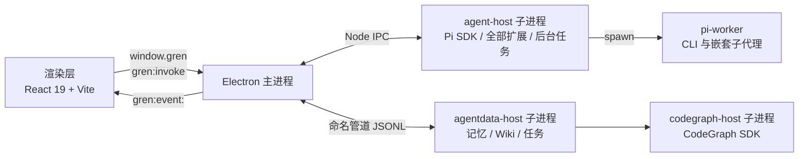

# GrenAgent

本地优先的桌面 AI 编码 Agent。基于 Pi 运行时（`@earendil-works/pi-coding-agent`），把对话、工具调用、代码智能、知识库与记忆整合进一个 Electron 桌面应用。Agent 运行在本机的子进程里，会话、记忆和索引都落在本地。

> 桌面端是 Electron（`electron-agent/`）。早期的 Tauri 版（`tauri-agent/`）已封存，快照见 git 标签 `archive/tauri-agent`，旧的 Tauri 仓库在本地以 `old-tauri` 远端保留。

## 特性

- **多会话与项目管理** — 按项目分组的侧栏，支持置顶、重命名、归档、分区折叠和右键菜单；同一仓库可开独立工作区（git worktree）并回传。
- **流式对话** — 工具卡片、Mermaid / KaTeX 渲染、Plan / Questions / Answer 卡片、子代理内联视图，长对话虚拟化并自动贴底。
- **本地 CodeGraph** — 内置 CodeGraph SDK 提供符号检索、调用关系与影响分析。已建索引的工作区由文件监听自动增量同步，结果分页并虚拟化展示。
- **Git 集成** — 改动 diff、分支切换、提交图谱，与工作区上下文一体。
- **多供应商** — 多模型供应商配置、模型同步与拖动排序，支持分段计价；每个模型可单独测活，生图、TTS 等能力可分别选源。
- **MCP 扩展** — 连接外部 MCP server，工具以 `mcp__<server>__<tool>` 暴露给 Agent，面板内测试连接，权限与调用有审计。
- **本机 Skills** — Skill 保持原生目录管理，与 Agent Data 模块的生命周期解耦。
- **安全与审批** — 三档审批策略（ask / auto / full）、路径保护、危险命令拦截；bash 在 OS 沙箱里运行，被拒后可在同一次调用里申请升权并经你批准。
- **后台任务** — bash 可转后台继续跑，输出实时回流到工具卡片，可单独停止；名下有存活任务的会话被切走时不会被回收。
- **Goal 目标驱动** — 给会话设一个完成条件，Agent 自动续跑，直到自己报告完成或受阻。
- **子代理** — 把任务委派给子代理，支持并行、转后台，详情页可回看完整的工具调用流。
- **命令与规则** — 带 `{参数}` 的提示词模板可在输入框里变成参数胶囊；规则文件按全局 / 项目范围追加进系统提示。
- **本地长期记忆与 Wiki** — L0-L3 分层记忆按工作区隔离；Markdown 知识库用 FTS5 检索，数据在本机 SQLite。
- **文件浏览器** — Dock 里的项目文件树，Markdown 预览与 CodeMirror 编辑，外部改动自动同步。
- **用量统计** — 用量账本按天、模型、会话聚合 Token 与费用，回退或删除会话后用量仍保留。
- **终端 Dock** — 终端标签容器，子代理会话独立成标签。
- **视觉设计面板** — Agent 可以展示 HTML 方案让你点选，再把选择回传。
- **后台完成提醒** — 后台会话完成、失败或等待批准时给出应用内提示和任务栏计数。
- **IM 接入** — 微信 ilink bot 与 HTTP 网关源码仍在仓库，当前稳定版不加载。接回见 [IM 功能：暂缓与后期接入](./docs/im-reintroduction.md)。

## 架构



渲染层只通过 `window.gren` 与主进程通信：请求走单一通道 `gren:invoke`，流式事件用 `gren:event:` 前缀广播。Pi SDK 跑在 `agent-host` 子进程里，所有工作区共用；记忆、Wiki、任务审计和代码索引由 `agentdata-host` 与 `codegraph-host` 独立承载，数据落在本机 SQLite。主进程自己只做窗口、IPC 路由、模型短调用和各类服务。业务代码统一走 `src/platform/runtime.ts` 的后端抽象，不直接依赖 Electron。详见 [架构文档](./docs/architecture.md)。

| 目录 | 包名 | 职责 |
| --- | --- | --- |
| `electron-agent/` | `electron-agent` | 桌面应用：React 渲染层、Electron 主进程与服务层、Agent Data Runtime、打包配置与 UI 自动化检查（`ui-harness/`） |
| `extensions/` | `pi-extensions-pack` | 内置扩展集合，由 `extensions/index.ts` 的 `allExtensions` 汇总，打进 agent-host 与 worker |
| `cli/` | `grenagent-agent-sidecar` | 内嵌 SDK 装配与 `pi-worker` 入口，由 electron-vite 打进主进程产物，不产出独立可执行文件 |

## 快速开始

### 环境要求

- Node.js >= 22.19
- pnpm
- Windows 是主要开发与验证平台（OS 沙箱和进程树守卫有 Windows 专用 helper）；打包配置同时包含 macOS（dmg）和 Linux（AppImage）。

### 安装与启动

`electron-agent/`、`extensions/`、`cli/` 各自维护依赖，三处都要装：

```bash
pnpm install                      # 仓库根，仅笔记校验脚本用
cd extensions && pnpm install && cd ..
cd cli && pnpm install && cd ..
cd electron-agent && pnpm install
```

之后在 `electron-agent/` 下：

```bash
pnpm dev                          # 开发：Vite HMR，启动较慢
pnpm start                        # 日常使用：渲染层生产构建后启动；源码没改时可 pnpm start -- --skipBuild
```

### 测试与构建

```bash
pnpm test                         # vitest run
pnpm build                        # tsc 类型检查 + electron-vite build
pnpm package                      # electron-builder 打包，产物在 release/
pnpm ui:check -- <场景名>          # 真实 Electron 窗口里的 UI 检查，见 AGENTS.md
```

扩展和 cli 各有自己的测试：`extensions/` 下 `npx vitest run <文件>`，`cli/` 下 `npm test`。

## 内置扩展

扩展通过 `pi.registerTool()` 注册工具、`pi.registerCommand()` 注册斜杠命令；纯策略类扩展只挂 hook，没有显式工具。`safety` 排在最前以便最早拦截。实际加载哪些，还要经过 `cli/src/extension-profile.ts` 的过滤。

| 类别 | 扩展 | 说明 |
| --- | --- | --- |
| 安全与策略 | `safety`、`approval`、`sandbox`、`loop-guard`、`rulebook`、`mcp-policy` | 工具拦截、审批策略、OS 沙箱 bash、相同调用提醒、声明式规则、MCP 工具权限 |
| 提示词与规则 | `prompt-commands`、`context-rules`、`header-placeholders`、`fable-behavior` | 参数化命令、规则文件注入系统提示、请求头占位符、行为层提示 |
| 上下文与会话 | `compaction-policy`、`image-limits`、`session-memory`、`auto-title`、`usage-ledger`、`todo`、`present` | 压缩与裁剪、图片限幅、会话工作状态、自动标题、用量记账、待办、产物声明 |
| 任务驱动 | `goal`、`agent-mode`、`multi-agent`、`jobs`、`working-directory` | 目标续跑、Agent / Ask / Debug / Plan 模式、子代理委派、后台任务、工作目录与 worktree |
| 知识与记忆 | `memory`、`wiki-rag` | 分层记忆检索、Wiki 只读检索 |
| 代码智能 | `code-retrieval`、`lsp`、`ast-tools`、`hashline`、`batch-tools`、`code-exec`、`diagnostics`、`after-tool-feedback`、`debug-tools`、`dap` | CodeGraph 检索、LSP、AST 编辑、行号锚点编辑、批量读搜、Python / JS 执行、诊断、改完文件自动回灌诊断、调试日志与 DAP |
| 联网与外部 | `web-fetch`、`web-search`、`mcp`、`resource-manager`、`github` | 页面抓取、联网搜索（Bing / 搜狗 / 百度与 AnySearch）、MCP 桥接、MCP server 与 Skill 管理、GitHub CLI |
| 媒体与界面 | `image-gen`、`tts`、`visual-companion`、`diagram-hint` | 文生图、语音合成、HTML 视觉选项、Mermaid / KaTeX 渲染约定 |
| IM（暂缓） | `im-gateway`、`im-platforms` | 源码保留，不进 `allExtensions` |

完整清单与工具名见 [架构文档 — 内置扩展](./docs/architecture.md#内置扩展)。

## 文档

- [架构文档](./docs/architecture.md)：系统现状事实
- [开发指南](./docs/development.md)
- [Agent Data：记忆与代码索引](./docs/agent-data-memory-code.md)、[Wiki](./docs/agent-data-wiki.md)、[运维](./docs/agent-data-operations.md)
- [Pi SDK 升级清单](./docs/pi-sdk-upgrade-checklist.md)
- [决策笔记](./.agents/notes)：改动背后的取舍和被否决的方案，规则见 [AGENTS.md](./AGENTS.md)

## 目录结构

```
.
├── electron-agent/   # 桌面应用
│   ├── src/          # 渲染层：features / stores / lib / platform / components / theme
│   ├── electron/     # 主进程：app / agent / agentProcess / agentData / agentDataProcess / pi / ipc
│   ├── native/       # Windows 原生 helper 源码（进程树守卫）
│   └── ui-harness/   # UI 自动化检查：场景与断言
├── extensions/       # 内置扩展，由 allExtensions 汇总
├── cli/              # SDK 装配与 pi-worker 入口
├── docs/             # 架构、开发与 Agent Data 文档
├── scripts/          # 仓库级脚本
└── .agents/          # 决策笔记、实跑证据与 skill
```

## 许可证

保留所有权利。本仓库的代码不对外授予使用、复制、修改或再分发的许可，详见 [LICENSE](./LICENSE)。第三方依赖与参考实现各自遵守其许可证，见 [第三方声明](./docs/third-party-notices.md)。

## 友情链接

- [LINUX DO](https://linux.do/) — 新的理想型社区

## 命名说明

产品名为 GrenAgent。底层 Agent 运行时为 Pi（`pi-coding-agent`），由 Electron 的 agent-host 子进程内嵌。内部 CSS 设计变量 `--gren-*` 与若干 localStorage 持久化键属于实现细节，不对外作为品牌。
