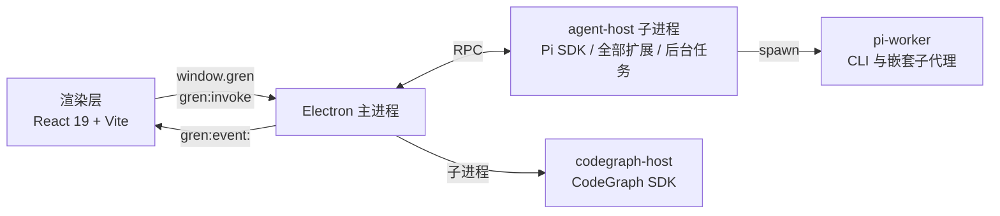

# GrenAgent

本地优先的桌面 AI 编码 Agent。基于 Pi 运行时（`@earendil-works/pi-coding-agent`），把对话、工具调用、代码智能与知识库整合进一个 Electron 桌面应用。Agent 运行在本机的子进程里，会话、知识库和索引都落在本地。

> 桌面端是 Electron（`electron-agent/`）。早期的 Tauri 版（`tauri-agent/`）已封存，快照见 git 标签 `archive/tauri-agent`，旧的 Tauri 仓库在本地以 `old-tauri` 远端保留。

## 特性

对话、代码与知识库都在本机，不依赖云端服务。

**多会话与项目** 侧栏按项目分组，会话可置顶、重命名、归档，分区可折叠；有后台任务、等待批准或已完成未看的会话带状态图标。左下角模块栏切换对话、扩展、用量、Agent 数据与设置。

**对话** 流式输出，工具调用与结果以卡片呈现，Mermaid、KaTeX、diff 就地渲染。长对话虚拟化，右侧小地图跳转，`Ctrl+F` / `Cmd+F` 在会话内查找。计划、提问、答案各有专门卡片；子代理的完整工具流可内联展开。

**工作区面板** 右侧与底部 Dock 停靠终端、内置浏览器、文件树（CodeMirror 编辑）、子代理会话、计划与轮次审查（本轮改了哪些文件、逐块 diff）。标签可拖动重排、跨区拖放，面板可拉伸。

**代码智能** 内置 CodeGraph 做符号检索、调用关系与影响分析，文件监听增量同步。另有 LSP、AST 结构化搜索与编辑、行号锚点编辑、持久的 Python / JS 内核，以及可配置的 tsc / eslint 诊断；改完文件自动回灌诊断结果。

**知识与索引** Markdown 知识库走 FTS5 全文检索；代码索引可搜符号、看调用关系、跳转到真实行号。两者在「Agent 数据」面板统一浏览，长列表分页拉取，源码按行虚拟化。

**长任务** bash 可转后台并实时回流输出，可单独停止；有存活任务的会话被切走时不销毁。Goal 给会话设完成条件后自动续跑，直到报告完成或受阻。子代理可并行、可转后台，Ultra 模式做多代理编排。

**控制面** 审批五档（仅查看 / 请求批准 / 替我审批 / 工作区编辑 / 完全权限）按会话生效；路径保护与危险命令拦截；bash 在 OS 沙箱里跑，被拒后可在同一次调用里申请升权并经你批准。支持 `{参数}` 提示词模板与按全局 / 项目范围生效的规则文件。

**模型** 多供应商配置，每个模型单独测活，各自配思考档位、Fast 模式与分段计价；生图与 TTS 可分别指定供应商。

**扩展** MCP server 桥接（工具以 `mcp__<server>__<tool>` 暴露，面板内可测连接、看工具清单、查审计），本机 Skill 目录即插即用，另有 44 个内置扩展与它们提供的工具集。

**用量** 账本按天、模型、会话聚合 Token 与费用，回退或删除会话后仍然保留。

**通知** 后台会话完成、失败或等待批准时给出应用内提示与任务栏计数。

**IM 接入** 微信 ilink bot 与 HTTP 网关源码在仓库，当前版本不加载。接回见 [IM 功能：暂缓与后期接入](./docs/im-reintroduction.md)。

**独立工作区** 从主仓 `clone` 一份到 `.gren/worktrees/`，与主仓改动互不干扰，完成后可回传。这里刻意不用 `git worktree`：它的元数据在主仓 `.git` 里，把沙箱根设在工作区时提交会被拒。

## 架构



渲染层只通过 `window.gren` 与主进程通信：请求走单一通道 `gren:invoke`，流式事件用 `gren:event:` 前缀广播。Pi SDK 跑在 `agent-host` 子进程里，所有工作区共用；代码索引由主进程持有的 `codegraph-host` 承载。AgentData 运行时与 `agentdata-host` 已下线：运行时改为在主进程内装配，扩展通过一个最小命名管道端点使用代码检索与工具授权。业务代码统一走 `src/platform/runtime.ts` 的后端抽象，不直接依赖 Electron。详见 [架构文档](./docs/architecture.md)。

| 目录 | 包名 | 职责 |
| --- | --- | --- |
| `electron-agent/` | `electron-agent` | 桌面应用：React 渲染层、Electron 主进程与服务层、Agent Data Runtime、打包配置与 UI 自动化检查（`ui-harness/`） |
| `extensions/` | `pi-extensions-pack` | 内置扩展集合，由 `extensions/index.ts` 的 `allExtensions` 汇总，打进 agent-host 与 worker |
| `cli/` | `grenagent-agent-sidecar` | SDK 装配与运行时工厂（`makeGrenRuntimeFactory`），由 `electron-agent` 直接引用编译进去；另带一个可选 `pi-worker` CLI 入口，不随安装包发布 |

## 快速开始

### 环境要求

- Node.js >= 22.19
- pnpm
- Windows 是主要开发与验证平台（OS 沙箱和进程树守卫有 Windows 专用 helper）；打包配置同时包含 macOS（dmg）和 Linux（AppImage）。

### 安装与启动

`electron-agent/`、`extensions/`、`cli/` 各自维护依赖，三处都要装：

```bash
pnpm install                      # 仓库根，仅笔记校验脚本用
cd extensions && pnpm install && cd ..
cd cli && pnpm install && cd ..
cd electron-agent && pnpm install
```

之后在 `electron-agent/` 下：

```bash
pnpm dev                          # 开发：Vite HMR，启动较慢
pnpm start                        # 日常使用：渲染层生产构建后启动；源码没改时可 pnpm start -- --skipBuild
```

### 测试与构建

```bash
pnpm test                         # vitest run
pnpm build                        # tsc 类型检查 + electron-vite build
pnpm package                      # electron-builder 打包，产物在 release/
pnpm ui:check -- <场景名>          # 真实 Electron 窗口里的 UI 检查，见 AGENTS.md
```

扩展和 cli 各有自己的测试：`extensions/` 下 `npx vitest run <文件>`，`cli/` 下 `npm test`。

## 内置扩展

扩展通过 `pi.registerTool()` 注册工具、`pi.registerCommand()` 注册斜杠命令；纯策略类扩展只挂 hook，没有显式工具。`safety` 排在最前以便最早拦截。实际加载哪些，还要经过 `cli/src/extension-profile.ts` 的过滤。

| 类别 | 扩展 | 说明 |
| --- | --- | --- |
| 安全与策略 | `safety`、`approval`、`sandbox`、`loop-guard`、`rulebook`、`mcp-policy` | 工具拦截、审批策略、OS 沙箱 bash、相同调用提醒、声明式规则、MCP 工具权限与审计 |
| 提示词与行为 | `prompt-commands`、`context-rules`、`header-placeholders`、`fable-behavior` | 参数化命令、规则文件注入系统提示、请求头占位符、行为层提示 |
| 上下文与会话 | `compaction-policy`、`image-limits`、`session-memory`、`auto-title`、`usage-ledger`、`todo`、`present` | 压缩与裁剪、图片限幅、会话工作状态、自动标题、用量记账、待办、产物声明 |
| 任务驱动 | `goal`、`agent-mode`、`multi-agent`、`jobs`、`working-directory` | 目标续跑、Agent / Ask / Debug / Plan / Ultra 模式、子代理委派、后台任务、工作目录与独立工作区 |
| 知识库 | `wiki-rag` | Wiki 只读检索 |
| 代码智能 | `code-retrieval`、`lsp`、`ast-tools`、`hashline`、`batch-tools`、`code-exec`、`diagnostics`、`after-tool-feedback`、`debug-tools`、`dap` | CodeGraph 检索、LSP、AST 编辑、行号锚点编辑、批量读搜、Python / JS 常驻内核、诊断、改完文件自动回灌诊断、调试日志与 DAP |
| 联网与外部 | `web-fetch`、`web-search`、`mcp`、`resource-manager`、`github` | 页面抓取、联网搜索（Bing / 搜狗 / 百度与 AnySearch）、MCP 桥接、MCP server 与 Skill 管理、GitHub CLI |
| 媒体与界面 | `image-gen`、`tts`、`visual-companion`、`diagram-hint` | 文生图、语音合成、HTML 视觉选项、Mermaid / KaTeX 渲染约定 |
| 会话行为 | `fast-mode` | 按会话开关 Fast 模式，请求期改写请求体 |
| IM（暂缓） | `im-gateway`、`im-platforms` | 源码保留，不进 `allExtensions` |

`allExtensions` 共 44 个工厂，上表覆盖全部。完整工具名与钩子职责见 [架构文档 — 内置扩展](./docs/architecture.md#内置扩展)。

## 文档

- [架构文档](./docs/architecture.md)：系统现状事实
- [开发指南](./docs/development.md)
- [Agent Data：代码索引](./docs/agent-data-memory-code.md)、[Wiki](./docs/agent-data-wiki.md)、[运维](./docs/agent-data-operations.md)
- [Pi SDK 升级清单](./docs/pi-sdk-upgrade-checklist.md)
- [决策笔记](./.agents/notes)：改动背后的取舍和被否决的方案，规则见 [AGENTS.md](./AGENTS.md)

## 目录结构

```
.
├── electron-agent/   # 桌面应用
│   ├── src/          # 渲染层：features / stores / lib / platform / components / theme
│   ├── electron/     # 主进程：app / agent / agentProcess / agentData / pi / ipc
│   ├── native/       # Windows 原生 helper 源码（进程树守卫）
│   └── ui-harness/   # UI 自动化检查：场景与断言
├── extensions/       # 内置扩展，由 allExtensions 汇总
├── cli/              # SDK 装配与 pi-worker 入口
├── docs/             # 架构、开发与 Agent Data 文档
├── scripts/          # 仓库级脚本
└── .agents/          # 决策笔记、实跑证据与 skill
```

## 许可证

采用 [PolyForm Noncommercial License 1.0.0](./LICENSE)。非商业用途（个人学习、研究实验、爱好项目，以及慈善、教育、公共研究、公共安全与卫生、环保、政府机构的使用）免费，允许修改与分发；商业用途需另行获得书面授权，范围与申请方式见 [商业使用授权](./COMMERCIAL.md)。第三方依赖与参考实现各自遵守其许可证，见 [第三方声明](./docs/third-party-notices.md)。

## 友情链接

- [LINUX DO](https://linux.do/) — 新的理想型社区

## 命名说明

产品名为 GrenAgent。底层 Agent 运行时为 Pi（`pi-coding-agent`），由 Electron 的 agent-host 子进程内嵌。内部 CSS 设计变量 `--gren-*` 与若干 localStorage 持久化键属于实现细节，不对外作为品牌。
