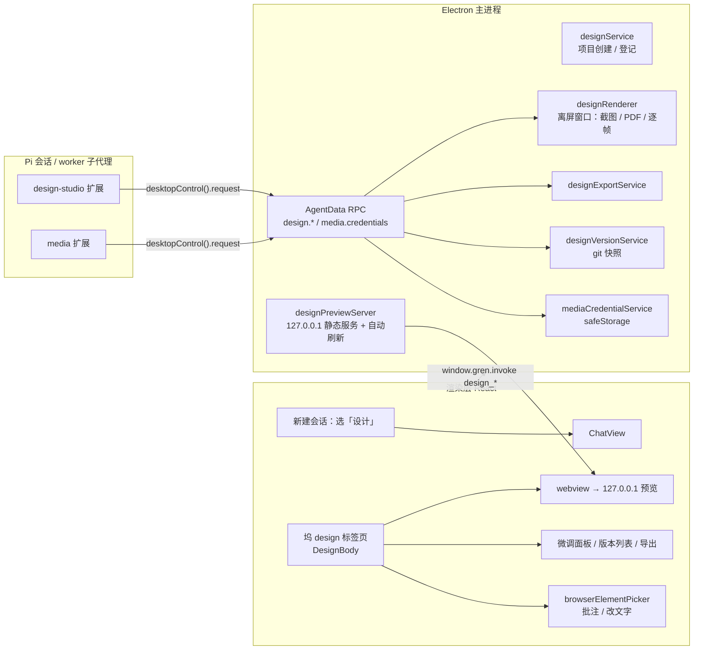

# 设计模式（Design Mode）

- 日期：2026-09-26
- 状态：设计已按节批准（方案 A + D1–D17）；已按 `2026-09-26-design-mode-design-review.md` 的审查意见修订（6 项 P0 + P1 项，修订记录见第 12 节），待拆分 M0–M5 实现计划
- 范围：GrenAgent 桌面端（`electron-agent`）内的「设计」会话；新扩展 `extensions/design-studio`、`extensions/media`；主进程预览、渲染、导出、版本、媒体凭据服务；坞内 `design` 标签页
- 主题：新建会话时可选「设计」。设计会话复用同一窗口、设置、模型配置和 MCP，对齐 open-design 的全部设计能力：六类产出、自检闭环、导出、点选编辑、微调、版本、品牌与设计系统、媒体生成与动效、记忆规则、多角色评审。
- 参考：`docs/architecture.md`、`docs/pi-sdk-upgrade-checklist.md`、`extensions/agent-mode/modes.ts`、`extensions/fable-behavior/README.md`、`electron-agent/src/features/dock/browser/browserElementPicker.ts`；open-design（Apache-2.0）`apps/daemon/src/**`、`apps/web/src/edit-mode/**`、`craft/`、`design-templates/`、`design-systems/`；Pi SDK 0.87.0（仓库实际安装版本；`extensions/package.json` 声明 `^0.87.0`）`extensions/node_modules/@earendil-works/pi-coding-agent/dist/core/agent-session.js`、`dist/core/system-prompt.d.ts`、`dist/core/extensions/types.d.ts`、`dist/core/session-manager.js`
- 不取代：现有五个模式（agent / ask / debug / plan / brainstorm）的语义与存储；`fable-behavior` 的行为注入；`visual-companion` 的 `show_visual`；浏览器 webview 的安全策略（不放开 `file:` / `data:`）

路径约定：仓库路径相对 GrenAgent 仓库根。open-design 路径首次出现时写全（以 `open-design/` 开头）；同一段落或表格内的后续引用、以及第 6 节矩阵「需要移植」列，均相对 `open-design/apps/daemon/src/`，以 `apps/`、`packages/`、`design-templates/`、`design-systems/`、`craft/`、`assets/` 开头的除外（相对 `open-design/` 根）。标「新建」的文件在快照中不存在，其余路径均已在快照中核实。

## 1. 背景与目标

### 1.1 背景

GrenAgent 是三层结构：React 渲染层、Electron 主进程（内嵌 Pi SDK，`AgentHost` 按项目持有 `WorkspaceHandle`）、Agent Data Runtime（`node:sqlite`，经本机 JSONL RPC 给扩展和 worker 子代理提供记忆、任务、CodeGraph、权限等宿主方法）。扩展经 `extensions/index.ts` 聚合，`cli/src/extension-profile.ts` 的 `CORE_ALWAYS_ON` 决定常驻集合。

模式系统在 `extensions/agent-mode/modes.ts`：五个模式按工作目录存 `AGENT_MODE:<cwd>`（`electron-agent/electron/app/settingsService.ts` 的 `agentModeConfigKey`），用工具白名单和 `gateToolCall` 收权。`fable-behavior` 每轮以 `display:false` 消息注入行为片。

与设计相关的现成能力：坞内浏览器 webview（`BrowserBody.tsx`、`ResponsiveBrowserViewport.tsx`、`browserElementPicker.ts`）、`visual-companion` 的 HTML 选择卡、`image-gen` 和 `tts`（OpenAI 兼容单路）、`ask_user`（阻塞、可跨重启恢复）、`present`、`multi-agent` 的 `spawn_agent`、AgentData 记忆（全局 / 项目两种 scope）。缺的是：设计提示与资产、预览源、截图与导出宿主、自检闭环、编辑与微调、版本、品牌与设计系统导入、多服务商媒体生成、动效导出。

open-design 是独立的设计 agent 平台（Apache-2.0），其设计能力就是本规格的对齐目标。

### 1.2 目标

1. 新建会话时可选「设计」。设计会话与普通会话同窗口，共享设置、模型配置、MCP；坞内多一个 `design` 预览标签页。
2. 支持六类产出：网页 / 落地页、移动 App 原型、幻灯片、仪表盘 / 后台、海报 / 社交图、自家产品（含本 harness）改版。
3. 对齐 open-design 的设计能力（第 6 节 38 行矩阵中标为「做」的行），分 M0–M5 六个里程碑交付，每个里程碑可独立验收。
4. 质量闭环不依赖模型自觉：写 HTML 后自动检查并回灌，收尾自动截图对照清单，严重问题退回重做。
5. 所有 Electron 能力（截图、导出、凭据）经 Agent Data RPC 由主进程提供，worker 里的子代理走同一路径。

## 2. 非目标

1. open-design 的平台型能力一律不做（D17，以后单独立项）：部署（Cloudflare Pages，`open-design/apps/daemon/src/deploy.ts`）、live artifacts、自动化 / routines、协作（collab）。
2. harness 已有对应物的 open-design 模块不移植：插件市场（用 Pi Package）、27 个 runtime adapter（用 Pi ModelRuntime）、genui（用 `ask_user` / `visual-companion`）、orbit / pets、Langfuse 遥测。
3. 不移植 `open-design/apps/daemon/src/prompts/official-system.ts`（自述改编自 claude.ai/design，无许可覆盖），也不复制 `core-slim.ts` 原文。
4. 设计会话不修改产品源码（D15）。改版稿只写进设计项目目录，实现交给普通编码会话。
5. PPTX 不做可编辑文字版，只做每页一图。
6. 不改动 Pi 的 `auth.json` 明文存储（列为后续建议，见第 11 节）。
7. 不引入 headless Chromium（playwright / puppeteer）；渲染全部用 Electron 离屏窗口。
8. 不改变现有五个模式的存储键和行为。
9. MP4 逐帧导出只保证 WAAPI（`element.getAnimations()`）与 CSS 动画；`requestAnimationFrame` 驱动的 JS 动画、`<video>` 播放、canvas / WebGL 绘制不在保证范围内，导出面板须注明（见 5.5）。
10. 不做跨会话交付的产品侧入口：定稿后由用户自行在产品仓库新开编码会话，并引用 `handoff/IMPLEMENT.md`（见 5.4）。

## 3. 已确认的设计决定

| # | 决定 | 结论 |
|---|---|---|
| 方案 | 集成形态 | 方案 A：作为现有应用内的会话类型。新建会话时选「设计」，共享窗口、设置、模型配置、MCP；预览是新增坞标签页 |
| D1 | 设计标记的作用域 | 按会话存：会话元数据 `design: true`（custom entry `design-session`）。其余五个模式仍按 cwd 存 `AGENT_MODE:<cwd>` |
| D2 | 实现形态 | 新扩展 `extensions/design-studio`（登记 `CORE_ALWAYS_ON`），读会话标记后启用设计工具、注入提示、按设计白名单收掉 `bash` 等。`design` 不加入按 cwd 存的 `AgentMode` 枚举；白名单常量 `DESIGN_TOOLS` 放在 `modes.ts` 与其它模式并列，并新增判定函数 `activeDesignToolsFor(allTools: readonly string[]): string[]`（`activeToolsFor` 的入参是 `AgentMode`，design 不在该枚举内，不能直接复用；沿用其「取交集、交集为空时回退白名单本身」的语义）。MCP 工具按前缀放行，但设计会话默认不启用 MCP（新增设置项，默认关）：filesystem / shell 类 MCP 能读写任意文件与执行命令，会绕过白名单的收权意图；用户显式打开即视为授权 |
| D3 | 设计提示注入 | `before_agent_start` 写 `event.systemPromptOptions.sections`。不用 fable-behavior 那种每轮 `display:false` 消息（会在会话里累积），不用 `systemPrompt` 整体替换（会丢 Pi 拼装的工具清单）。注意 Pi 会把除 `preamble` 外的每个 section 键包成同名 XML 标签（`dist/core/system-prompt.d.ts:45-49`），本规格的四个键 `design_*` 因此会被包成 `<design_charter>` 等。内容不做额外转义，但测试须断言渲染后的 system prompt 中 `</design_system>` 只出现一次（见第 9 节） |
| D4 | 预览形态 | 主进程起只监听 `127.0.0.1` 的静态服务；坞新增 `design` 标签页，内嵌 webview 指向该服务；写文件自动刷新。不放开 `file:` / `data:`。**预览 webview 的隔离**（补充，原规格遗漏）：`electron/browser/webviewPolicy.ts` 的 `applyWillAttachPolicy` 会强制给每个 webview 注入应用 preload（含 `window.gren` 桥），而设计预览加载的是模型写的、可能抓取自第三方站点的 HTML。因此设计预览走独立路径：独立 `partition`（`design-preview-<projectId>`，不持久化）、**不注入应用 preload**，拾取与批注改由渲染层经 `executeJavaScript` 注入脚本（见 5.3）。静态路由与 SSE 端点 `/__design/events/<token>` 都校验 token。预览 URL 不持久化：重启后 token 与端口可能变化，标签页每次挂载重新调用 `design_preview_info` |
| D5 | 截图通道 | `render_screenshot` 经 Agent Data RPC 调主进程 `design.render`，离屏 `BrowserWindow` 按视口截图，图片作为内容块返回；worker 子代理同路径 |
| D6 | 资产存放 | 核心小套模板 / 版式 / 设计系统随应用打包；完整模板（约 110 个）和设计系统包（约 150 个）做成可选 Pi Package；用户自建资产放 `~/.pi/agent/design/`。真实品牌名改中性命名或只留 token |
| D7 | 资产暴露方式 | 自有工具 `design_catalog` 检索与读取，只在设计会话启用；不注册为 Pi skills |
| D8 | 需求澄清表单 | 扩展现有 `ask_user`：新增单选、多选、颜色、文件四种字段；回传格式与持久化 / 恢复链路不变。**类型变更**（补充）：`extensions/agent-mode/questions.ts:9-18` 的 `QuestionSpec.options` 与 `allowMultiple` 当前都是**必填**，须改为可选，否则 color / file 两种无选项字段无法表达。`field` 的类型为联合：`{ type: "single" \| "multi", options }` \| `{ type: "color", default? }` \| `{ type: "file", accept? }`。旧草稿缺 `field` 时按现有行为渲染（向后兼容）；`file` 字段的草稿只保存回传的相对路径，恢复时按路径还原缩略信息，不保存文件内容 |
| D9 | 媒体生成与密钥 | 新扩展 `extensions/media`，移植 `media/models.ts` 与 `media-adapters`，每家一个适配器，统一 `submit` / `poll` / `fetchResult`。已在模型设置里的服务商直接复用；仅媒体用的密钥存 `media-credentials.json`，`safeStorage` 加密，worker 调用时经 RPC 向主进程取。**素材落盘分流**（补充）：设计会话写设计项目 `assets/<kind>/<时间>-<短 id>.<ext>`；其它会话沿用现有 `<cwd>/.pi/images/`（`extensions/image-gen/index.ts:75`），避免回归 |
| D10 | 导出 | RPC `design.export` + 离屏窗口。HTML 单文件内联资源；PDF 用 `printToPDF`；PPTX 每页一图（文字不可编辑，界面注明）；PNG 用 `capturePage`；MP4 在 M4，ffmpeg 首次导出时下载并校验哈希 |
| D11 | 点选编辑 / 批注 | 复用 `browserElementPicker.ts`；关键元素带 `data-od-id`；直接改文字经移植的 `source-patches.ts` 写回，不经模型；批注作为消息发给 agent |
| D12 | 多角色评审 | `spawn_agent` 开设计总监、可用性、品牌一致性、无障碍四个子代理；默认关闭，手动触发或设置开「定稿前自动评审」 |
| D13 | 记忆规则 | 设计偏好存为 AgentData 记忆规则，分全局 / 项目；agent 总结的新规则须用户确认才写入；收尾做记忆核对 |
| D14 | 项目存储与版本 | 设计项目目录 `~/.pi/agent/designs/<slug>/`，目录内 git 自动快照；每轮一次提交，恢复 = 旧版本作为新提交。**git 不可用降级**（补充，原规格遗漏）：`electron/app/gitService.ts` 用 `execFile('git', …)` 调用系统 git，仓库未内置。创建项目前检测 git 可用性；不可用时降级为**文件系统快照**（每次提交 = 把工作树复制到 `.design/snapshots/<ts>/`，恢复 = 复制回来），版本抽屉标注「文件系统快照模式（未安装 git）」，版本列表 / 预览 / 恢复在两种模式下行为一致 |
| D15 | 自家产品改版 | 产品仓库只读挂入设计项目，CodeGraph 定位页面组件；本 harness 从 `src/theme/tokens.ts`、`colorSchemes.ts`、`--gren-*` 变量提取现有 DESIGN.md；改版稿画在设计项目目录，定稿后由普通编码会话实现 |
| D16 | 自检闭环归属 | `design-studio` 拥有 lint 与完成钩子：`tool_result` 回灌（沿用 `after-tool-feedback` 的回灌写法），`agent_before_settle` 完成钩子，严重问题最多退回 3 次 |
| D17 | 范围 | 只对齐 open-design 的设计能力；部署、live artifacts、自动化、协作不做 |

## 4. 架构

### 4.1 总览



### 4.2 设计会话的生命周期

1. 用户在新建会话入口选「设计」，填标题（可空）。渲染层调用 `design_create_project`。
2. 主进程 `designService.createProject(title)`：生成 slug、建目录、`git init`、写 `.design/project.json` 和 `.gitignore`、首个提交、登记为项目（复用 `WorkspaceService.ensureWorkspace`），返回 `cwd`。
3. 渲染层打开该 workspace 并新建会话；**在会话可接受用户输入之前**调用 `design_mark_session`（与新建会话同一个流程内 await，不可「随后」异步发起），主进程对该会话的 `sessionManager.appendCustomEntry("design-session", { design: true, projectId })`（先例：`piRuntimeService.ts:604` 的 `setSessionName`）。Pi 在第一条助手消息前把条目留在内存、首条回复时一并落盘（`session-manager.js:785-813` 的 `_persist`：无 assistant 消息时不写盘，只进 `fileEntries`），因此标记从第一轮就可读。
   - **竞态约束**：若标记在第一条消息之后才写入，`before_agent_start` 读不到，第一轮会按错误处理表最后一行静默降级为普通会话。实现必须保证写入先于输入可用；写入失败视为创建失败并报错，不静默降级（旧会话缺失才静默降级）。
   - **幂等**：写入前先查是否已有 `design-session` 条目，存在则跳过；`session_start` 再兜底去重（取第一条）。`appendCustomEntry` 每次调用都会追加一条并前移 `leafId`（`session-manager.js:901-912`），重试 / 多窗口 / 会话重开不得产生第二条。
4. 每轮 `before_agent_start`：`design-studio` 从 `ctx.sessionManager` 读 `design-session` 条目，确认后注入提示 sections、设置设计白名单。
5. 模型写 HTML → `tool_result` 自动检查并回灌 → 预览自动刷新 → 收尾 `agent_before_settle` 截图对照清单 → 通过后 `agent_settled` 触发 git 快照。

**标记相关的边界情形。**（原规格未定义，补充）

| 情形 | 行为 |
|---|---|
| 会话 fork / 会话树导航到旧节点 | fork 点之前的 `design-session` 条目被继承，之后的不会。导航到标记之前的节点时该轮按普通会话运行，且不改写标记 |
| 设计会话切换 workspace | 标记按会话保留，但 `tool_call` 的路径拦截把写入限制在原设计项目目录 → 提示「当前为设计会话，仅可写入 <项目目录>」，并引导切回 |
| 普通会话打开设计项目目录 | 不特殊处理（拿到完整工具集）。设计项目的 `.git` 由宿主维护，其一致性不依赖此保证 |
| `design-session` 条目重复 | 取第一条，其余忽略（见上文幂等） |

### 4.3 设计项目目录

```
~/.pi/agent/designs/<slug>/
  .design/project.json         项目元数据：id、slug、title、createdAt、outputKinds、artifacts（产出注册表）、designSystem、sources（只读挂入的产品仓库）
  .design/assets-manifest.json 超过 20MB 不进 git 的素材清单（路径、大小、sha256、来源）
  .design/media-tasks.json     进行中的媒体任务（taskId、服务商、提交时间），供重启后续查
  .design/snapshots/<ts>/      git 不可用时的文件系统快照（降级模式，见 D14）
  .gitignore                   忽略 exports/、.design/cache/、.design/snapshots/ 与清单中的大文件
  artifacts/                   产出 HTML（每个产出一个文件或子目录）
  assets/                      生成或导入的素材
  brand/                       品牌 token（extract_brand 确认后写入）
  design-system/tokens.json    统一格式的当前设计系统 token
  DESIGN.md                    定稿说明
  handoff/                     交付包（含 IMPLEMENT.md）
  exports/                     导出结果（不进 git）
```

slug 由标题转成小写短横线形式，重名追加 `-2`、`-3`；标题为空时用 `design-<yyyymmdd-hhmm>`。

**`outputKinds` 枚举**（原规格只零散出现五类，此处定死取值与默认视口）：

| id | 中文名 | 默认视口 | craft 映射（在 5.2 基础上） | 里程碑 |
|---|---|---|---|---|
| `web` | 网页 / 落地页 | desktop | `typography`、`color`、`anti-ai-slop`、`laws-of-ux` | M1 |
| `mobile` | 移动 App 原型 | mobile（加设备框） | 网页项 + `state-coverage`、`form-validation` | M1 |
| `dashboard` | 仪表盘 / 后台 | desktop | `typography-hierarchy`、`state-coverage` | M1 |
| `deck` | 幻灯片 | deck（按 deck framework 页边界） | `typography-hierarchy-editorial` + deck framework | M1 |
| `poster` | 海报 / 社交图 | poster | `typography`、`color` | M1 |
| `redesign` | 自家产品改版 | desktop | 网页项 + `cjk-typography`（若为中文界面） | M3 |

所有类型都叠加 `accessibility-baseline`；界面含中文时叠加 `cjk-typography`（中文排版：行高、标点挤压、中西文混排间距、字体回退、避免日文字形）。首轮未知时只加 `anti-ai-slop` 与 `accessibility-baseline`，`ask_user` 澄清后写回 `outputKinds`。`outputKinds` 为数组；多值时 craft 映射取**并集**，默认视口取首个值对应的视口。

**产出注册表。** `artifacts/` 下的文件不靠扫目录发现，统一登记在 `.design/project.json` 的 `artifacts: Array<{ id, path, kind, updatedAt }>`：

- `design-studio` 在 `tool_result`（`write` / `edit` 命中 `.html` / `.htm`，见 5.2）时创建或更新条目，`id` 取文件相对路径的 slug；
- 完成钩子的截图对象、预览的产出切换、导出菜单、版本抽屉一律读这张表，而不是扫目录 mtime；
- 多个产出时预览默认打开 `updatedAt` 最大的一个，用户切换后按会话记住选择；
- 文件被删除时标记条目为 `deleted`，不从数组移除（保留历史引用，供版本对比）。

**大文件入库顺序**（原规格只说写 `.gitignore`，此处定死）。git 不会因 `.gitignore` 变更而把已跟踪文件移出索引，顺序错了大文件就进了历史：

1. 写入素材文件；
2. 立即更新 `.gitignore` 与 `.design/assets-manifest.json`；
3. 若该路径已被 git 跟踪，执行 `git rm --cached <path>`；
4. 之后才允许下一次提交。

## 5. 分节设计

### 5.1 核心架构（M0）

**会话标记。** `design-session` 条目只写一次、不可切换。设计会话里 `ModeAction` 不显示模式下拉，改为固定的「设计」标签；该会话 cwd 的 `AGENT_MODE:<cwd>` 保持 `agent`，因此 `agent-mode` 的 `gateToolCall` 不收权，白名单完全由 `design-studio` 负责。侧栏 `Sidebar.tsx` 给设计项目加图标。

**提示注入。** `design-studio` 在 `before_agent_start` 写 `event.systemPromptOptions.sections` 的四个键：`design_charter`、`design_discovery`、`design_craft`、`design_system`（内容见 5.2）。Pi 对 sections 做差异追加，内容不变时不重复进会话，prompt cache 稳定。非设计会话不写任何 section。M0 只写 `design_charter`（骨架版），其余三个键在 M1 加入。

**工具白名单。** `modes.ts` 新增导出 `DESIGN_TOOLS`，与 `ASK_TOOLS`、`PLAN_TOOLS` 并列：

- 允许：`read`、`write`、`edit`、`grep`、`find`、`ls`、`ask_user`、`present`、`todo`；联网检索 `fetch_url`、`fetch_llms`、`fetch_html`、`fetch_markdown`、`fetch_txt`、`fetch_json`、`fetch_web_content`、`fetch_github_readme`、`web_search`、`web_search_multi`、`search`；记忆检索 `memory_search`、`conversation_search`；`show_visual`、`read_visual_choice`；`spawn_agent`（M5 评审用）；设计工具 `render_screenshot`、`design_catalog`、`lint_artifact`、`export_artifact`、`extract_brand`、`import_design_system`、`finalize_design`、`product_source`；媒体工具 `generate_image`、`generate_video`、`generate_audio`；全部 `mcp__<server>__<tool>` 工具（按前缀放行，仍受 `mcp-policy` 约束，但设计会话默认不启用 MCP，见 D2）。各工具在所属里程碑交付后才实际存在，白名单与当前全量工具取交集（沿用 `activeToolsFor` 的做法，经 `activeDesignToolsFor`）。
- 白名单外的工具一律不启用，典型如：`bash`、`bash_escalate`、`py_run` / `js_run`、`lsp_*`、`dap_*`、`ast_grep` / `ast_edit`、`hl_read` / `hl_edit`、`github`、`speak`、`code_*`（挂入仓库改由 `product_source` 访问）。

`design-studio` 在 `before_agent_start` 用 `pi.setActiveTools` 应用白名单，并在 `tool_call` 里二次拦截：白名单外的工具返回阻断说明；`write` / `edit` 的目标必须在设计项目目录内；`read` / `grep` / `find` / `ls` 允许设计项目目录与 `sources` 里的只读路径。非设计会话里，`design-studio` 把设计专属工具从 active 集合移除，`tool_call` 也拦截它们。`design-studio` 在 `extensions/index.ts` 中排在 `agent-mode` 之后注册，保证其 `setActiveTools` 后执行。

**预览服务。** `designPreviewServer` 只绑定 `127.0.0.1`，默认端口 `47651`，占用时改用系统分配的随机端口。路由 `/p/<token>/<相对路径>`，`token` 为每个项目打开时生成的随机串（作用域为项目 + 本次应用生命周期，重启后重新生成），映射到项目目录；拒绝路径穿越与目录外符号链接。静态路由与 SSE 端点 `/__design/events/<token>` **都校验 token**（原规格只说了路由带 token）。对 `text/html` 响应注入一段自动刷新脚本，服务端用 `fs.watch` 监听项目目录，文件变化 200ms 去抖后推送刷新。带查询参数 `?static=1` 时不注入，供截图与导出使用。`electron/browser/webviewPolicy.ts:1-13` 已放行 `http:`，无需修改；但该文件的 `applyWillAttachPolicy`（`:24-43`）会强制注入应用 preload，因此设计预览 webview 走独立挂载路径（独立 partition、不注入应用 preload），不复用 `BrowserBody` 的 preload 通道，仅复用其 webview 挂载与崩溃重建、视口切换的逻辑。预览 URL 不持久化，标签页每次挂载重新调用 `design_preview_info`。

**坞标签页。** `dockStore.ts` 的 `DockTabKind` 新增 `design`；`TabBodyRenderer.tsx` 渲染 `DesignBody`。`DesignBody` 内嵌 webview（复用 `BrowserBody` 的 webview 挂载与崩溃重建、`ResponsiveBrowserViewport` 的视口切换），顶部是产出切换（列 `artifacts/` 下的 HTML）与视口预设（桌面 1440×900、平板 834×1112、手机 390×844，移动产出加设备框）。`design` 与 `browser` 一样按会话存在（加入 `isSessionOnlyDockKind`），设计会话激活时自动打开。

**截图工具 `render_screenshot`。** 参数与返回见 5.7。扩展经 `desktopControl().request('design.render', …)` 调主进程；`designRenderer` 用离屏窗口（`show:false`、`offscreen:true`、`sandbox:true`、`contextIsolation:true`、`nodeIntegration:false`）加载 `?static=1` 的预览地址，等 `did-finish-load`、`document.fonts.ready`（超时 2s，不阻塞）与 `waitMs` 后 `capturePage`，同时收集页面 `console` 错误。返回 PNG 内容块（长边超过 2000px 时等比缩到 2000px）、一行文字摘要，以及 `details`（见 5.7）。离屏窗口池上限 2，超出排队；**导出与 MP4 逐帧使用独立窗口实例，不占池中额度**（见 5.3）。worker 里的子代理用同一 RPC。

**项目目录与快照（D14）。** 目录结构见 4.3。`designService` 创建项目时 `git init` 并做首个提交；每轮结束由 `design-studio` 经 RPC `design.snapshot` 请求 `designVersionService` 自动提交一次（规则见 5.3「版本」）。模型不能执行 `git`（`bash` 不在白名单），快照只由宿主完成。

**测试（M0）。** 扩展单测覆盖标记读取、sections 注入、白名单与路径拦截；主进程 vitest 覆盖静态服务（绑定地址、端口回退、路径穿越、刷新注入）、`design.render` / `design.snapshot` 的 RPC 注册与参数校验、自动快照；截图链路先用 mock 窗口（`vi.mock('electron')`）测超时与错误路径。

**错误处理。**

| 情况 | 处理 |
|---|---|
| 默认端口被占 | 改用随机端口，`design_preview_info` 返回实际地址 |
| 截图超过 10 秒 | 销毁该离屏窗口，工具返回文字错误「[design] 截图超时（10s）」，不返回图片 |
| 页面加载失败（404、脚本崩溃） | 返回文字错误与控制台前 5 条 |
| **系统无 git（创建项目时检测到）** | 不阻断创建：降级为文件系统快照模式（D14），`ctx.ui.notify` 提示「未检测到 git，本项目改用文件系统快照」；版本抽屉标注模式。**阻断**仅发生在两种模式都无法初始化时（如目录不可写），此时创建失败并报错 |
| **标记写入前用户已发消息** | 不应发生（4.2 第 3 步的时序约束）。一旦发生，本轮按普通模式运行并明确提示「设计标记尚未写入，本轮按普通模式运行」，不静默降级 |
| 提示或资产加载失败 | 本轮不注入设计 sections、不改白名单，按普通 agent 模式运行；`ctx.ui.notify` 提示「设计资源加载失败，本轮按普通模式运行」并写日志 |
| `design-session` 条目缺失（旧会话） | 视为普通会话（静默，无提示） |

### 5.2 提示、资产、自检闭环（M1）

**提示四层。** 均由 `extensions/design-studio/prompt.ts` 拼装，写入 5.1 列出的 sections。

1. `design_charter`：核心守则，自写（新建 `charter/core.md`）。内容：设计会话的工作流（澄清 → 定方向 → 构建 → 自检 → 交付）、文件落点约定、工具使用约定（`render_screenshot` 自看、`design_catalog` 查资产、`ask_user` 澄清）、`data-od-id` 与 EDITMODE 标记约定、禁止事项。不复制 `official-system.ts` 与 `core-slim.ts` 原文。
2. `design_discovery`：移植 `open-design/apps/daemon/src/prompts/discovery.ts` 与 `directions.ts`（Apache-2.0），渲染成 `charter/discovery.md` 与 `catalog/directions.json`，文件头保留原署名与修改说明。原文中 `$OD_BIN` 等 open-design 专有命令改写为本 harness 的工具名。
3. `design_craft`：`open-design/craft/*.md` 按产出类型选择加载。映射表放 `prompt.ts`，取值见 4.3 的 `outputKinds` 枚举表（多值取并集）：网页 / 落地页 → `typography`、`color`、`anti-ai-slop`、`laws-of-ux`；移动 → 再加 `state-coverage`、`form-validation`；仪表盘 → `typography-hierarchy`、`state-coverage`；幻灯片 → `typography-hierarchy-editorial`；海报 → `typography`、`color`；所有类型都加 `accessibility-baseline`；**界面含中文时加 `cjk-typography`**（自写，不来自 open-design：中文行高、标点挤压、中西文混排间距、字体回退、避免日文字形——海报 / 社交图多为中文，原映射表全是英文语境规则）。产出类型取自 `.design/project.json` 的 `outputKinds`，首轮未知时只加 `anti-ai-slop` 与 `accessibility-baseline`，在 `ask_user` 澄清后写回 `outputKinds`。幻灯片额外加入 deck framework（移植 `open-design/packages/contracts/src/prompts/deck-framework.ts`）。
4. `design_system`：当前设计系统 token，读 `design-system/tokens.json`（M3 之前由 `design_catalog` 选中的内置设计系统生成）。只放 token 与简短用法，组件清单等大文件只给路径，由模型按需 `read`。

提示长度上限：四层合计不超过 24,000 token（按 `chars / 4` 估算），测试断言（见第 9 节）。

**资产（D6、D7）。**

- 随应用打包（`extensions/design-studio/assets/`）：每类产出 2–3 个模板（`web-prototype`、`mobile-app`、`dashboard`、`simple-deck`、`image-poster`、`social-carousel` 等）、`assets/frames/*` 设备框、8 个中性命名的设计系统、全部 `craft/*.md`、`directions.json`。经 `electron-agent/electron/agent/copyPiAdjacentAssets.ts` 复制到 `out/main` 与 `out/main/chunks`。
- 可选 Pi Package `gren-design-assets`：完整模板（快照实测 114 个）与设计系统包（快照实测 152 个），走现有 `PiPackageService` 安装到 Pi 包目录，`design_catalog` 自动发现。
- 用户自建：`~/.pi/agent/design/{templates,systems}/`。
- 品牌名处理：打包与 Pi Package 中的设计系统目录名、标题、说明里的真实品牌名替换为中性名（例如 `linear-app` → `precise-dark-saas`），`DESIGN.md` 与 `tokens.css` 中的品牌字样与 logo 引用删除，只保留 token 与用法。映射表由移植脚本生成并随包提供（`assets/systems/RENAMES.json`）。
- `design_catalog` 工具：`action: "search" | "read"`；`kind: "template" | "system" | "direction" | "craft" | "frame"`。`search` 按关键词和产出类型返回至多 20 条，每条为 id、名称、一句话描述、来源（bundled / package / user）。`read` **统一返回结构**（原规格只说「正文或文件列表」，此处定死，避免大模板撑爆上下文）：`{ id, kind, source, files: [{ path, size }], content? }`——正文（含所有文件拼接）超过 8 KB 时省略 `content`，只给 `files` 与路径，让模型按需 `read`。三处来源同名时优先级为 user > package > bundled。完整参数与 `details` 见 5.7。

**需求澄清表单（D8）。** `ask_user` 的每个问题新增可选 `field`：`{ type: "single" | "multi", options }`（沿用现有 `options` / `allowMultiple` 语义）、`{ type: "color", default? }`（取色器，回传 `#rrggbb`）、`{ type: "file", accept? }`（选本地文件，主进程复制到设计项目 `assets/uploads/` 后回传相对路径）。未带 `field` 的问题行为不变；回传仍为现有的 `[我的选择]` 文本格式，持久化与跨重启恢复走现有 `askUserDraft` / `completeAskUser` 链路。渲染在 `InlineQuestionCard.tsx` 与 `QuestionsCard.tsx`。

**自检闭环（D16）。** 由 `extensions/design-studio/hooks.ts` 实现，只在设计会话生效。

1. `tool_result`：`write` / `edit` 的目标命中产出文件时依次运行。**命中规则**（原规格只匹配 `.html`，过窄）：`.html` / `.htm`；产出同名的外部 `.css` / `.js` 变更时只运行第三项语法检查（模型会把样式与脚本拆成外部文件，此时 lint 完全不触发，而 standalone 导出又要内联它们）。命中 `.html` / `.htm` 时同时维护产出注册表（4.3）。三项检查为：
   - `lint-artifact`（移植 `open-design/apps/daemon/src/lint-artifact.ts`），输出 P0 / P1 / P2 级别问题；
   - 占位内容检查（移植 `artifacts/stub-guard.ts`）：lorem ipsum、`TODO`、空图片、占位链接等；
   - 产出格式检查（移植 `artifacts/deliverable-syntax.ts`、`deliverable-syntax-safe-fix.ts`、`publication-guard.ts`）：HTML / 内联脚本语法错误，可安全修复的直接修复并写回文件，其余列为问题。

   自动检查的结果按 `after-tool-feedback` 的写法（复用 `extensions/after-tool-feedback/render.ts` 的 `patchContent`）追加到该次工具结果文本末尾，模型下一步即可看到并修改。open-design 计算了这些结果却没有回传给模型，这里补上。单次回灌最多列 20 条，超出给计数。模型也可以用 `lint_artifact` 工具（参数 `path`）主动对任一 HTML 运行同一组检查，返回同样格式的问题列表。
2. `agent_before_settle`（完成钩子）：对本轮**产出注册表中被写过**的每个 HTML 产出截图（按产出类型的默认视口），连同自检清单经 `BoundaryResult.entries` 追加一条 `display:false` 的 `custom_message`（`SessionBoundaryDraft` 要求 `type: "custom_message"`、`customType`、`content`、`display`）交模型对照；存在 P0、占位内容、页面自身脚本错误或产出类型要求不满足时同时返回 `continue: true` 退回修改。同一轮最多退回 3 次，第 3 次仍不通过时放行，并在聊天中显示未解决问题列表。

   - **截图总量上限**：`agent_before_settle` 是阻塞的，且离屏窗口池上限 2。一轮最多对 3 个产出截图（取 `updatedAt` 最大的 3 个），超出部分只在清单里标注「未截图」，避免最坏 15 次串行截图。
   - **控制台错误的分类**（原规格未区分，会导致必然误报）：只把**页面自身脚本错误**（来自页面内联 / 同源脚本）计入退回条件；第三方 CDN、字体、图片等**资源加载失败**（网络类）降级为 P2 提示，不触发退回——离线环境下外链资源必然报错，否则每轮都会退回 3 次后放行。
   - 自检清单：P0 问题为零；无占位内容；页面自身脚本无错误；产出类型要求：移动产出在手机视口内无横向滚动、幻灯片每页内容不超出页边界、海报尺寸与 `.design/project.json` 声明一致。

### 5.3 导出、编辑、微调、版本（M2）

**导出（D10）。** 主进程 RPC `design.export`（渲染层 IPC `design_export` 与工具 `export_artifact` 共用），参数 `{ path, format, options }`，结果写入 `exports/<产出名>-<yyyymmdd-hhmmss>.<ext>` 并返回路径。

| 格式 | 做法 |
|---|---|
| HTML 单文件 | 参考 `artifacts/standalone-html.ts`：把本地 CSS、JS、图片、字体内联（图片与字体转 base64），外链 CDN 资源保留原链接 |
| PNG | 离屏窗口 `capturePage`，视口与 `fullPage` 同 `render_screenshot` |
| PDF | 离屏窗口 `webContents.printToPDF`，矢量、文字可选；幻灯片按 deck framework 的页边界一页一张，实现手段为 `printToPDF` 的 `pageRanges` 配合每页固定高度的容器（不用 CSS `break-after`，其在离屏渲染下分页不稳定）。**导出前等 `document.fonts.ready`（超时 2s）**：模型常用 Google Fonts 外链，字体未就绪会回退，导致 PDF 与预览不一致；导出面板提示「首次导出建议联网以保证字体一致」 |
| PPTX | 每页截图、一图一页（参考 `deck-export.ts`，依赖 `pptxgenjs`）；导出面板注明「PPTX 为图片页，文字不可编辑」 |
| ZIP | M3 交付：打包 `handoff/`（`jszip`），见 5.4 |
| MP4 | M4 交付，见 5.5 |

导出使用**独立于截图池的窗口实例**（不与 `render_screenshot` 争抢「池上限 2」，否则长导出会让截图请求饿死），并走 `onUpdate` 上报进度、可取消。MP4 额外设上限：≤ 60 秒 / ≤ 1800 帧，超出时在导出面板提示分段导出。

**点选编辑与批注（D11）。**

- 设计守则要求页面的关键元素（区块、标题、按钮、卡片、图片）带唯一 `data-od-id`。
- `browserElementPicker.ts` 扩展：拾取结果附带最近祖先的 `data-od-id`、CSS 选择器、元素局部截图（`capturePage` 元素矩形）。**注入通道**（补充，与 D4 耦合）：设计预览 webview 不注入应用 preload，因此拾取脚本改由渲染层经 `executeJavaScript` 注入并撤回，不依赖 `window.gren`；`browserElementPicker.ts` 中被复用的部分是脚本构造、解析与结果格式化（`buildBrowserElementPickerScript` / `parseBrowserElementPick` / `formatBrowserElementOffer`），与 preload 绑定的 sink（`bindBrowserElementChatSink`）不复用。
- 直接改文字：在 `DesignBody` 中双击带 `data-od-id` 的文本元素进入编辑，提交后经移植的 `source-patches.ts`（`open-design/apps/web/src/edit-mode/source-patches.ts` 与 `types.ts`）按 `data-od-id` 精确定位源文件中的节点并替换文本，不经过模型；定位失败（元素由脚本生成、同 id 多处）时提示改用批注。
- 批注：选中元素后输入意见，作为一条用户消息发给 agent，内容包含批注文字、`data-od-id`、选择器、产出路径与局部截图。
- EDITMODE 标记解析器：open-design 的守则引用了 `/*EDITMODE-BEGIN*/ … /*EDITMODE-END*/` 标记，但宿主端没有解析器。新建 `extensions/design-studio/edit/editmode.ts` 与渲染层共用的纯函数，解析标记块并能只改写块内的值；配正反例单测（无标记、多个块、嵌套注释、非法 JSON、CSS 形式）。

**微调面板。** 守则要求 agent 把可调参数声明为 EDITMODE 块内的 CSS 变量，并用行尾注释声明控件：

```css
/*EDITMODE-BEGIN*/
:root {
  --accent: #3b82f6;      /* color 主色 */
  --radius: 12px;         /* range 0 32 1 圆角 */
  --density: 1;           /* range 0.75 1.25 0.05 密度 */
}
/*EDITMODE-END*/
```

`DesignBody` 侧栏用 `editmode.ts` 解析当前产出，`color` 生成取色器，`range <min> <max> <step>` 生成滑块。拖动时经 webview `executeJavaScript` 在预览中实时设置 `document.documentElement.style.setProperty`，不写文件；点「保存」才把新值写回 EDITMODE 块并触发一次版本提交；点「还原」丢弃改动。解析器也接受 open-design 的 JSON 形式（`/*EDITMODE-BEGIN*/{ "key": value }/*EDITMODE-END*/`），按值推断控件：`#` 开头为颜色，数字或带单位数字为滑块（范围取值的 0–2 倍）。

**版本（D14）。** 主进程 `designVersionService`。自动提交在 M0 交付（项目创建即 `git init`，每轮一次快照）；版本列表、按版本预览、恢复，以及微调 / 改文字的独立提交在 M2 交付：

- 自动提交：`design-studio` 在 `agent_settled` 经 RPC `design.snapshot` 请求提交（该钩子在自动重试、压缩、排队续跑都结束后才触发，保证每轮一次）；工作区无变化时不提交。提交说明取该轮用户请求（`before_agent_start` 时记下的 `event.prompt`）的第一行，截断到 72 字符，前缀 `design: `。微调保存与改文字各自提交，说明分别为 `tweak: <产出名>`、`edit: <data-od-id>`。
- 版本列表：`DesignBody` 的版本抽屉列出提交（时间、说明、改动文件）。点击某版本在预览中打开 `/p/<token>/@rev/<sha>/<路径>`（预览服务用 `git show` 读取该版本文件，只读）。
- 恢复：把所选版本的工作树内容作为一个新提交放到最前（说明 `restore: <完整 sha>`，短 sha 在同一仓库内可能歧义），历史不丢。恢复后工作树 = 该版本内容，因此默认路由与 `@rev/<新 sha>` 必须返回一致内容（测试断言）。恢复由渲染层发起，不触发 `agent_settled` 的自动快照（不产生嵌套提交）。降级模式下「恢复」= 把 `.design/snapshots/<ts>/` 复制回工作树，同样作为一次新快照。

### 5.4 品牌、设计系统、交付、自家产品改版（M3）

**品牌抽取 `extract_brand`。** 参数 `url`。主进程 RPC `design.inspectUrl` 用离屏窗口加载网址（联网操作走现有 `permission.authorize` 审批），注入脚本收集计算样式：主要颜色（按出现面积排序）、字体族与字号层级、圆角、阴影、logo 与 favicon、主要图标；另截整页图。扩展据此生成品牌 token 草稿（参考 `open-design/apps/daemon/src/brands/` 的 `design-md.ts` 输出结构），用 `ask_user`（颜色字段、单选字段）请用户确认或修改，确认后写入项目 `brand/tokens.json`、`brand/screenshot.png`、`brand/logo.*`，并更新 `design-system/tokens.json`。

**设计系统导入 `import_design_system`。** 四种来源统一转换成内部 token 格式（`design-system/tokens.json`，结构参考 `open-design/apps/daemon/src/design-systems/token-contract.ts`：`color`、`typography`、`spacing`、`radius`、`shadow`、`motion` 六组，外加 `components` 与 `rules` 文本）：

1. DESIGN.md（open-design 格式或同类 Markdown）；
2. token JSON，含 Figma Tokens（Tokens Studio）格式；
3. CSS 变量文件（解析 `:root` 与主题选择器内的自定义属性）；
4. 设计系统包（`design_catalog` 中的内置、Pi Package 或用户自建包）。

**导入的错误契约。**（原规格未定义）采用**部分成功 + 明确失败原因**，便于模型自纠：返回 `{ ok, groups: { color, typography, spacing, radius, shadow, motion }, warnings: [{ source, reason }] }`；至少一组 token 成功即视为成功并把成功部分写入 `design-system/tokens.json`，失败原因逐条列出。全部失败时才返回错误。典型失败：Figma Tokens JSON 结构不符、CSS 文件无 `:root` 或主题选择器内无自定义属性、DESIGN.md 无 token 表格、包 id 不存在于 `design_catalog`。

`design_system` 提示层（第四层）只读 `tokens.json`。

**定稿与交付 `finalize_design`。** 生成 `DESIGN.md`：token、组件清单（从产出的 `data-od-id` 与 class 归纳）、使用规则、注意事项（参考 `open-design/apps/daemon/src/design/finalize-design.ts` 的结构）。交付包写入 `handoff/`：`DESIGN.md`、**`IMPLEMENT.md`**（面向编码会话的实现指引：改哪些文件、token 映射表、逐页改动清单、验收点）、最终 HTML（单文件导出版）、`assets/` 中被引用的素材、各产出的 PNG 截图；可一键导出为 `exports/handoff-<时间>.zip`。`IMPLEMENT.md` 是 D15「定稿后由普通编码会话实现」的落点：本规格不做跨会话的产品侧入口（第 2 节第 10 条），用户在产品仓库新开编码会话后引用 `handoff/IMPLEMENT.md` 即可，导出面板提供「复制实现提示」动作把该文件路径与一段引导语复制到剪贴板。

**自家产品改版（D15）。**

- 挂入：新建设计项目时可选「改版现有产品」，选择产品仓库目录，写入 `.design/project.json` 的 `sources: [{ path, readonly: true }]`。
- 读取：工具 `product_source`（`action: "search" | "node" | "read"`）经 `codeRetrieval.call` 以挂入路径为 `workspace` 查询 CodeGraph，定位页面组件；`read` / `grep` / `find` / `ls` 也可直接读挂入路径。挂入路径上的 `write` / `edit` 一律被 `tool_call` 拦截。
- **CodeGraph 未索引时**（补充）：`product_source search` 不得返回空数组——模型会误判为「没有这个组件」。返回明确的错误文本「目标仓库尚未建立 CodeGraph 索引，请先索引后再查询」，并在工具说明里写明前置条件。
- 起点：对本 harness，`import_design_system` 增加「从产品源码提取」来源，解析 `electron-agent/src/theme/tokens.ts`、`electron-agent/src/theme/colorSchemes.ts` 与 `--gren-*` CSS 变量，生成现有状态的 `DESIGN.md` 作为改版起点。其它产品按 CSS 变量文件或 token JSON 来源处理。
- 产出：改版稿画在设计项目 `artifacts/`，可与产品 dev server（坞内普通浏览器标签页）并排对比。设计会话不修改产品源码；定稿后用户在产品仓库新开普通编码会话，附上 `handoff/`（DESIGN.md 与稿子）实现。

### 5.5 媒体、密钥、动效（M4）

**扩展 `extensions/media`（D9）。**

- 移植 `open-design/apps/daemon/src/media/models.ts`（模型注册表：服务商、能力、尺寸 / 时长 / 比例元数据）与 `open-design/apps/daemon/src/media-adapters/`（请求构建纯函数）。
- 每家服务商一个适配器 `providers/<id>.ts`，实现统一接口：`submit(request, credentials) → taskId`、`poll(taskId) → { state, progress }`、`fetchResult(taskId) → { bytes | url, mime }`。同步接口的服务商在 `submit` 内完成，`poll` 直接返回完成。
- **首批服务商候选**（原规格只写「至少 2 家」而无法排期，此处给出名单，最终以密钥可获取性为准）：图像 — `openai-compatible`（现有）、`replicate`、`fal`；视频 — `replicate`、`fal`；音频 — `openai-compatible`（TTS）、`elevenlabs`。能力矩阵（谁能出图 / 视频 / 音频、支持哪些尺寸与时长）随 `models.ts` 移植时一并落库。
- 工具：`generate_image`、`generate_video`、`generate_audio`（`kind: "speech" | "music" | "sfx"`）。长任务每 3 秒轮询一次，经工具 `onUpdate` 在聊天显示进度；用户点停止时 `AbortSignal` 触发，适配器调用服务商的取消接口（没有取消接口的只停止轮询）。
- `generate_image` 已由现有 `extensions/image-gen` 注册。M4 把 `image-gen` 并入 `media`：其 OpenAI 兼容实现改为 `providers/openai-compatible.ts`；`media` 注册的 `generate_image` 保留原有参数（`prompt`、`size`、`count`、`reference_images` 等）并新增可选 `provider` / `model`，未指定时行为与现在一致；`extensions/image-gen` 不再注册，避免工具重名。普通会话同样使用新的 `generate_image`。
- `tts` 的 `speak` 保持不变（普通会话用）；设计会话用 `generate_audio`，`speak` 不在设计白名单内。

**密钥。**

- 模型设置里已有的服务商（如 OpenAI）直接复用其 base URL 与密钥（经 `extensions/_shared/provider-endpoint.ts`）。
- 仅媒体用的服务商密钥存 `userData/media-credentials.json`，每个值用 Electron `safeStorage.encryptString` 加密后 base64 存储。`safeStorage.isEncryptionAvailable()` 为假时（Linux 无 keyring 常见）拒绝保存并在设置页提示。**Linux 场景**：此时只能走「复用模型设置里已有服务商」这条路（该路径不依赖 safeStorage），设置页须明确提示该限制，不要把用户留在「无法配置任何媒体密钥」的状态。`safeStorage` 在本仓库尚无使用先例（`electron-agent/electron/` 下无引用），为新增面。
- worker 在调用时经 RPC `media.credentials` 向主进程取单个服务商密钥，不写入 runtime config 或环境变量，不缓存到磁盘。
- 设置页新增「媒体生成」分组：服务商列表、密钥输入（掩码显示）、测试连接、每类媒体的默认模型。
- 现有 `auth.json` 明文不动。

**费用确认。** `generate_video` 提交前用 `ask_user` 确认模型、时长与预估费用（按 `models.ts` 中的单价元数据计算；无单价时显示「未知」）；用户取消则不提交。图片与音频不确认。

**素材落盘。** 生成文件写入 `assets/<kind>/<时间>-<短 id>.<ext>`。单文件超过 20MB 不进 git：写入 `.gitignore`，并在 `.design/assets-manifest.json` 记录路径、大小、sha256、服务商、模型与提示词。

**HyperFrames 动效与 MP4 导出。**

- 移植 `design-templates/{hyperframes,motion-frames,video-shortform}` 模板与 `media/hyperframes-scaffold.ts` 的合成结构。
- `design.export` 的 `mp4` 格式：离屏窗口加载产出，暂停页面上所有动画（`document.getAnimations()` 全部 `pause()`，CSS 动画同理），按目标帧率（默认 30fps）逐帧设置时间并 `capturePage`，帧序列交 ffmpeg 编码为 H.264 MP4；有配音（`generate_audio` 产出或用户素材）时一并混入。
- ffmpeg：首次导出 MP4 时下载到 `userData/tools/ffmpeg/`，下载后校验 sha256，不符则删除并报错。**哈希来源**：平台 → `{ url, sha256 }` 常量表内置在 `ffmpegService.ts`，升级 ffmpeg 版本时同步更新。镜像必须提供与官方**逐字节一致**的二进制，否则哈希校验必然失败——这一点写在设置页说明里。设置页「媒体生成」分组提供「下载镜像地址」与「本地 ffmpeg 路径」两项，填了本地路径则不下载。
- **长任务的中断**（补充）：`submit` 成功后立即把 `{ taskId, provider, kind, submittedAt }` 写入 `.design/media-tasks.json`，应用退出或用户停止后仍可续查结果，避免已扣费的任务丢失；`AbortSignal` 触发时先停轮询，再尽力调用服务商取消接口（无取消接口的服务商只停止轮询）。

### 5.6 记忆、评审（M5）

**记忆规则（D13）。**

- 设计偏好存为 AgentData 记忆（`memory.create`，`MemoryOwner` 为 `global` 或 `project`），内容以 `[design-rule]` 开头以便过滤。
- 来源：用户批注与反复修改。agent 总结出新规则后必须用 `ask_user` 请用户确认（可改写、可选范围），确认后才写入。提炼逻辑参考 `open-design/apps/daemon/src/memory-rules.ts`。
- 注入：当前生效的设计规则并入 `design_charter` section 末尾的「用户偏好」小节。
- 收尾核对（参考 `memory-verify.ts`）：在完成钩子中，可机械检查的规则（颜色、字体、圆角、间距等 token 值）直接比对产出计算样式；其余规则连同截图交模型逐条核对。不符合时退回，计入同一个最多 3 次的退回上限。
- **计算样式的获取**（原规格漏了这条依赖）：`design.render` 只收集 console 错误，`design.inspectUrl`（M3，给 `extract_brand` 用）读的是外部网址。因此新增 RPC **`design.inspectArtifact`**：离屏加载指定产出，注入脚本采集给定选择器的计算样式（颜色、字体族、字号、圆角、间距）并以 JSON 返回。改动落在 `designRenderer.ts`、`main.ts`、`agentData/runtime.ts`，见 8.6。没有这条 RPC，M5 验收第 2 条的机械断言无法成立。

**多角色评审（D12）。**

- 四个子代理模板：设计总监、可用性、品牌一致性、无障碍，模板文件放 `extensions/design-studio/agents/*.md`，播种方式照 `extensions/fable-behavior/default-agents.ts` 与 `extensions/_shared/seed-agents.ts`。子代理工具限于只读工具与 `render_screenshot`。
- 每个子代理输出 1–10 分与问题清单（严重程度、位置 `data-od-id`、建议）；主 agent 汇总后修改。评分维度参考 `open-design/apps/daemon/src/prompts/panel.ts`。
- 默认关闭。触发方式：用户说「评审一下」（或 `/design-review` 命令）；或设置里开「定稿前自动评审」。
- **「定稿前自动评审」的实现机制**（原规格说「`finalize_design` 执行前先评审」但没说怎么做）：在 `tool_call` 钩子中拦截 `finalize_design`——先原地跑四个子代理，把汇总结果作为文本追加到 `event.input.summary`（`ToolCallEvent.input` 可原地改写，`types.d.ts:784-789`），再放行工具执行。因此评审**不阻断**定稿：评审超时（单个子代理 60s）或失败时放行并标注「评审未完成」。评审发现的问题走正常的修改流程，**不计入** 5.2 完成钩子的 3 次退回上限（否则会与自检退回叠加）。
- **子代理的工具限制与并发**：`setActiveTools` 是会话级的（`types.d.ts:1074`），无法直接为子代理单独设限，因此改为在子代理模板里声明只读工具集，并由 `spawn_agent` 调用方传入；四个子代理并发调用 `render_screenshot` 会打在「池上限 2」上，故评审**串行执行**（或只跑一次截图、四个角色共享同一张截图），避免排队放大延迟。

### 5.7 工具接口契约（跨里程碑）

原规格只给了工具名与零散参数，本节补齐 schema 与返回契约。每个工具随所属里程碑交付；schema 用 TypeBox 定义，除下表外还须按 AGENTS.md 提供 `description` 与 `promptSnippet`，有路由或纪律约束的补 `promptGuidelines`（每条必须写出工具名，禁止写 `this tool`）。

**通用约定。**

- 路径参数一律相对设计项目目录，由 `policy.ts` 解析与越界拦截；绝对路径先判定是否在白名单内。
- 工具失败返回文字错误，统一以 `[design] ` 开头，便于模型识别与测试断言。
- 渲染层 IPC（`design_create_project` 等命令）沿用 `electron/electron/ipc/register.ts` 现有惯例，以 `throw new Error(...)` 抛出，**不引入新的返回形状**。
- `details` 是给渲染层的结构化附加信息，不进模型上下文：

| 工具 | `details` |
|---|---|
| `render_screenshot` | `{ path, artifactId, viewport: { width, height }, fullPage, consoleErrors }` |
| `export_artifact` | `{ path, format, bytes, pages?, durationSec? }` |
| `design_catalog` | `{ kind, ids: string[] }` |
| `lint_artifact` 与自检回灌 | `{ path, counts: { p0, p1, p2 }, fixable }` |
| `generate_image` / `_video` / `_audio` | `{ path, paths, provider, model, size? }`（沿用现有 `image-gen` 形状并加 `provider`） |

**`render_screenshot`（M0）**

| 参数 | 类型 | 默认 | 说明 |
|---|---|---|---|
| `path` | string | 必填 | 相对设计项目的 HTML 路径 |
| `viewport` | `"desktop" \| "tablet" \| "mobile" \| "deck" \| "poster" \| { width, height }` | `desktop` | 预设见 4.3 的 `outputKinds` 表 |
| `fullPage` | boolean | `false` | |
| `selector` | string? | — | 只截该元素 |
| `waitMs` | number | 500 | 最大 5000 |

返回：PNG 内容块（长边 > 2000px 等比缩到 2000px）+ 一行文字摘要（尺寸、控制台错误条数与前 5 条）+ `details`。

**`design_catalog`（M1）**

| 参数 | 类型 | 说明 |
|---|---|---|
| `action` | `"search" \| "read"` | |
| `kind` | `"template" \| "system" \| "direction" \| "craft" \| "frame"` | |
| `query` | string? | `search` 用；产出类型作为附加过滤 |
| `id` | string? | `read` 用；格式为 `<kind>:<来源>:<名称>` |

`search` 返回至多 20 条摘要；`read` 返回 `{ id, kind, source, files: [{ path, size }], content? }`，正文超 8 KB 时省略 `content`（见 5.2）。

**`lint_artifact`（M1）**

| 参数 | 类型 | 说明 |
|---|---|---|
| `path` | string | 相对设计项目的 HTML 路径 |

返回 P0 / P1 / P2 问题列表，每条为 `{ level, rule, message, file, line?, fixable }`；与 `tool_result` 自动回灌的格式完全一致（同一套渲染函数）。单次最多列 20 条，超出给计数。

**`export_artifact`（M2）**

| 参数 | 类型 | 说明 |
|---|---|---|
| `path` | string | 相对设计项目的 HTML 路径 |
| `format` | `"html" \| "png" \| "pdf" \| "pptx" \| "zip" \| "mp4"` | ZIP 为 M3，MP4 为 M4 |
| `options` | object? | 按 format 展开，见下 |

`options` 按格式取并集忽略无关字段：

- `png`：`{ fullPage?: boolean, viewport? }`（同 `render_screenshot`）
- `pdf`：`{ landscape?: boolean, pageSize?: "A4" | "Letter", margins?: number, pageRanges?: string }`
- `pptx`：`{ aspect?: "16:9" | "4:3" }`
- `mp4`：`{ fps?: number（默认 30）, durationSec?: number（上限 60）, audioPath?: string }`
- `html` / `zip`：无

返回导出路径与 `details`；导出面板在点击 PPTX 时即弹「文字不可编辑」确认，而非导出完成后提示。

**`extract_brand`（M3）**

| 参数 | 类型 | 默认 | 说明 |
|---|---|---|---|
| `url` | string | 必填 | 联网操作走现有 `permission.authorize` 审批 |
| `viewport` | `"desktop" \| "mobile"` | `desktop` | |
| `fullPage` | boolean | `true` | 是否另截整页图 |
| `timeoutMs` | number | 15000 | 加载超时 |

**`import_design_system`（M3）**

| 参数 | 类型 | 说明 |
|---|---|---|
| `source` | `"design_md" \| "token_json" \| "css_vars" \| "package" \| "product_source"` | 五种来源分 action |
| `path` | string? | `design_md` / `token_json` / `css_vars` 用 |
| `content` | string? | 直接给内容而不落文件时用 |
| `id` | string? | `package` 用，`design_catalog` 的 id |

返回部分成功结构（见 5.4 的错误契约）。

**`finalize_design`（M3）**

| 参数 | 类型 | 默认 | 说明 |
|---|---|---|---|
| `title` | string? | 项目 title | `DESIGN.md` 标题 |
| `exportHandoff` | boolean | `true` | 是否同时写 `handoff/`（含 `IMPLEMENT.md`） |
| `skipReview` | boolean | `false` | 覆盖「定稿前自动评审」设置（本轮跳过） |

**`product_source`（M3）**

| 参数 | 类型 | 说明 |
|---|---|---|
| `action` | `"search" \| "node" \| "read"` | |
| `query` | string? | `search` 用；走 CodeGraph，未索引时报错而非返回空 |
| `symbol` | string? | `node` 用：组件 / 符号名 |
| `path` | string? | `read` 用：挂入仓库内的相对路径 |

**`generate_image` / `generate_video` / `generate_audio`（M4）**

| 工具 | 参数 |
|---|---|
| `generate_image` | 沿用现有 `prompt`、`size`、`count`（上限 4）、`reference_images`，新增可选 `provider`、`model`；未指定时行为与现在一致 |
| `generate_video` | `{ prompt, durationSec?, aspect?, provider?, model?, referenceImage? }`；提交前经 `ask_user` 确认模型、时长与预估费用，取消则不提交 |
| `generate_audio` | `{ kind: "speech" \| "music" \| "sfx", prompt?, text?, durationSec?, provider?, model? }`；`speech` 用 `text`，其余用 `prompt` |

三者的 `provider` / `model` 合法取值由 `media/registry.ts` 提供，并在工具描述里给出候选，避免模型猜名字。

## 6. 对齐矩阵

工作量：S ≤ 2 人日，M 3–7，L 8–15，XL > 15（粗估，不含评审与打包冒烟）。「做」为本规格交付，「不做」依据 D17 或第 2 节。

| # | open-design 能力 | harness 已有 | 需要移植 / 新写（open-design 路径） | 外部依赖 / API | 工作量 | 里程碑 |
|---|---|---|---|---|---|---|
| 1 | 设计会话入口 | 新建会话流程、`ModeAction`、`AgentHost` | 新写：`design-session` 标记、`designService` | — | M | M0 |
| 2 | 设计守则与流程（澄清 → 方向 → 构建 → 自检） | `before_agent_start`、sections | 自写 `charter/core.md`；不移植 `official-system.ts` / `core-slim.ts` | — | M | M0（骨架）/ M1（全文） |
| 3 | 预览面板（多文件、自动刷新、视口） | webview、`ResponsiveBrowserViewport`、坞 | 新写 `designPreviewServer`、`DesignBody`；`assets/frames/*` | — | M | M0 |
| 4 | 截图自看 | — | 新写 `design.render`、`render_screenshot` | Electron offscreen、`capturePage` | M | M0 |
| 5 | 网页 / 落地页原型 | `write` / `edit`、`present` | `design-templates/web-prototype` 等、`craft/*.md` | — | S | M1 |
| 6 | 移动 App 原型 + 设备框 | 视口切换 | `design-templates/mobile-app`、`assets/frames/*` | — | S | M1 |
| 7 | 仪表盘 / 后台 | — | `design-templates/dashboard` 等 | — | S | M1 |
| 8 | 幻灯片 + deck framework | — | `packages/contracts/src/prompts/deck-framework.ts`、`design-templates/simple-deck` 等、`apps/web/src/runtime/srcdoc.ts` 中的翻页桥（拆出）、`apps/daemon/src/qa/deck-layout.ts` | — | L | M1 |
| 9 | 海报 / 社交图 | `image-gen`（基础） | `design-templates/{image-poster,social-carousel}` 等 | PNG 导出（#20） | M | M1 |
| 10 | 视觉方向库 | `visual-companion` 可做方向选择 | `apps/daemon/src/prompts/directions.ts` → `directions.json` | — | S | M1 |
| 11 | craft 规则 | fable tier3 前端片（简版） | `craft/*.md`，按产出类型加载 | — | S | M1 |
| 12 | 内置设计系统 | — | `design-systems/<id>/`（核心 8 个随包，去品牌名） | — | M | M1 |
| 13 | 模板 / 设计系统目录 | Pi Package、`PiPackageService` | `design-templates/*`、`design-systems/*` 全量 → Pi Package；新写 `design_catalog` | — | M | M1（随包子集）/ M3（全量包） |
| 14 | anti-slop lint 自动回灌 | `after-tool-feedback` 回灌写法 | `apps/daemon/src/lint-artifact.ts`（并补上回传） | — | S | M1 |
| 15 | 语法安全修复 | — | `apps/daemon/src/artifacts/deliverable-syntax*.ts` | `@babel/parser`、`acorn`、`cheerio` | M | M1 |
| 16 | 占位 / 发布守卫 + 完成钩子 | `agent_before_settle` | `artifacts/stub-guard.ts`、`publication-guard.ts` | — | S | M1 |
| 17 | CTA 层级检查 | — | `apps/daemon/src/qa/cta-hierarchy.ts`（并入 `lint-artifact`，与 5.2 的三项检查同一入口，P1 级） | — | S | M2 |
| 18 | 需求澄清表单 | `ask_user`（阻塞、可恢复） | 字段类型参考 `apps/web/src/artifacts/question-form.ts` | — | M | M1 |
| 19 | 微调面板（Tweaks） | — | 新写 EDITMODE 解析器 + 面板；`design-templates/tweaks` | — | M | M2 |
| 20 | 导出 HTML / PNG / PDF | `tempHtmlService` | `artifacts/standalone-html.ts`、`pdf-export.ts`（参考） | `printToPDF` | M | M2 |
| 21 | 导出 PPTX | — | `deck-export.ts`（图片页） | `pptxgenjs` | M | M2 |
| 22 | 点选编辑 / 批注（`data-od-id`） | `browserElementPicker` | `apps/web/src/edit-mode/{source-patches,types}.ts` | — | L | M2 |
| 23 | 版本 / 快照 | `gitService`（无 init / commit） | 新写 `designVersionService`（git 自动提交与恢复） | git | M | M0（自动提交）/ M2（列表、预览、恢复） |
| 24 | 品牌抽取 | `web-fetch` 扩展（`fetch_url` 等） | `apps/daemon/src/brands/`（参考结构） | 网络（走权限审批） | L | M3 |
| 25 | 设计系统导入 | — | `design-systems/{import,token-contract}.ts`；Figma Tokens JSON、CSS 变量、DESIGN.md、包四种来源 | — | L | M3 |
| 26 | 定稿 DESIGN.md | — | `design/finalize-design.ts`（参考结构） | LLM | M | M3 |
| 27 | 交付包 | — | `design/handoff-design.ts`（参考结构） | `jszip` | S | M3 |
| 28 | 自家产品改版 | CodeGraph（`codeRetrieval.call`）、坞内浏览器 | token 提取参考 `project-design-token-suggestions.ts` | — | M | M3 |
| 29 | 图像生成（多服务商） | `image-gen`（OpenAI 兼容单路，M4 并入 `media`） | `media/models.ts`、`media-adapters/`、`media/index.ts` 中各 `render*Image` 拆成适配器 | 各家 API | L | M4 |
| 30 | 视频生成 | — | `media-adapters/video.ts`、`media/tasks.ts`（轮询） | 各家 API | L | M4 |
| 31 | 音频（speech / music / sfx） | `tts`（OpenAI 兼容） | `media/index.ts` 中各 TTS / SFX 渲染函数拆成适配器 | 各家 API | M | M4 |
| 32 | HyperFrames 动效 + MP4 | — | `media/hyperframes-scaffold.ts`、`design-templates/{hyperframes,motion-frames,video-shortform}`；新写逐帧导出 | ffmpeg | L | M4 |
| 33 | 媒体密钥设置 | `settingsSchema`、`provider-endpoint` | `media/config.ts`（掩码读取形状） | Electron `safeStorage` | M | M4 |
| 34 | 记忆规则 + 核对 | AgentData 记忆（全局 / 项目） | `memory-rules.ts`、`memory-verify.ts`（参考） | — | M | M5 |
| 35 | 多角色评审 | `spawn_agent` | `prompts/panel.ts`、`critique/{parser,scoreboard}.ts`（只取评分维度） | — | M | M5 |
| 36 | 研究（资料检索后设计） | `web_search`（Tavily） | `prompts/research-contract.ts` → 守则中的研究小节 | — | S | M5 |
| 37 | 部署（Cloudflare Pages） | — | — | — | — | 不做（D17） |
| 38 | live artifacts / 自动化 / 协作 / genui / 市场 / 遥测 | Goal、MCP、Pi Package | — | — | — | 不做（D17、第 2 节） |

**工作量合计。** 按 S=1.5、M=5、L=11 人日取中位（S × 10 + M × 19 + L × 7）：**约 190 人日**，规格说明不含评审与打包冒烟。这是一个约 9 人月的工程，**本规格未给时间线与并行假设**，拆分实现计划时必须补上。其中 M1 内部已含一个 L（#8 幻灯片 deck framework）加 6 个 M，紧接 M0 交付，是排期风险最高的一段；建议把 #8 拆为 M1 的可选尾项或延到 M2。

## 7. 里程碑、交付物与验收标准

### M0 核心架构

交付物：设计会话创建与标记；`design-studio` 骨架（标记读取、sections 注入、白名单）；设计项目目录、首个 git 提交与每轮自动快照（`design.snapshot`）；预览服务与 `design` 标签页（自动刷新）；`render_screenshot` 与 `design.render`。

验收标准：

1. 新建会话入口出现「设计」；创建后 `~/.pi/agent/designs/<slug>/` 存在且含 `.design/project.json`；重启应用后该会话仍被识别为设计会话。**git 分两种模式验收**：检测到 git 时目录含 `.git` 且有一个初始提交；模拟 git 不可用（PATH 中移除 git）时仍能创建成功，改用文件系统快照并在版本抽屉标注模式。
2. 同一窗口中另开普通会话，工具列表不含设计工具；设计会话工具列表不含 `bash`，调用被拦截。
3. 模型写入 `artifacts/index.html` 后，`design` 标签页 **2 秒内**完成刷新（热重载场景：链路为 `fs.watch` + 200ms 去抖 + SSE + webview 重载，冷启动与含大图的页面不在本条范围内，标签页首次挂载单独计时）。
4. `render_screenshot` 返回 PNG 内容块；worker 子代理调用同样成功；构造 10 秒以上的页面时返回「截图超时（10s）」文字错误。
5. 占用 47651 端口后启动，预览仍可用。
6. 删除打包资产目录模拟加载失败时，会话按普通模式运行并出现提示。
7. 一轮中写过文件后，项目 git 日志新增一条 `design: <请求首行>` 提交；未改文件的轮次不产生提交。

### M1 提示、资产、自检闭环

交付物：四层提示；随包资产与 `design_catalog`；`ask_user` 新字段；`lint_artifact` 与三项自动检查、回灌、完成钩子；六类产出中前五类的模板。

验收标准：

1. 用 faux provider 驱动的冒烟会话中，写入含 P0 问题的 HTML 后，工具结果末尾出现问题列表；模型修复后列表消失。**fixture 需预置**（否则本条每次都要重造）：`extensions/design-studio/smoke/fixtures/bad.html`（含 P0 问题，如空图片 + 占位链接 + 语法错误）与 `fixed.html`（修复后版本），由 `extensions/design-studio/smoke/design-loop.smoke.ts` 驱动，faux provider 按脚本依次写这两个文件。
2. 完成钩子在 P0 未清零时退回，同一轮最多 3 次，第 3 次后放行并列出未解决问题。
3. 四层提示合计 ≤ 24,000 token（测试断言）；提示中不出现 `official-system.ts` 的文本。
4. `design_catalog search` 能返回随包模板与设计系统；安装 Pi Package 后同一查询返回更多条目。
5. `ask_user` 的颜色、文件字段可填写、可跨重启恢复，回传格式与现有一致。
6. 网页、移动、仪表盘、幻灯片、海报各完成一次端到端生成（手动验收清单）。

### M2 导出、编辑、微调、版本

交付物：`design.export` 的 HTML / PNG / PDF / PPTX；点选改文字与批注；EDITMODE 解析器与微调面板；版本提交、列表、预览、恢复。

验收标准：

1. 四种格式均生成文件；PDF 文字可选；幻灯片 PDF 页数等于幻灯片数；PPTX 导出面板显示不可编辑提示。
2. 双击带 `data-od-id` 的标题改文字，源文件只有该文本变化，且未产生模型调用。
3. 批注消息包含 `data-od-id`、选择器与局部截图。
4. 微调滑块拖动时预览实时变化、文件不变；保存后 EDITMODE 块内值更新并产生 `tweak:` 提交。
5. 版本抽屉列出全部提交，点选后预览显示该版本；恢复旧版本后历史提交数增加 1，旧提交仍在。

### M3 品牌、设计系统、交付、自家产品改版

交付物：`extract_brand`；`import_design_system` 四种来源 + 产品源码来源；`finalize_design` 与 `handoff/`；`product_source` 与只读挂入；完整资产 Pi Package。

验收标准：

1. 对任一公开网站运行 `extract_brand`，经确认后 `brand/tokens.json` 含颜色、字体、圆角、阴影。
2. 四种来源各有一个样例能导入成 `design-system/tokens.json`，第四层提示随之变化。
3. 对本 harness 仓库生成的 DESIGN.md 包含 `--gren-*` 变量与 `colorSchemes.ts` 中的配色方案。
4. 对挂入仓库的 `write` / `edit` 被拦截；`product_source search` 能定位到组件文件。
5. `handoff/` 含 DESIGN.md、单文件 HTML、被引用素材与截图，可导出 ZIP。

### M4 媒体、密钥、动效

交付物：`extensions/media`、首批适配器（图像：OpenAI 兼容、至少 2 家其它服务商；视频：至少 2 家；音频：至少 2 家）、`mediaCredentialService`、「媒体生成」设置分组、视频费用确认、MP4 导出与 ffmpeg 下载。

验收标准：

1. 复用模型设置中的 OpenAI 服务商生成图片成功，未要求重复填密钥。
2. 仅媒体用的密钥在 `media-credentials.json` 中为密文；worker 进程环境变量与 runtime config 中查不到该密钥（**检查手段**：在 worker 内断言 `process.env` 中无该值且 `getConfig()` 中无该键，并 grep runtime config 落盘文件；不写具体值以免测试本身泄漏密钥）。
3. 视频生成前出现确认表单；取消后未发出提交请求；生成中聊天显示进度，点停止后轮询结束。
4. 超过 20MB 的素材出现在 `.gitignore` 与 `assets-manifest.json` 中。
5. HyperFrames 模板导出 MP4，时长与帧率符合参数；哈希不符的 ffmpeg 下载被拒绝；配置本地路径后不再下载。

### M5 记忆、评审

交付物：设计规则提炼、确认、注入与收尾核对；四角色评审子代理；研究小节；本规格第 9 节全部测试接入 CI。

验收标准：

1. agent 提出的新规则在用户确认前不出现在记忆列表中；确认后下一轮 `design_charter` 含该规则。
2. 违反「主色为 #xxxxxx」这类可机械检查规则的产出在完成钩子中被退回。
3. 说「评审一下」触发四个子代理，各自返回分数与问题清单，主 agent 汇总后修改；默认设置下定稿不触发评审。

## 8. 文件级改动清单

### 8.1 M0

新建：

- `extensions/design-studio/index.ts`：注册工具、`before_agent_start` / `tool_call` / `session_start` 钩子
- `extensions/design-studio/session.ts`：读取 `design-session` 条目、项目元数据
- `extensions/design-studio/prompt.ts`：拼装 sections
- `extensions/design-studio/policy.ts`：写入路径与只读路径判定
- `extensions/design-studio/tools/renderScreenshot.ts`
- `extensions/design-studio/charter/core.md`（M0 为骨架版）
- `extensions/design-studio/index.test.ts`、`prompt.test.ts`、`policy.test.ts`
- `electron-agent/electron/app/designService.ts`（+ `.test.ts`）
- `electron-agent/electron/app/designPreviewServer.ts`（+ `.test.ts`）
- `electron-agent/electron/app/designRenderer.ts`（+ `.test.ts`）
- `electron-agent/electron/app/designVersionService.ts`（+ `.test.ts`）：`init`、自动快照
- `electron-agent/src/features/dock/design/DesignBody.tsx`（+ `.test.tsx`）
- `electron-agent/src/stores/designStore.ts`（+ `.test.ts`）
- `scripts/port-open-design-assets.mjs`：从 open-design 渲染、复制、去品牌名，生成 `NOTICE` 与 `RENAMES.json`
- `extensions/design-studio/git.ts`：git 可用性检测与「git / 文件系统快照」两种模式的统一封装（D14）
- `electron-agent/src/features/dock/design/DesignPreviewWebview.tsx`（+ `.test.tsx`）：独立 partition、不注入应用 preload 的预览挂载（D4）

修改：

- `extensions/index.ts`：注册 `design-studio`（排在 `agent-mode` 之后）
- `cli/src/extension-profile.ts`：`CORE_ALWAYS_ON` 加 `design-studio`
- `extensions/agent-mode/modes.ts`：新增 `DESIGN_TOOLS` 与判定函数
- `electron-agent/electron/main.ts`：创建预览服务、渲染器与版本服务，AgentData 选项注册 `design.render`、`design.snapshot`
- `electron-agent/electron/agentData/runtime.ts`：分发 `design.*` 方法到主进程处理器（照 `codeRetrieval` 的选项注入写法）
- `electron-agent/electron/app/piRuntimeService.ts`：`design_mark_session` 写入 `design-session` 条目
- `electron-agent/electron/app/workspaceService.ts`：设计项目目录登记
- `electron-agent/electron/ipc/register.ts`、`electron-agent/electron/ipc/contracts.ts`：`design_create_project`、`design_mark_session`、`design_preview_info`
- `electron-agent/src/lib/pi.ts`、`electron-agent/src/platform/runtime.ts`：对应渲染层封装
- `electron-agent/src/App.tsx`：新建会话入口加「设计」
- `electron-agent/src/features/chat/input/actions/ModeAction.tsx`：设计会话显示固定「设计」标签
- `electron-agent/src/features/sessions/Sidebar.tsx`：设计项目图标
- `electron-agent/src/stores/dockStore.ts`：`DockTabKind` 加 `design`，`isSessionOnlyDockKind` 包含 `design`
- `electron-agent/src/features/dock/TabBodyRenderer.tsx`：渲染 `DesignBody`
- `electron-agent/src/features/dock/dockKindIcon.ts`：`design` 标签图标
- `electron-agent/src/features/settings/settingsSchema.ts`：「设计会话启用 MCP」开关（默认关，见 D2）
- `electron-agent/electron/agent/copyPiAdjacentAssets.ts`：复制 `charter/` 与 `assets/`
- `electron-agent/electron/ipc/register.test.ts`、`electron-agent/electron/ipc/commandCoverage.test.ts`：纳入新命令

### 8.2 M1

新建：

- `extensions/design-studio/charter/core.md`（全文）、`charter/discovery.md`（移植，保留署名）
- `extensions/design-studio/catalog/directions.json`（移植，保留署名）
- `extensions/design-studio/assets/**`（随包子集：templates、systems、frames、craft）
- `extensions/design-studio/assets/systems/RENAMES.json`
- `extensions/design-studio/tools/designCatalog.ts`、`tools/lintArtifact.ts`
- `extensions/design-studio/catalog.ts`：三处来源发现与检索
- `extensions/design-studio/lint/lint-artifact.ts`、`lint/types.ts`（移植）
- `extensions/design-studio/artifacts/stub-guard.ts`、`publication-guard.ts`、`deliverable-syntax.ts`、`deliverable-syntax-safe-fix.ts`（移植）
- `extensions/design-studio/hooks.ts`：`tool_result` 回灌与 `agent_before_settle` 完成钩子
- `extensions/design-studio/artifacts.ts`：产出注册表的维护（创建 / 更新 / 标记删除，见 4.3）
- `extensions/design-studio/charter/cjk-typography.md`：中文排版规则（自写）
- `extensions/design-studio/smoke/design-loop.smoke.ts`、`smoke/fixtures/{bad,fixed}.html`：M1 验收第 1 条的驱动与 fixture
- `extensions/design-studio/NOTICE`：open-design Apache-2.0 署名与修改说明
- 对应单测：`catalog.test.ts`、`hooks.test.ts`、`lint/lint-artifact.test.ts`（含正反样例页面 `lint/fixtures/*.html`）

修改：

- `extensions/agent-mode/questions.ts`、`extensions/agent-mode/index.ts`：`ask_user` 新字段
- `electron-agent/src/features/chat/InlineQuestionCard.tsx`、`electron-agent/src/features/chat/QuestionsCard.tsx`：颜色、文件字段渲染
- `electron-agent/src/stores/inlineQuestionStore.ts`、`electron-agent/src/stores/restoreInlineQuestionOnLoad.ts`、`electron-agent/electron/agent/askUserDraft.ts`：新字段的草稿保存与跨重启恢复
- `extensions/package.json`：`@babel/parser`、`acorn`、`cheerio`
- `docs/third-party-notices.md`：open-design 与上述依赖

### 8.3 M2

新建：

- `electron-agent/electron/app/designExportService.ts`（+ `.test.ts`）：HTML / PNG / PDF / PPTX
- `extensions/design-studio/tools/exportArtifact.ts`
- `extensions/design-studio/edit/source-patches.ts`、`edit/types.ts`（移植）
- `extensions/design-studio/edit/editmode.ts`（+ `.test.ts`）
- `electron-agent/src/features/dock/design/TweaksPanel.tsx`、`VersionDrawer.tsx`、`CommentComposer.tsx`、`ExportMenu.tsx`（+ 测试）

修改：

- `electron-agent/src/features/dock/browser/browserElementPicker.ts`：附带 `data-od-id`、选择器、局部截图
- `electron-agent/electron/app/designVersionService.ts`：版本列表、读取指定版本文件、恢复为新提交
- `electron-agent/electron/app/designPreviewServer.ts`：`@rev/<sha>` 路由
- `electron-agent/electron/main.ts`、`electron-agent/electron/agentData/runtime.ts`：`design.export`
- `electron-agent/electron/ipc/register.ts`、`contracts.ts`、`electron-agent/src/lib/pi.ts`、`electron-agent/src/platform/runtime.ts`：`design_export`、`design_versions_list`、`design_version_restore`、`design_apply_text_edit`、`design_save_tweaks`
- `electron-agent/package.json`：`pptxgenjs`

### 8.4 M3

新建：

- `extensions/design-studio/tools/extractBrand.ts`、`tools/importDesignSystem.ts`、`tools/finalizeDesign.ts`、`tools/productSource.ts`
- `extensions/design-studio/systems/token-contract.ts`（参考移植）、`systems/importers/{designMd,tokenJson,cssVars,package,productSource}.ts`
- `extensions/design-studio/finalize.ts`、`handoff.ts`
- 对应单测与样例（`systems/fixtures/`，含 Figma Tokens JSON 样例）
- 完整资产 Pi Package：由 `scripts/port-open-design-assets.mjs` 输出到仓库外的发布目录，另行发布

修改：

- `electron-agent/electron/app/designRenderer.ts`：`inspectUrl`（计算样式收集脚本）
- `electron-agent/electron/main.ts`、`electron-agent/electron/agentData/runtime.ts`：`design.inspectUrl`
- `electron-agent/electron/app/designService.ts`：`sources` 挂入
- `extensions/design-studio/policy.ts`：挂入路径只读
- `electron-agent/electron/app/designExportService.ts`：`zip` 格式
- `electron-agent/package.json`：`jszip`

### 8.5 M4

新建：

- `extensions/media/index.ts`、`registry.ts`、`models.ts`（移植）、`tasks.ts`
- `extensions/media/adapters/*`（移植 `media-adapters`）
- `extensions/media/providers/<id>.ts`（每家一个）
- `extensions/media/credentials.ts`：经 RPC 取密钥
- 对应单测（请求构建纯函数、轮询与取消）
- `electron-agent/electron/app/mediaCredentialService.ts`（+ `.test.ts`）
- `electron-agent/electron/app/ffmpegService.ts`（+ `.test.ts`）：下载、校验、镜像、本地路径
- `electron-agent/src/features/settings/MediaSettings.tsx`（+ `.test.tsx`）
- `extensions/design-studio/assets/templates/{hyperframes,motion-frames,video-shortform}/`（移植）

修改：

- `cli/src/extension-profile.ts`：`CORE_ALWAYS_ON` 加 `media`、移除 `image-gen`
- `extensions/index.ts`：注册 `media`，取消注册 `image-gen`
- `extensions/image-gen/image.ts`、`extensions/image-gen/index.ts`：实现迁入 `extensions/media/providers/openai-compatible.ts`，单测随迁；迁移完成后删除 `extensions/image-gen/` 目录
- `extensions/agent-mode/modes.ts`：`DESIGN_TOOLS` 加媒体工具（M0 已列名，M4 落实）
- `electron-agent/src/features/settings/settingsSchema.ts`：「媒体生成」分组
- `electron-agent/electron/app/designExportService.ts`、`electron-agent/electron/app/designRenderer.ts`：MP4 逐帧导出
- `electron-agent/electron/main.ts`、`electron-agent/electron/agentData/runtime.ts`：`media.credentials`

### 8.6 M5

新建：

- `extensions/design-studio/rules/distill.ts`、`rules/verify.ts`（+ 测试）
- `extensions/design-studio/agents/{design-director,usability,brand-consistency,accessibility}.md`
- `extensions/design-studio/charter/research.md`
- `extensions/design-studio/review.ts`：在 `tool_call` 拦截 `finalize_design` 并串行跑四个评审子代理（5.6）

修改：

- `extensions/design-studio/hooks.ts`：完成钩子加入记忆核对与自动评审开关
- `extensions/design-studio/index.ts`：`/design-review` 命令
- `extensions/_shared/seed-agents.ts`：播种四个评审模板
- `electron-agent/src/features/settings/settingsSchema.ts`：「定稿前自动评审」开关
- `electron-agent/electron/app/designRenderer.ts`：`inspectArtifact`（采集产出计算样式）
- `electron-agent/electron/main.ts`、`electron-agent/electron/agentData/runtime.ts`：注册 `design.inspectArtifact`

### 8.7 其它建议改动

- `electron-agent/package.json`：Electron 版本下限由 `^38.0.0` 提到 `>=38.7.0`（保证内置 Node ≥ 22.21.1，满足 Pi `engines.node >= 22.19.0`）。

## 9. 测试策略

- 工具元数据：每个新工具（`render_screenshot`、`design_catalog`、`lint_artifact`、`export_artifact`、`extract_brand`、`import_design_system`、`finalize_design`、`product_source`、`generate_image`、`generate_video`、`generate_audio`）都须通过 `extensions/prompt-metadata.test.ts`。
- 扩展单测（`cd extensions && npx vitest run design-studio media agent-mode`）：
  - 标记：有 / 无 `design-session` 条目时的行为；旧会话视为普通会话。
  - 注入：sections 快照；内容不变时 sections 不变；非设计会话无 section；资产加载失败时回退。
  - 白名单：`DESIGN_TOOLS` 生效、`bash` 被拦截、写入越界与挂入路径写入被拦截、非设计会话拦截设计工具。
  - 提示长度：四层合计 ≤ 24,000 token。
  - 自检：构造 `tool_result` 事件断言回灌文本；完成钩子最多退回 3 次。
  - lint：每条规则至少一正一反样例页面。
  - EDITMODE：解析与回写的正反例。
  - 媒体：各适配器请求构建、轮询、取消；视频确认流程。
  - 记忆：未确认不写入；机械核对。
  - 补充项（原规格未覆盖）：git 可用 / 不可用两种模式的快照与恢复（D14）；大文件先入库后标记时的 `git rm --cached` 顺序（4.3）；sections 渲染后 `</design_system>` 只出现一次（D3）；标记写入前用户已发消息（4.2）；重复写标记的幂等（4.2）；预览 token 校验与 SSE 端点鉴权（D4）；控制台错误区分脚本类与网络类（5.2）；导出独立窗口不饿死截图池（5.3）；`design_catalog read` 超 8 KB 时省略 `content`（5.7）；媒体任务中断后续查（5.5）。
- 主进程（`electron-agent` vitest `main` 项目）：
  - `designPreviewServer`：只绑定 127.0.0.1、端口占用回退、路径穿越、token 校验、MIME、刷新脚本注入与 `?static=1`。
  - AgentData：`design.*`、`media.credentials` 注册与参数校验（照 `runtime.test.ts`）。
  - `designRenderer`：先用 `vi.mock('electron')` 与假 `WebContents` 测超时、池上限、错误路径（骨架照 `electron/devtoolsShortcut.test.ts`）。
  - 截图、导出、MP4 的集成测试：在 `main` 项目下用真实离屏窗口跑，渲染固定样例页，断言 PNG 尺寸、PDF 页数、PPTX 页数、MP4 时长。**这类测试在无显示环境（CI）不可用**（见第 10 节），须用 `describe.skipIf(!hasDisplay)` 之类显式跳过并在日志中记录跳过原因，不要让它变成静默失败或偶发红。
  - `designVersionService`：提交、无变化不提交、恢复为新提交。
  - `mediaCredentialService`：`safeStorage` 可用 / 不可用、掩码读取。
  - `ffmpegService`：哈希校验失败、镜像地址、本地路径。
  - `register.test.ts`、`commandCoverage.test.ts`：新命令纳入覆盖。
- 渲染层（`renderer` 项目，jsdom）：`DesignBody`、`designStore`、`dockStore` 的 `design` kind、`ModeAction` 固定标签、`ask_user` 新字段、`TweaksPanel`、`VersionDrawer`、`MediaSettings`。
- 端到端冒烟：用 `pi-ai` 的 faux provider 驱动真实会话，走「写 HTML → 回灌 → 完成钩子退回 → 修复 → 快照」；打包冒烟按 `docs/pi-sdk-upgrade-checklist.md` 检查相邻资源在 `out/main` 与 `out/main/chunks`。

## 10. 风险

| 风险 | 应对 |
|---|---|
| 许可证 | 不移植 `official-system.ts`；移植的 Apache-2.0 文件保留原署名、标注修改，加 `extensions/design-studio/NOTICE` 并更新 `docs/third-party-notices.md`；带独立 MIT LICENSE 的模板目录随目录保留 LICENSE；设计系统包去真实品牌名；`pptxgenjs`、`jszip`、`@babel/parser`、`acorn`、`cheerio` 在引入所在里程碑核对许可证 |
| 提示过长 | 分层、按产出类型加载；大文件只给路径；测试给四层合计设 24,000 token 上限 |
| ffmpeg 国内下载慢或失败 | 可配镜像地址或本地路径；下载后校验 sha256 |
| 媒体服务商接口变动 | 变化隔离在单个适配器；适配器请求构建有单测 |
| 离屏渲染在无显示环境（CI）不可用 | 截图链路先用 mock 窗口测；真实离屏集成测试在具备显示的环境运行 |
| 设计工具在普通会话泄漏 | `setActiveTools` 移除 + `tool_call` 二次拦截，均有单测 |
| **系统未安装 git（Windows 常见）** | D14 的降级：检测可用性，不可用时改用文件系统快照，版本抽屉标注模式；两种模式的行为一致性有单测 |
| **设计预览 webview 被注入应用 preload** | D4：独立 partition + 不注入应用 preload，拾取改由 `executeJavaScript` 注入；`window.gren` 不得出现在预览页面的检查项纳入单测 |
| **MCP 工具绕过设计白名单** | D2：设计会话默认不启用 MCP（新增设置项，默认关）；开启视为用户显式授权 |
| **MP4 逐帧导出饿死截图池 / 帧数爆炸** | 5.3：导出用独立窗口实例；≤ 60 秒 / ≤ 1800 帧上限，超出提示分段 |
| **外链 CDN 导致控制台错误误报** | 5.2：只把页面自身脚本错误计入退回，资源加载失败降为 P2 |
| **`safeStorage` 在 Linux 不可用** | 5.5：此时只能复用模型设置里已有服务商；设置页提示该限制 |
| **项目约 190 人日、M1 排期过载** | 第 6 节：拆分实现计划时补时间线与并行假设，考虑把 #8 幻灯片延到 M2 |
| 仓库同步 | 本地 master 比 GitHub 超前 666 个提交且有未提交改动；云端实现前需先推送，路径以本快照为准 |
| Electron 版本下限 | `^38.0.0` 理论上允许内置 Node 低于 Pi 要求的早期 38.x；建议提到 `>=38.7.0` |

## 11. 未决问题与后续建议

1. HyperFrames 运行时：MP4 导出按本规格自写逐帧控制，不依赖 npm `hyperframes`。若部分移植模板依赖其运行时脚本，需在 M4 开工前核对该包许可证，再决定随模板引入或改写模板。
2. `fable-behavior` 内核中偏编码的条目（如 `coding-harness`）在设计会话中是否裁剪。本规格不改动 fable-behavior；若 M1 冒烟发现其与设计守则冲突，再单独提出。
3. 后续建议（不在本规格范围）：把 Pi `auth.json` 中的模型密钥迁到 `safeStorage`。
4. `speak`（`tts`，普通会话用）与 `generate_audio`（设计会话用）长期并存为两套音频路径。本规格不收敛；建议在 M5 之后评估是否统一到 `media`。
5. 媒体服务商候选名单（5.5）以密钥可获取性为准，M4 开工前需逐家确认可用性与单价元数据。
6. 设计预览 webview 是否注入应用 preload 已在 D4 定死（不注入）；若 M0 实现发现拾取与批注能力不足，需回改 D4 而非临时放开 preload。

## 12. 规格自检

- **运行参数**无「待定 / TODO」占位：端口（47651 + 随机回退）、超时（截图 10s、字体 2s、品牌抽取 15s）、退回次数（3）、提示上限（24,000 token）、大文件阈值（20MB）、素材正文阈值（8 KB）、轮询间隔（3s）、截图产出上限（3）、MP4 上限（60s / 1800 帧）、视口预设、版本说明截断（72 字符）均已写死。
- **接口定义**（审查后补充，见 5.7）：11 个新工具的 TypeBox schema、`details` 结构、工具层 `[design] ` 前缀错误、IPC 层沿用 `throw new Error(...)` 的现有惯例，均已补齐。剩余唯一未定项是 5.5 的媒体服务商候选名单（以密钥可获取性为准，已在第 11 节第 5 条登记）。
- D1–D17 与第 5 节、第 6 节里程碑列、第 8 节文件清单一致；工具名全文统一为 `render_screenshot`、`design_catalog`、`lint_artifact`、`export_artifact`、`extract_brand`、`import_design_system`、`finalize_design`、`product_source`、`generate_image`、`generate_video`、`generate_audio`。
- 范围：只对齐设计能力；D17 列出的平台能力与第 2 节非目标明确不做。
- 引用的现有文件均在快照中核实；新文件在第 8 节以「新建」列出。
- **审查修订记录**（2026-09-26）：按 `2026-09-26-design-mode-design-review.md` 修订。P0 六项已处理：git 不可用降级（D14、5.1 错误表、M0 验收 1）、预览 webview preload 隔离（D4、5.1、5.3、8.1）、`ask_user` 必填字段冲突（D8）、产出注册表（4.3、5.2）、定稿前评审的实现机制（5.6、8.6）、计算样式 RPC `design.inspectArtifact`（5.6、8.6）。P1 项（首轮竞态与幂等、大文件入库顺序、MCP 绕过白名单、MP4 独立窗口与帧数上限、PDF 字体就绪与分页手段、控制台错误分类、`.htm` 与外部资源 lint 触发、`outputKinds` 枚举、中文排版 craft、M1 排期、#17 孤儿条目）已一并并入对应小节。
