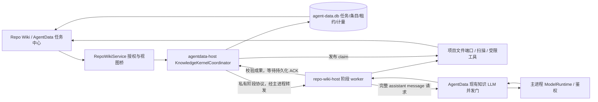

# Repo Wiki KnowledgeKernel 设计规格

状态：已批准并实现。日期：2026-11-01。实际验证覆盖面见 [验收记录](../../../.agents/evidence/2026-11-01-repo-wiki-knowledge-kernel/ACCEPTANCE.md)。

## 1. 目标与已确认约束

把当前“计划 + 预选源码 + 每页一次 completion”升级为可观察、可恢复的知识构建内核，覆盖 Wiki 与知识卡。用户可以生成、暂停、继续、取消、增量更新和修复失败项；关闭页面后继续工作，应用重启后自动继续符合原授权的未完成任务。

保留已确认的边界：

- AgentData 统一任务身份、调度与控制状态；不恢复已删除的 Memory，不合并旧资料 Wiki 的内容格式。
- 已发布正文、人工编辑、计划及增量基线保存在项目 `docs/repo-wiki`；索引可从文件重建。
- 扫描、文件 I/O、工具执行和构建在独立 worker；Electron 主进程保管鉴权与模型实际请求。
- 模型使用既有 `agentDataModel` 解析规则、配置身份与知识库共享并发预算，不静默改用其他模型。
- 页面只是动作入口和后端状态投影；首屏不等待所有项目扫描，重开页面不创建新任务。
- 现有授权、canonical path、克隆隔离、文件 token、journal、人工编辑合并与草稿保护继续有效。

Qoder 是静态架构参考，不是产品依赖、代码来源或动态可靠性证明。可携带的参考摘要见 `.agents/evidence/2026-11-01-repo-wiki-knowledge-kernel-design/qoder-reference.md`。

## 2. 方案选择与范围

| 方案 | 最强理由 | 结论 |
| --- | --- | --- |
| 在原 vendor engine 中继续追加 | 当前扫描、文件存储、宿主契约和回归可直接复用，迁移最少 | 不作为长期编排位置；阶段、任务和恢复权威仍分散 |
| AgentData 托管自有 KnowledgeKernel，worker 执行阶段 | 统一控制权，复用现有项目文件与 SDK，能够逐项验证 | 推荐；接口、发布协调和恢复成本必须纳入实现 |
| 直接接 Qoder context 包或移植其运行时 | 已有完整构建能力 | 不采用；其宿主、账号、SDK、数据事实源与本项目不同 |

此次覆盖分阶段全量构建、阶段恢复、只读工具会话、增量更新、失败修复和 UI 投影。暂不增加云知识同步、多机任务调度、独立新配置面板、Wiki/Cards 组合任务或自动付费更新。仓库变化可标记待检查/待更新；新的生成仍由用户发起，已有任务按原授权恢复。

首版保留整批原子发布：单页失败时保存成功的 staged 成果，允许明确标注的草稿预览和定向修复，上一版正式内容继续可读；不把缺页的新目录直接发布成正式新版。

## 3. 所有权与进程



- `agent_jobs` 是唯一任务权威。内核不另建一张重复保存全局 run state 的任务表。
- KernelCoordinator 在 agentdata-host，管理阶段图、检查点确认、控制请求、预算、恢复与发布协调。
- 现有 Repo Wiki OS child 保留读写文件和扫描职责，新增私有阶段执行入口。生产 generate/update/repair 全部由 KernelCoordinator 驱动；旧 `WorkspaceService.generate` 和 `workspace-runs.json` 不再独立派发或恢复生产任务。
- worker 不打开 `agent-data.db`，不持有账号凭据，也不加载普通聊天的 extensions、skills、用户 MCP、shell 或写文件模型工具。
- `RepoWikiService` 逐步收窄为授权、worker supervisor、私有 IPC 转发和视图投影，不继续持有独立生成队列/终态状态机。
- 正常切项目、切语言、模块关闭不重启 worker。宿主撤销项目授权按任务 scope 停止后续扫描/模型请求；已 prepared 的文件事务仍必须安全完成恢复。

## 4. 身份与状态契约

```ts
type KnowledgeDomain = 'wiki' | 'cards';
type KnowledgeIntent = 'generate' | 'update' | 'regenerate' | 'repair';
type KnowledgePhase = 'prepare' | 'change_analysis' | 'overview' | 'plan'
  | 'catalogue' | 'generate' | 'relations' | 'validate' | 'publish';
interface KnowledgeKey {
  workspaceInstanceId: string; // canonical root + portable project identity 的本机实例摘要
  projectId: string;
  portableProjectId: string;
  branch: string;             // 非 Git 使用固定 non-git 身份，不伪造 commit
  language: string;
  domain: KnowledgeDomain;
}
interface ExecutionFence {
  ledgerId: string;
  controllerEpoch: string;
  ownerId: string;
  generation: number;
}
interface KnowledgeBudgets {
  version: 1;
  unit: {
    maxModelRequests: number; maxToolCalls: number; maxAttempts: number;
    maxOutputTokens: number; maxTotalTokens: number;
    maxFileBytes: number; maxReadBytes: number; maxReadLines: number;
    maxResultBytes: number; maxSearchMatches: number; maxDirectoryEntries: number;
    modelTimeoutMs: number; activeTimeMs: number;
  };
  run: { maxItems: number; maxDepth: number; maxModelRequests: number; maxTotalTokens: number };
}
interface KnowledgeTaskMetadata {
  version: 1;
  key: KnowledgeKey;
  intent: KnowledgeIntent;
  revision: number;
  phase: KnowledgePhase;
  sourceSnapshotId?: string;
  modelIdentity?: string;
  pipelineConfigHash: string;
  budgets: KnowledgeBudgets; // 接受任务时冻结，升级默认值不改旧任务额度
  planHash?: string;
  resumePolicy: 'auto' | 'manual' | 'never';
  pauseCause?: 'user' | 'application_exit';
  fence?: ExecutionFence;
  counts: { planned: number; prepared: number; failed: number; blocked: number; published: number };
  outcome?: 'complete' | 'partial';
  publication?: { id: string; claimId: string; intentHash: string; state: 'claimed' | 'prepared' | 'files_committed' };
  error?: { code: string; message: string; retriable: boolean };
}
```

`KnowledgeTaskMetadata` 放在 `JobMetadata.repoWiki`，不重复保存全局 runState。runState 根据 `agent_jobs.state`、phase、控制请求与恢复过程投影。`JobState` 为 Repo Wiki 增加 `paused`、`blocked`；其他 job kind 不改变中断语义。`TaskStatus` 补 `paused`，部分失败使用 failed + outcome=partial，不新增含糊的终态。

逻辑去重键为工作区实例 + project + branch + language + domain；写租约冲突域为 canonical root + portableProjectId + language。后者不含 domain/branch，因为当前 ProjectFiles.commit 会重写该语言的整份 facts。

所有 worker 结果携带 taskId、fence、stageAttempt、itemId 和事件序号。仅当前 fence 的条件更新可落库；客户端序号不替代数据库 revision。修复创建新 taskId 并保存 retryOf，恢复沿用旧 taskId。

## 5. AgentData 持久化与保留策略

`AgentDataStorage` 升级 schema 5 → 6，幂等建表和索引，不删除共享资料 Wiki、CodeGraph、线程、权限或审计。

| 存储 | 责任与关键键 |
| --- | --- |
| agent_jobs + metadata.repoWiki | 全局状态、原授权、来源/模型身份、阶段、预算、发布意图与计数 |
| knowledge_build_items | PK(task_id, phase, item_id)；条目状态、attempt、inputHash、outputHash、经过校验的 payload、证据/依赖清单、错误 |
| knowledge_source_snapshots | snapshotId；文件 hash manifest、旧/新依赖边、覆盖范围、Git/dirty 信息；不保存整仓源码 |
| knowledge_execution_requests | requestId 唯一；model/tool/time 三类预算 reservation、task/phase/item/attempt、实际 usage/读量/结果、计量去重；不持久化凭据或整份聊天 transcript |
| agent_job_leases | scope PK；task、owner、generation、expiry、claim/pin；只协调写入，不成为第二任务状态机 |

阶段成果只有在 schema/来源/哈希校验通过，并且 item 写入与 job revision/count 推进在同一事务完成后，才向 worker 回 ACK、向 UI 发已完成事件。worker 提交按 fence + stageAttempt + inputHash 校验，job revision 由 AgentData 在事务内读取并推进，不能拿模型请求前的旧 revision 与 usage 更新竞争。相同提交重发只回既有 ACK，不重复计数；同 attempt 的不同输出拒绝。单个输出 payload 上限 512 KiB；超限失败并保留既有文档，不静默截断成有效输出。prepare 的源码 manifest 经独立 putSourceSnapshot 写入（上限 4 MiB），item 仅保留 snapshotId 和摘要，不把大 manifest 塞入条目 payload。

child 原 `generation_checkpoints` 仅用于受控兼容迁移和可丢弃缓存，不再唯一保存内核已确认成果。删除索引不会丢失 AgentData 已确认的阶段输出；删除 AgentData DB 不会丢失已发布项目文档。

已发布并确认文件 manifest 可重建的 payload 可回收，保留条目摘要/哈希与任务历史。paused、failed、repair lineage 引用的成果不定时自动清理；删除任务必须检查活动状态与引用，不能删除其他修复任务仍引用的成果。无任务及原确认记录时，不凭磁盘 guard/收据自动重建付费任务。

## 6. 阶段图与输出

Wiki 全量：prepare → overview → plan → catalogue → generate → validate → publish。

Cards 全量：prepare → plan → generate → relations → validate → publish。generate 的单元是模块/类别卡；仓库级综合卡依赖对应模块卡，relations 输出受校验的关系边。

update 在 prepare 后先 change_analysis，给出 no-op、仅更新基线、受影响条目图或需要重新规划的决定，再执行必要阶段。repair 复用同输入身份的已验证条目，仅重跑失败、依赖阻塞或已失效单元。每个阶段/条目有版本化输出 schema；合法 JSON 不等于合法知识结果。

| 阶段 | 必需输出 |
| --- | --- |
| prepare | 授权/portable identity、source snapshot、模型绑定、原计划 token、文件 read-set |
| overview | 有源码证据的项目用途、入口、边界和模块摘要 |
| plan | 稳定逻辑 itemId、标题/目标、依赖、声明范围与作者约束 |
| catalogue | 无环、无重名冲突的最终目录和展开节点检查点 |
| generate | Markdown/卡片结构、有效源码范围、观察到的文件和搜索范围、依赖 item 输出 hash |
| relations | 存在的模块端点、关系类型与证据；不生成自链接/悬空边 |
| validate | 必需条目完成、来源仍稳定、引用/链接有效、预算及目录完整、文件 token 检查结果 |
| publish | 发布 claim、文件收据、正式基线与索引重建结果 |

计划和目录一旦冻结，当前 task 使用冻结版本。计划被编辑、模型身份改变、源码/分支发生变化时，未完成运行进入 blocked，并展示重新分析/确认入口；不得静默改用新模型或用旧阶段拼新源码。其他无关项目和语言不受影响。

单页失败继续完成没有失败依赖的条目；依赖者记 blocked_by_dependency。若必需条目不齐，任务 failed/outcome=partial，保留成果和旧正式文档，允许草稿预览及 repair。不得用 preparedCount 冒充 publishedCount。

## 7. Pi 工具会话与模型端口

实际本机 Pi SDK 是 1.3.0；实施时以 lockfile 和本地公开声明为准，不按旧注释版本推断。采用 `@earendil-works/pi-agent-core.Agent`，注入 streamFn。`AgentSession` 的鉴权、资源发现和压缩副作用不适合直接用于无凭据 worker。

新增私有完整消息端口，旧 `completeKnowledge(): Promise<string>` 对资料 Wiki 保持兼容：

```ts
interface KnowledgeModelBinding {
  bindingId: string;
  expectedModel: string;
  expectedConfiguration: string;
  model: PublicModelDescriptor; // 不含 headers、密钥或 env
}
type PublicModelDescriptor = Pick<Model<Api>, 'id' | 'name' | 'api' | 'provider'
  | 'reasoning' | 'input' | 'contextWindow' | 'maxTokens' | 'cost'>;
interface KnowledgeMessageInput {
  controllerEpoch: string;
  requestId: string;
  taskId: string;
  fence: ExecutionFence;
  phase: KnowledgePhase;
  itemId: string;
  attempt: number;
  bindingId: string;
  transcript: TranscriptContext; // SDK 1.3 的规范化 transcript
  options: { maxTokens: number; reasoning?: ThinkingLevel };
}
interface KnowledgeMessagePort {
  bind(taskId: string): Promise<KnowledgeModelBinding>;
  request(input: KnowledgeMessageInput, signal?: AbortSignal): Promise<AssistantMessage>;
}
```

主进程真实 ModelRuntime 调 `streamSimple(...).result()`，返回保留 toolCall、调用 ID、thinking/signature、stopReason 和 usage 的完整 AssistantMessage；不使用现有只提取 text/thinking 的 Host.streamSimple 包装。worker 用 `createAssistantMessageEventStream` 产生 done/error 事件驱动真实 Agent loop，第一版不另做 token 流 IPC。

worker 为自定义 streamFn 构造的公开 Model 只增加固定占位 baseUrl，不用其直接联网；真实 endpoint 只在 main 绑定中。模型/阶段私有传输帧上限 4 MiB，超限明确失败，不截断成合法 transcript 或 manifest。

request/auth/runtime 失败转换成 error/aborted AssistantMessage 与 error 事件，符合 StreamFn 不直接抛请求错误的协议。Agent 使用显式 system prompt、四个工具和 sequential tool execution；不加载交互资源、用户 hooks、会话历史或写入工具。

每次 assistant HTTP 请求进入同一个 `WikiService.globalLlmLimit`。将槽位获取抽为 `withKnowledgeModelSlot`，旧 Wiki 和新 request 各获取一次；stage 和工具执行不占槽，也不在已持槽的 completeKnowledge 内再请求槽。provider maxRetries=0，重试和退避由内核一层控制，每次尝试重新排队。

模型绑定解析复用 createAgentDataModelPort 的真实 configured model 和 compatibility request config。主进程保存实际配置快照，绑定只持 opaque ID；每次派发及 transformHeaders 前校验配置身份。正常 OAuth 凭据刷新不当成配置改变，worker 不读取 auth.json。

新 controllerEpoch 启动恢复采用两步握手：新 AgentData 先打开数据库但禁止派发，调用 bindEpoch；main 中止旧 provider、等待 provider settle 与旧受控 worker 退出，返回旧 requestId 的终态计量 reports；新 AgentData 事务导入/去重这些 reports、保留未知 reservation，再调用 activateEpoch 放行恢复。drain 只等 provider 与 worker，不等待已死亡 controller 的 usage ACK，避免握手与落账互相等待。超时进入 blocked/OLD_EXECUTOR_NOT_DRAINED，不重建空 limiter 后直接并发派发。

正常请求中，main 返回完整 AssistantMessage，同时暂存不含 transcript 的终态 usage report，直到 AgentData 去重落账后 ackUsage；AgentData 先落账再答复 worker。应用整体崩溃使 main report 丢失时，依靠已持久化的 reservation 记 unknown，不退款成零；没有对应任务的旧 report 只保留审计，不重建付费任务。worker 汇总不得重复计量。

## 8. 只读工具与预算

内部工具名固定 Read、Glob、Grep、ListDir。复用 SDK 工具的参数 schema，替换受授权约束的 execute；Grep 的 rg 路径另做显式控制，不能只包装 readFile。不新增产品依赖或升级 SDK。

- 每次实际访问按 approved canonical root + source snapshot manifest 校验，处理大小写、junction/symlink、UNC、绝对路径和 `..`。
- 输出目录 docs/repo-wiki、journal、staging、缓存始终排除；旧知识只能通过明确的阶段输入给模型。
- Grep 只对已授权 manifest 文件使用固定 rg 参数、shell=false，二次检查返回路径；不接受任意 shell 或 rg flags。
- 二进制、图片、不完整扫描、权限失败和截断不能伪装成有效空结果或文件删除。工具返回可区分的错误与 truncated 标志。
- Read 记录真实读到的文件 hash；Glob/Grep/ListDir 记录搜索 scope 和目录清单摘要，新增文件也会影响恢复/增量判定。

固定内部默认预算：每个 AI 单元最多 12 次模型请求、40 次工具调用、2 次执行尝试，输出上限 min(8192, 模型上限, 剩余额度) tokens；累计 tokens 上限 120000，单次/累计读取 256 KiB / 2 MiB，单次最多 400 行、工具结果 32 KiB、搜索 100 命中、目录 200 项。单次 provider active timeout 为 120 秒，单元 active deadline 为 10 分钟；排队和应用关闭时间不计 active deadline。

整任务同时冻结全局预算：最多 500 个规划单元、目录深度 6、1000 次模型请求、2000000 累计 tokens，防止按节点展开绕过单元预算。全局与单元 reservation 在同一事务预扣；超限保留成果并显示 BUDGET_EXHAUSTED/CATALOGUE_LIMIT，不能静默裁掉目录。没有新增设置面板；用户通过已有计划约束范围，或明确发起新的修复/重试任务授权后续工作。

预算在条目 checkpoint 之外独立持久化：`beginAttempt` 在开始单元前记次数，`reserveExecutionBudget` 在模型/工具实际派发前以 requestId 幂等预扣调用数、token/读量上界，`finishExecutionBudget` 按已知实际值结算。排队且确定未派发的取消可释放 reservation；已经派发但未收到结算的请求记 interrupted/unknown，保留次数与上界，不因条目尚未 ACK 重置。

active duration 以最多 5 秒的预扣执行时间片授权并续签；worker 无有效时间片时不能继续执行，断联中止。worker 在等待 message port 时停止自己的 active-time 领取；AgentData 在拿到模型槽后、发送 HTTP 前预扣 provider 的首个时间片，实际请求期间再续领。排队不计时，也不重复计算 worker 等待与 provider 时间。用户暂停和应用关闭期间不领取时间片，恢复后已扣片段不回退。读取字节预算计算进入模型上下文的源码文本，扫描 I/O 另受 source manifest 范围和 deadline 限制。

尝试次数、工具/模型调用、读取量、tokens 和时间片均跨重启保留。未知 provider usage 使用预估/预留上界并标明 unknown，不能当零。length/error/aborted、超预算和不完整验证都不能发布。预算耗尽后由明确的新重试任务重新授权，不自动无限付费重试。

## 9. 文件发布、fence 和崩溃恢复

保留当前 facts schema_version=1，新增可选的版本化 `snapshot.kernelBaseline`、页 `inputManifest` 和 `project.last_publication`。旧字段、正文、人工基线、冲突候选和 revision 原样保留，不全项目迁移。journal 写版本 2，并保留版本 1 恢复器。

语言根 `docs/repo-wiki/<lang>/.execution-guard.json` 保存永久 generation floor、ledgerId、owner、task、claim；不是用户配置或调度源，不随任务清理/索引重建删除。新账本 generation 取 max(DB 历史, 磁盘 floor)+1；不同 owner 不能以相同 generation 覆盖 guard。

发布步骤必须按顺序执行：

1. AgentData 事务领取协调租约；worker 在现有 .write-lock 内先处理遗留 journal，再 CAS 安装 fence，ACK 后才能执行。
2. AgentData 事务核对当前 task/fence、取消意图、冻结输入与必需条目；写 publish claim 和 intentHash，pin lease，关闭 cancel/pause/new claim 能力。
3. worker 在文件锁内核对 guard/claim、来源稳定性、read-set token 和人工编辑合并结果；准备完整 durable journal。
4. journal prepared 后不因 TTL、取消、模型设置变化中途 abort，必须按既有 before/after 哈希协议 roll-forward；未知外部内容继续阻断并保留备份。
5. namespace manifest 写 publicationId，project.json.last_publication 最后落盘。收据含 taskId、claimId、ledgerId、generation、intentHash、outputSetHash；outputSetHash 排除收据自身，避免循环摘要。
6. 恢复/确认收据，重建需要的索引，再由 AgentData 同事务结算 task/计数、释放 pin/lease。完成不能仅凭 child 回执或旧 run 的 completed。

租约到期只允许发起恢复检查，不允许抢活进程持有的文件锁。接管前必须确认受控旧 executor 已退出；PID 数值不单独证明进程实例身份。已 pin 的发布只能 reconcile 后接管。

| 中断窗口 | 恢复动作 |
| --- | --- |
| DB 已 claim，journal 未 prepared | 确认旧 writer 退出，无匹配收据/日志后撤销 pin，复用已确认成果 |
| journal prepared / 部分 rename | 先恢复整个文件事务，未知内容阻断；禁止重新调用模型 |
| 收据完成但 child 回执丢失 | 对照 claim、task 和 hash 直接结算原任务 |
| 文件已发布但索引/任务 COMMIT 失败 | 从文件重建索引并结算，不回滚正式文件 |
| task 完成但 lease 未释放 | 幂等释放，不重放终态 |
| DB 删除或恢复到与磁盘历史不一致的旧备份 | 不凭 guard 重建付费任务；未知历史进入 RECOVERY_HISTORY_DIVERGED，保留文档并明确处置 |

receipt 证明的是原发布已经发生。若发布完成后有人合法编辑正文，再发生回执丢失，应保留后来的编辑、重建投影并结算原任务，不能为“匹配旧输出”重新覆盖正文；验证不得混淆发布收据摘要与此后可变的文件内容。

这是同一本机物理目录的多进程协议，不声称 OneDrive 跨机器具有同一把文件锁，也不声称可与任意外部编辑器实现内核级跨文件 CAS。

## 10. 增量、恢复与人工编辑

正确性依据是上次成功发布的 input manifest 与当前内容 snapshot，Git diff 只做候选优化与来源说明。候选集合包含 baseline→HEAD、当前 staged/unstaged/untracked，以及上次发布时 dirty/untracked 的路径。非 Git 按文件 manifest 差异更新，Git 失败不能静默伪装成干净非 Git。

对 added/deleted/changed 使用旧边与新边的并集做反向依赖传播，再沿页/卡 DAG 扩散。rename 按路径变化失效引用，内容相同不免检。README、依赖清单、入口、目录增删和作者计划等结构性变化触发重新规划；来源观测覆盖不充分时保守扩大失效，不承诺完美语义最小集合。

baseline 记录 sourceSnapshotId、hashes/edges、definitions、scanner/scope/catalogue/pipeline hash、发布 commit 与 dirty 摘要。页 inputManifest 记录直接/传递来源、搜索 scope、依赖页 output hash、计划/提示词/模型身份。内容不变但 Git commit 改变可只推进经验证基线，不付费重新生成。

源码不可读/扫描覆盖不完整时阻断删除与归档。分支切换进入独立 namespace；恢复旧任务不得在新分支继续。模型、源码或计划改变默认 blocked，先显示受影响范围，再由用户明确重新分析/确认新任务，已确认且未失效成果可复用。

正文编辑沿用现有文件 token 与基线三方合并；冲突保留人工正文及候选，不自动覆盖。保存计划不偷偷更改当前冻结任务；最终 token 不一致时阻断发布，提供重新分析。repair 的新任务从旧成果复制/引用经验证条目，保留 retryOf，不复用旧 taskId 调旧 completed run。

## 11. 恢复与动作语义

| 动作/事件 | 持久化与后续行为 |
| --- | --- |
| 关闭页面、切项目/语言 | 停观察、清视图订阅；不取消任务 |
| 手动暂停 | 记录 pause request；停止模型/工具并等待落定；state=paused，resumePolicy=manual |
| 应用退出 | 在安全点暂停，resumePolicy=auto、pauseCause=application_exit；prepared 发布优先完成恢复 |
| 主动取消 | 先记录控制意图，等待实际停止后 cancelled；resumePolicy=never，不自动恢复 |
| 启动或 controller/worker 故障 | 先 epoch drain、journal/receipt reconcile，再校验来源、模型和预算；合格 auto 任务继续原 taskId |
| 模型/来源变化、未知发布、缺失原授权 | blocked，返回具体 reason/capabilities，不悄悄重建任务 |
| repair/reanalyse | 新 taskId，展示模型和重做范围，关联旧 task，复用未失效的已验证成果 |

新请求接受前记录持久化 requestId/idempotency key；重复点击、超时重试或跨视图请求不会重复建同一活动目标。发布期服务端 capabilities 关闭 cancel/pause，不能只在某个按钮上置灰。

旧任务按需兼容：completed 只保留历史；活动任务在首次恢复时补版本字段，必须证明原模型/源码/缓存成果，无法证明时 blocked/confirmation_required；不通过绑定“当前模型”补造历史授权。只迁移当前恢复/访问的任务和项目，不扫描全部已登记工程。

## 12. UI 与读模型

统一 `RepoWikiKnowledgeSnapshot`，包括四个正交维度：

| 维度 | 数据和规则 |
| --- | --- |
| content | empty / available / current / stale / partial；publishedCount、preparedCount、expectedCount、baselineId、checkedSnapshotId；available 表示已有文档但尚未验证新鲜度 |
| run | taskId、revision、phase、queued/running/recovering/pause_requested/paused/blocked/completed/failed/cancelled、计数/错误/能力，来自 AgentData |
| action | idle / submitting、kind/requestId，仅前端动作请求态，不乐观伪造长期运行状态 |
| admission | ready / preparing / blocked 和 reasonCode，来自当前项目授权、身份、模型、恢复与输入预检；ready 不等于新的模型授权 |

阅读页保留全宽森林绿界面和项目/语言；显示阶段、当前单元、已准备/计划数、失败数、最后更新时间、暂停/继续/取消/修复动作及明显任务入口。生成计划未知时显示阶段与不定进度，目录冻结后显示真实计数；100% 仅在发布和账本结算完成后出现，不使用假百分比或只拿 pageCount 推导完成。

失败或更新过程中继续阅读上次正式版本。staged 预览明确标“未发布草稿”，不得混进正式目录或被当成 published/current。修复确认展示模型、语言、目标、可复用和重做范围，自动滚入可视区；草稿、滚动、文件标签和未保存保护不因刷新重挂。

任务中心和阅读页使用同一 revision 和 capabilities。事件优先、单飞读取兜底；隐藏页面停读，重新可见立即补读，旧事件/旧轮询响应不能倒退状态。TaskPage 新增 pollingCount 区分仍在执行与 paused/blocked 的待处理任务，避免手动暂停后永久高频轮询；activeCount 仍用于进行中列表与徽标。

## 13. 交付次序与验收

按可独立验证的里程碑落地：A 契约/存储/模型工具循环；B 全量 Wiki/Cards/发布恢复；C 增量/repair/生产切换/UI完整闭环。生产切换在实现计划任务 10，前两阶段仅作内部验证，不向用户宣称整体改造完成。

最终验收至少包括：

1. 真实 Pi Agent 经过两轮 toolCall→toolResult→最终输出，来源越界与输出自摄入均被拒绝。
2. 旧资料 Wiki 与新阶段 global concurrency=1 交错无死锁；重启 drain、排队取消、在途取消和 usage 去重可证明。
3. 每个阶段/条目完成后强杀恢复，已确认产物不重调；用户暂停保持、应用退出继续、取消不复活。
4. 两个协调连接争同物理写 scope、旧事件/旧 publisher、TTL 与 publish pin、DB 重建 floor 都可验证。
5. journal prepared 前、任意 rename 后、receipt 后及账本完成前故障，不丢人工编辑、不重复发布、不重调模型。
6. dirty/non-Git/rename/delete/依赖边变化/分支/语言/克隆正确失效；读取失败不当成删除。
7. 单页失败→保留成功成果→repair→原子发布；正式版本和未发布草稿标识明确。
8. 实际 Electron repo-wiki 场景覆盖四维状态、同 revision、阶段能力、跨项目语言、关页/重开/暂停/修复及长抽屉交互。

所有模型测试走本地 loopback provider，证据保存在 `.agents/evidence/2026-11-01-repo-wiki-knowledge-kernel/`。构建验证开发/生产独立 host 入口和打包资源；只跑本需求 UI 场景，相关共享任务组件另定向验证。旧资料 Wiki 4 项既有失败和全工程既有类型诊断作为基线保留、明确报告，不冒充全仓通过。
